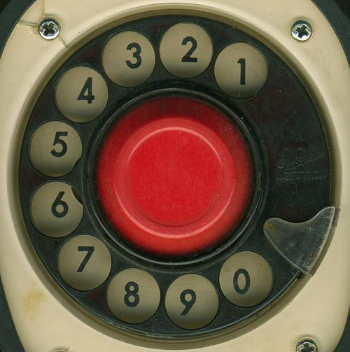
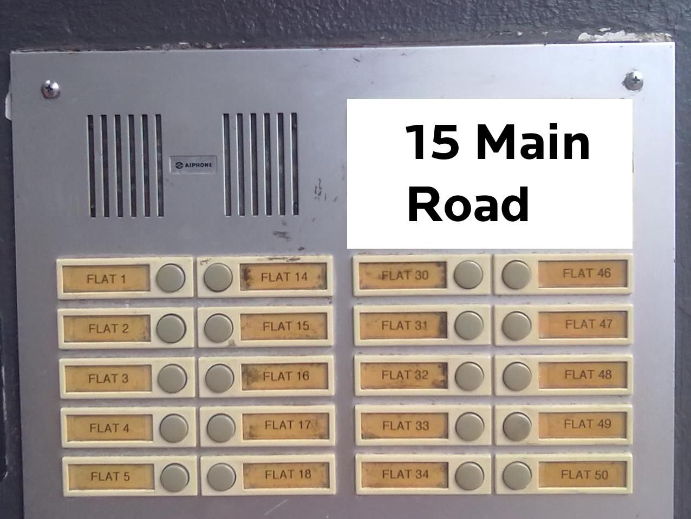
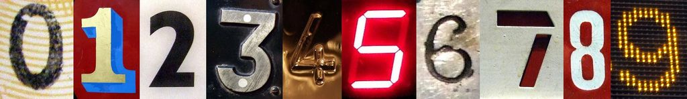

## 1.2 Number formats and conventions (EMG3)

### Ways of representing numbers (EMG4)

ConventionA standard way of doing something.FormatThe way that something appears or is set out.

Number formats and conventions refer to the different ways that we write numbers.

In South Africa the convention is to use the decimal comma to separate whole numbers from decimal fractions. We use spaces to separate groups of three digits. So we write one million rand as \(\text{R}\,\text{1 000 000,00}\). This makes big numbers easier to read. Compare 3000000 to \(\text{3 000 000}\).

You will sometimes see the use of the decimal point rather than the decimal comma, for example in account statements, bank statements and till slips. Also, sometimes people use commas to separate groups of three digits in very large numbers, for example one million rand is sometimes written as R1,000,000.00. These are all methods that make numbers easier to read. Using commas to separate groups is not common in South Africa however, and so this convention should be avoided - rather use spaces.

A calculator display shows a decimal point, with no spaces to separate the groups of three digits.

### Numbers in different situations (EMG5)

We use different kinds of numbers in different situations. Sometimes these represent counting numbers or measurement values; sometimes they represent order, and sometimes they are just codes for identification.

Think about the numbers you see around you all the time:

These numbers include:

- measurements, such as lengths and masses.
- numbers of houses and flat numbers, which represent where to find them.
- numbers for counting, such as the number of people on a bus.
- numbers for representing order (for example: Sophie won 1st prize and James won 2nd prize).
- numbers for amounts of money.
- the rate of unemployment, as a percentage.
- numbers that represent a code rather than a value, for example, telephone numbers, car registration plate numbers, PINs, etc.

Notice that the numbers are represented in different ways.

- We use **whole numbers** for counting exact numbers of things, for example, a person has exactly \(\text{10}\) toes.
- Things that are **ordered** in a particular way are given whole numbers, but these numbers do not represent a number value. Ordering of things can also be indicated by 1st, 2nd, 3rd, etc.
- Numbers can also be used to represent **position**. For example, a house or flat number.
  

Not all of these kinds of numbers can be used in calculations. We can only calculate with numbers that represent a value and not with numbers that are used for naming, ordering or classifying things. For example, it doesn't make sense to use a telephone number in a calculation - if you multiplied a telephone number, you would just get the wrong number!

## Different number formats

### Exercise 1.1

The numbers below are printed in a American magazine. Write them using our South African conventions:

**Problem:**
This new laptop computer can be bought for \(\$\)1,678.75.

**Solution:**
\(\$\text{1 678,75}\)

**Problem:**
The latest figure for the loss of income is \(\$\)3,988,620.12.

**Solution:**
\(\$\text{3 988 620,12}\)

**Problem:**
The population of the country is 42,000,199.

**Solution:**
\(\text{42 000 199}\)

**Problem:**
The mass of the new compound is 62.178 g.

**Solution:**
\(\text{62,178}\) \(\text{g}\)

Write these numbers with spaces to group them correctly:

**Problem:**
53211

**Solution:**
\(\text{53 211}\)

**Problem:**
167890

**Solution:**
\(\text{167 890}\)

**Problem:**
90001

**Solution:**
\(\text{90 001}\)

**Problem:**
1123456

**Solution:**
\(\text{1 123 456}\)

**Problem:**
4879120

**Solution:**
\(\text{4 879 120}\)

**Problem:**
Explain why it does not make sense to use a number such as a telephone number in a calculation.

**Solution:**
A telephone number does not represent a value, rather, it is a unique label. We can only calculate with numbers that represent values.

**Problem:**
Using three or four old magazines or newspapers, cut out examples of different uses of numbers. Stick each example onto a poster, and next to it, write down what the format of the number is, and what the use of that particular number is.

**Solution:**
Learner-dependent answer.

Choose one of the following numbering systems and find out more about how the system works, what kinds of numbers are allowed, what the numbers represent, and anything special about the number system. Write two or three paragraphs about what you find out:

**Problem:**
the sell-by dates on items in shops.

**Solution:**
Learner-dependent answer.

**Problem:**
the South African identity number system.

**Solution:**
Learner-dependent answer.

**Problem:**
personal identification numbers (PINs) for cell phones.

**Solution:**
Learner-dependent answer.

**Problem:**
the serial number on a cell phone.

**Solution:**
Learner-dependent answer.

**Problem:**
the tennis scoring system.

**Solution:**
Learner-dependent answer.

### Writing whole numbers in words (EMG6)

DigitOne of \(\text{0}\); \(\text{1}\); \(\text{2}\); \(\text{3}\); \(\text{4}\); \(\text{5}\); \(\text{6}\); \(\text{7}\); \(\text{8}\); \(\text{9}\); used to make up a number.

To convert a number that is written in digits into words, use the following method:

- Beginning at the right and working from right to left, separate the number into groups by inserting spaces after every three digits (e.g. “123456” becomes “\(\text{123 456}\)”).
- Beginning at the left, read each group individually, saying the name of the group.

Here are a few examples for writing the numbers as words.

<Callout type="tip" title="Worked example 1: Grouping large numbers and writing them in words">
**Question:**
1. Write out 42958 in words.
3. Write out 307991343 in words.

1. 1. Beginning at the right, we can separate this number into groups of digits by putting a space between the \(\text{2}\) and \(\text{9}\), which is \(\text{42 958}\).
   3. Beginning at the left, we read each group individually:
      - Thousands group: 4 2 → Forty-two thousand.
      - Units group: 9 5 8 → Nine hundred and fifty-eight.
   Solution: Forty-two thousand, nine hundred and fifty-eight.
3. 1. Beginning at the right, separate this number into groups of digits by putting spaces between the \(\text{1}\) and \(\text{3}\), and the \(\text{7}\) and \(\text{9}\), which gives us \(\text{307 991 343}\).
   3. Beginning at the left, read each group individually.
      - Millions group: 3 0 7 → Three hundred and seven million,
      - Thousands group: 9 9 1 → Nine hundred ninety-one thousand,
      - Units group: 3 4 3 → Three hundred and forty-three.
   Solution: Three hundred and seven million, nine hundred and ninety-one thousand, three hundred and forty-three
</Callout>

### Place value of large numbers (EMG7)

It is easier to read large numbers written in symbols than numbers written out in words, because the place value of the symbols makes the value of the number clear.

For example: \(\text{65 781}\) is written out in full as sixty-five thousand, seven hundred and eighty-one.

Note the comma after the thousands and the hyphen between the tens and the units. This is similar to the thousands space we use when writing numbers in numerals.

It is useful to write large numbers in a place value table to compare them:

| Millions | Hundred Thousands | Ten Thousands | Thousands | Hundreds | Tens | Units |
| --- | --- | --- | --- | --- | --- | --- |

<Callout type="tip" title="Worked example 2: Finding place value">
**Question:**
What is the place value of the \(\text{9}\) in each of these numbers?

1. \(\text{891 034}\)
3. \(\text{119 222}\)
5. \(\text{123 239}\)
7. \(\text{6 901 333}\)

Write the numbers in separate columns or in a table.

Write the place value in the top row:

|  | M | H Th | T Th | Th | H | T | U |
| --- | --- | --- | --- | --- | --- | --- | --- |
| 1. |  | \(\text{8}\) | \(\text{9}\) | \(\text{1}\) | \(\text{0}\) | \(\text{3}\) | \(\text{4}\) |
| 2. |  | \(\text{1}\) | \(\text{1}\) | \(\text{9}\) | \(\text{2}\) | \(\text{2}\) | \(\text{2}\) |
| 3. |  | \(\text{1}\) | \(\text{2}\) | \(\text{3}\) | \(\text{2}\) | \(\text{3}\) | \(\text{9}\) |
| 4. | \(\text{6}\) | \(\text{9}\) | \(\text{0}\) | \(\text{1}\) | \(\text{3}\) | \(\text{3}\) | \(\text{3}\) |

1. Ten Thousands
3. Thousands
5. Units
7. Hundred Thousands
</Callout>

### Arranging numbers in order (EMG8)

Here is a method for writing whole numbers from smallest to biggest (ascending order):

- Draw up a table with enough place value columns for all of the digits.
- Write in all the numbers. Put the units in the column on the right-hand side.
- Compare all of the numbers, starting from the first column on the left.
- If the digits are the same, look at the next column to the right until you find a digit that is different from the others.
- Write down the smallest number first, then the next smallest, and so on.

<Callout type="tip" title="Worked example 3: Writing numbers from smallest to biggest (ascending)">
**Question:**
Write these numbers in order from smallest to biggest.

\(\text{41 388}\); \(\text{444 697}\); \(\text{414 230}\); \(\text{14 000 021}\)

| TM | M | HTh | TTh | Th | H | T | U |
| --- | --- | --- | --- | --- | --- | --- | --- |
|  |  |  | \(\text{4}\) | \(\text{1}\) | \(\text{3}\) | \(\text{8}\) | \(\text{8}\) |
|  |  | \(\text{4}\) | \(\text{4}\) | \(\text{4}\) | \(\text{6}\) | \(\text{9}\) | \(\text{7}\) |
|  |  | \(\text{4}\) | \(\text{1}\) | \(\text{4}\) | \(\text{2}\) | \(\text{3}\) | \(\text{0}\) |
| \(\text{1}\) | \(\text{4}\) | \(\text{0}\) | \(\text{0}\) | \(\text{0}\) | \(\text{0}\) | \(\text{2}\) | \(\text{1}\) |

You can see at a glance from the table  that \(\text{41 388}\) is the smallest number, as its largest place value digit is only TTh (ten thousands).

So we write down \(\text{41 388}\); \(\ldots\)

Then we compare \(\text{444 697}\) and \(\text{414 230}\). In the TTh column, we see that \(\text{444 697}\) is larger than \(\text{414 230}\).

So we write down \(\text{41 388}\); \(\text{414 230}\); \(\text{444 697}\); \(\ldots\)

The largest number is clearly \(\text{14 000 021}\), as it is the only number that has digits in the millions group.

The numbers from smallest to biggest are: \(\text{41 388}\); \(\text{414 230}\); \(\text{444 697}\); \(\text{14 000 021}\).
</Callout>

We use a similar method for writing numbers from biggest to smallest (descending order): compare them in the same way and write down the biggest number first.

## Place value and ordering numbers

### Exercise 1.2

Write out each number in words:

**Problem:**
\(\text{12 341}\)

**Solution:**
Twelve thousand, three hundred and forty-one.

**Problem:**
\(\text{202 082 003}\)

**Solution:**
Two hundred and two million, eighty-two thousand and three.

**Problem:**
\(\text{1 000 010}\)

**Solution:**
One million and ten.

Write the following words as numbers:

**Problem:**
Four hundred and sixty thousand, five-hundred and forty-two.

**Solution:**
\(\text{460 542}\)

**Problem:**
Fourteen million, sixteen thousand and seven.

**Solution:**
\(\text{14 160 007}\)

**Problem:**
Three billion, eight-hundred and three thousand.

**Solution:**
\(\text{3 000 803 000}\)

Write the following numbers in order from biggest to smallest:

**Problem:**
\(\text{161 280}\); \(\text{600 765}\); \(\text{1 653 232}\); \(\text{1 694 212}\); \(\text{612 005}\)

**Solution:**
\(\text{1 694 212}\); \(\text{1 653 232}\); \(\text{612 005}\); \(\text{600 765}\); \(\text{161 280}\)

**Problem:**
\(\text{888 024}\); \(\text{188 765}\); \(\text{1 808 765}\); \(\text{818 123}\); \(\text{82 364}\)

**Solution:**
\(\text{1 808 765}\); \(\text{888 024}\); \(\text{818 123}\); \(\text{188 765}\); \(\text{82 364}\)

**Problem:**
\(\text{315 672}\); \(\text{333 289}\); \(\text{3 233 987}\); \(\text{3 402 987}\); \(\text{3 325 999}\)

**Solution:**
\(\text{3 402 987}\); \(\text{3 325 999}\); \(\text{3 233 987}\); \(\text{333 289}\); \(\text{315 672}\)
