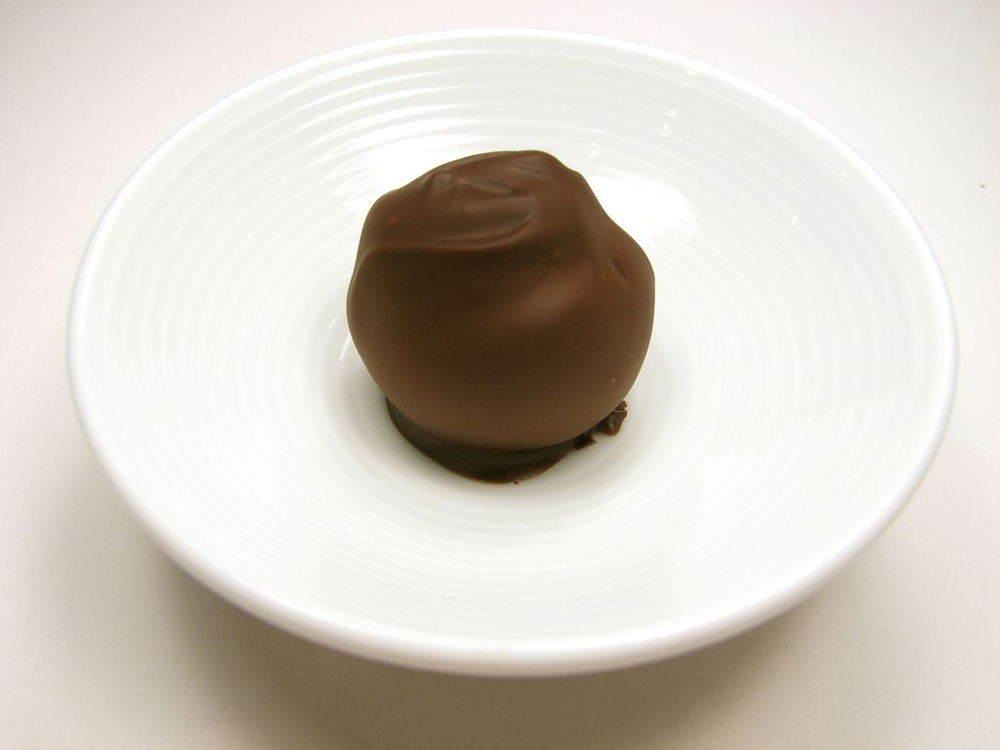
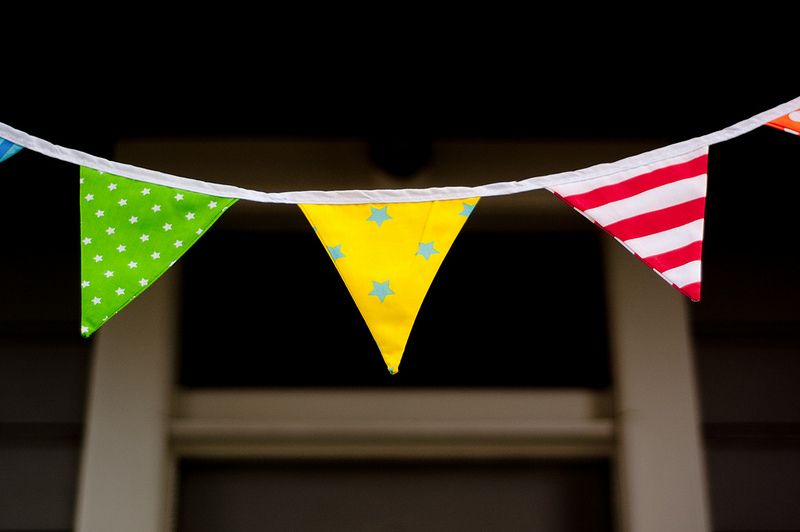

## 1.6 Ratio, rate and proportion (EMGT)

### What is a ratio? (EMGV)

A ratio is a comparison of two or more numbers that are usually of the same type or measurement. If the numbers have different units, it is important to convert the units to be the same before doing any calculations.

We write the numbers in a ratio with a colon (:) between them.

For example, if there are \(\text{8}\) learners who travel by bus and \(\text{12}\) learners who travel by taxi, then we say we have a ratio of \(\text{8}\) learners travelling by bus to \(\text{12}\) learners travelling by taxi.

We can write this as \(\text{8}\) : \(\text{12}\). We can also simplify this ratio to \(\text{2}\) : \(\text{3}\), by dividing both parts by \(\text{4}\).

It is important in which order you state the ratio. A ratio of \(\text{1}\) : \(\text{7}\) is not the same as a ratio of \(\text{7}\) : \(\text{1}\).

### What is a rate? (EMGW)

A rate, like a ratio, is also a comparison between two numbers or measurements, but the two numbers in a rate have different units.

Some examples of rate include cost rates, (for example potatoes cost \(\text{R}\,\text{16,95}\) per kg or 16,95 R/kg) and speed (for example, a car travels at \(\text{60}\) \(\text{km/h}\)).

When we calculate rate, we divide by the second value, so we are finding the amount per one unit.

#### Unit rates

For example, if we want a rate for \(\text{R}\,\text{20}\) for \(\text{2}\) \(\text{kg}\) of flour, we write:

\(\text{R}\,\text{20}\) : \(\text{2}\) \(\text{kg}\) = \(\text{R}\,\text{10}\) : \(\text{1}\) \(\text{kg}\)

= \(\text{R}\,\text{10}\)/kg.

This rate is a unit rate.

<Callout type="tip" title="Worked example 13: Calculating rates">
**Question:**
1. Elias, a star athlete, runs \(\text{100}\) \(\text{m}\) in \(\text{15}\) seconds.
   1. What is his speed in metres per second?
   3. If he was able to keep running at this speed, how long would he take to cover \(\text{1}\) \(\text{km}\)?
3. Cheese costs \(\text{R}\,\text{56}\) per kg. Thandi buys \(\text{200}\) \(\text{g}\) of cheese. How much does she pay?
   

1. 1. \(\text{100}\) \(\text{m}\) \(\div\) \(\text{15}\) sec = \(\text{6,67}\) \(\text{m/sec}\)
   3. \(\text{100}\) seconds or \(\text{1}\) min \(\text{40}\) sec
3. There are \(\text{1 000}\) \(\text{g}\) in \(\text{1}\) \(\text{kg}\). We can either reason that there are \(\text{5}\) \(\times\) \(\text{200}\) \(\text{g}\) in the \(\text{1 000}\) \(\text{g}\), and divide the cost by \(\text{5}\), or we can work out the cost per \(\text{100}\) \(\text{g}\) and then work out how much \(\text{200}\) \(\text{g}\) costs. The cost per \(\text{100}\) \(\text{g}\) would be \(\text{R}\,\text{5,60}\), so \(\text{200}\) \(\text{g}\) costs \(\text{R}\,\text{11,20}\).
</Callout>

## Working with rates

### Exercise 1.8

**Problem:**
A packet of \(\text{6}\) handmade chocolates costs \(\text{R}\,\text{15,95}\). How much does each chocolate cost?

**Solution:**
\(\text{R}\,\text{15,95} \div \text{6} = \text{R}\,\text{2,668} \ldots\) rounded off to \(\text{R}\,\text{2,67}\) per chocolate.

**Problem:**
A truck driver travels \(\text{1 500}\) \(\text{km}\) in \(\text{18}\) hours. What is his average speed?

**Solution:**
\(\text{1 500}\text{ km} \div\) \(\text{18}\) \(\text{h}\) = \(\text{83,33}\)\(\ldots\) km/h. Round off to \(\text{83,33}\) \(\text{km/h}\).

**Problem:**
Nicola is able to input \(\text{96}\) words in \(\text{2}\) minutes on her laptop. Karen times her own typing speed as \(\text{314}\) words in \(\text{7}\) minutes. Work out their speeds to see who is faster.

**Solution:**
Nicola types \(\text{96}\) words \(\div\) \(\text{2}\) min = \(\text{48}\) words/min. Karen types \(\text{314}\) words \(\div\) \(\text{7}\) min = \(\text{44,857}\)\(\ldots\) words/min. Round off to a whole word: \(\text{45}\) words/min. Nicola is faster.

### Finding missing numbers in ratios and rates (EMGX)

Solving problems often involves using ratios and rates to find unknown values. We use a similar process to find missing numbers in ratios and rates.

<Callout type="tip" title="Worked example 14: Finding missing numbers in a ratio">
**Question:**
Thenji makes a fruit salad for breakfast at a restaurant. She uses pieces of fruit in the following ratio:

banana : apple : paw-paw

\(\text{1}\) : \(\text{2}\) : \(\text{3}\)

1. If she uses \(\text{20}\) pieces of apple, how many pieces of banana and paw-paw should she use?
3. If she uses \(\text{12}\) pieces of banana, how many pieces of apple and paw-paw should she use?

1. Let's start with the banana : apple ratio.
   \(\text{1}\) : \(\text{2}\) = banana pieces : apple pieces
   \(\text{1}\) : \(\text{2}\) = \(\text{10}\) : \(\text{20}\)
   So we have \(\text{10}\) banana pieces and \(\text{20}\) apple pieces.
   Next we look at the apple : paw-paw ratio.
   \(\text{2}\) : \(\text{3}\) = apple pieces : paw-paw pieces.
   \(\text{2}\) : \(\text{3}\) = \(\text{20}\) : \(\text{30}\)
   So we have \(\text{20}\) apple pieces and \(\text{30}\) paw-paw pieces.
   So the complete ratio will be \(\text{10}\) : \(\text{20}\) : \(\text{30}\).
3. Let's start with the banana : apple ratio.
   \(\text{1}\) : \(\text{2}\) = banana pieces : apple pieces.
   \(\text{1}\) : \(\text{2}\) = \(\text{12}\) : \(\text{24}\)
   So we have \(\text{12}\) banana pieces and \(\text{24}\) apple pieces.
             Next, we look at the apple : paw-paw ratio.
   \(\text{2}\) : \(\text{3}\) = apple : paw-paw.
   \(\text{2}\) : \(\text{3}\) = \(\text{24}\) apple pieces : ? paw-paw pieces.
   Write in fraction form: \(\frac{\text{2}}{\text{3}} = \frac{\text{24}}{\text{paw-paw}}\)
             One way of solving this is to cross-multiply:
             So paw-paw pieces \(\times \text{2} = \text{3} \times \text{24}\)
         therefore paw-paw pieces = \(\text{72} \div \text{2} = \text{36}\) pieces
         So the complete ratio will be \(\text{12}\) : \(\text{24}\) : \(\text{36}\).
</Callout>

### Direct proportion and inverse proportion (EMGY)

Equal ratios have a directly proportional relationship. There is another kind of proportion that we need to investigate.

- Direct proportion:  as one quantity increases, the other increases OR as one quantity decreases, the other decreases.
- Inverse proportion: as one quantity decreases, the other increases OR as one quantity increases, the other decreases.

<Callout type="tip" title="Worked example 15: Working with inverse proportion">
**Question:**
The learners at a school want to hire a hall to hold a party. They can hire the use of a hall for one evening for \(\text{R}\,\text{3 000}\). The learners who are going to the party need to split the cost between them.

1. Draw up a table to show the cost per learner if \(\text{30}\); \(\text{50}\); \(\text{100}\); \(\text{200}\) and \(\text{300}\) learners attend the party.
3. The learners decide that they can't hold the party if they need to pay more than \(\text{R}\,\text{25}\) each. What number of learners must go to the party for it to be affordable?
   

1. | Number of learners | Cost per learner going to the party |
   | --- | --- |
   | \(\text{30}\) | \(\text{100}\) |
   | \(\text{50}\) | \(\text{60}\) |
   | \(\text{100}\) | \(\text{30}\) |
   | \(\text{200}\) | \(\text{15}\) |
   | \(\text{300}\) | \(\text{10}\) |
3. \(\text{R}\,\text{3 000} \div \text{R}\,\text{25} = \text{120}\) learners. So there must be at least \(\text{120}\) learners going to the party.
</Callout>

## Finding unknown values in ratios and rates

### Exercise 1.9

For the following problems, calculate the unknown values. The letter \(x\) indicates an unknown value.

**Problem:**
\(\text{5}\) hats are to \(\text{4}\) coats as \(x\) hats are to \(\text{24}\) coats.

**Solution:**
\(x=\text{30}\)

**Problem:**
\(x\) cushions are to \(\text{2}\) couches as \(\text{24}\) cushions are to \(\text{16}\) couches.

**Solution:**
\(x = \text{3}\)

**Problem:**
\(\text{1}\) spacecraft is to \(\text{7}\) astronauts as \(\text{5}\) spacecraft are to \(x\) astronauts.

**Solution:**
\(x=\text{35}\)

**Problem:**
\(\text{18}\) calculators are to \(\text{90}\) calculators as \(x\) students are to \(\text{150}\) students.

**Solution:**
\(x =\text{30}\)

**Problem:**
\(x\) TV's are to \(\text{R}\,\text{40 000}\) as \(\text{1}\) TV is to \(\text{R}\,\text{1 000}\).

**Solution:**
\(x = \text{40}\)

Indicate whether the following proportions are true or false:

**Problem:**
\(\frac{\text{3}}{\text{16}}=\frac{\text{12}}{\text{64}}\)

**Solution:**
True

**Problem:**
\(\frac{\text{2}}{\text{15}}=\frac{\text{10}}{\text{75}}\)

**Solution:**
True

**Problem:**
\(\frac{\text{1}}{\text{9}}=\frac{\text{3}}{\text{30}}\)

**Solution:**
False

**Problem:**
\(\frac{\text{6} \text{ knives}}{\text{7} \text{ forks}}=\frac{\text{12}\text{ knives}}{\text{15} \text{ forks}}\)

**Solution:**
False

**Problem:**
\(\frac{\text{33}\text{ kilometres}}{\text{1}\text{ litre}}=\frac{\text{99} \text{ kilometres}}{\text{3} \text{ litre}}\)

**Solution:**
True

**Problem:**
\(\frac{\text{320}\text{ metres}}{\text{5} \text{ seconds}}=\frac{\text{65}\text{ metres}}{\text{1}\text{ second}}\)

**Solution:**
False

**Problem:**
\(\frac{\text{35} \text{ students}}{\text{70}\text{ students}}=\frac{\text{1}\text{ class}}{\text{2} \text{classes}}\)

**Solution:**
True

**Problem:**
Write the simplified form of the rate “sixteen sentences to two paragraphs.”

**Solution:**
\(\frac{\text{8} \text{ sentences}}{ \text{1} \text{ paragraph}}\)

A rectangle has a fixed area of \(\text{81}\) square units.

**Problem:**
Complete the table to show the inverse proportion relationship between the length and the breadth of the rectangle:

| length (cm) | \(\text{1}\) | \(\text{3}\) | \(\text{9}\) | \(\text{27}\) | \(\text{81}\) |
| --- | --- | --- | --- | --- | --- |
| breadth (cm) |  |  |  | \(\text{3}\) |  |

**Solution:**
| length (cm) | \(\text{1}\) | \(\text{3}\) | \(\text{9}\) | \(\text{27}\) | \(\text{81}\) |
| --- | --- | --- | --- | --- | --- |
| breadth (cm) | \(\text{81}\) | \(\text{27}\) | \(\text{9}\) | \(\text{3}\) | \(\text{1}\) |

**Problem:**
If this rectangle is to be used as a serviette, which of the measurements are reasonable?

**Solution:**
\(\text{9}\times\) \(\text{9}\) units
