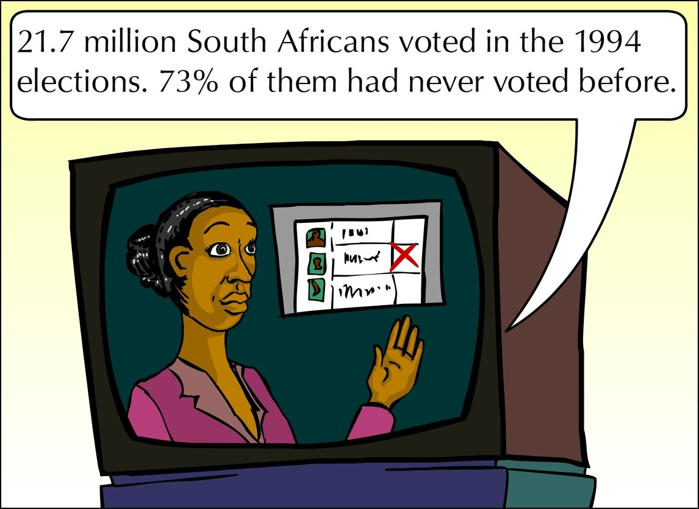
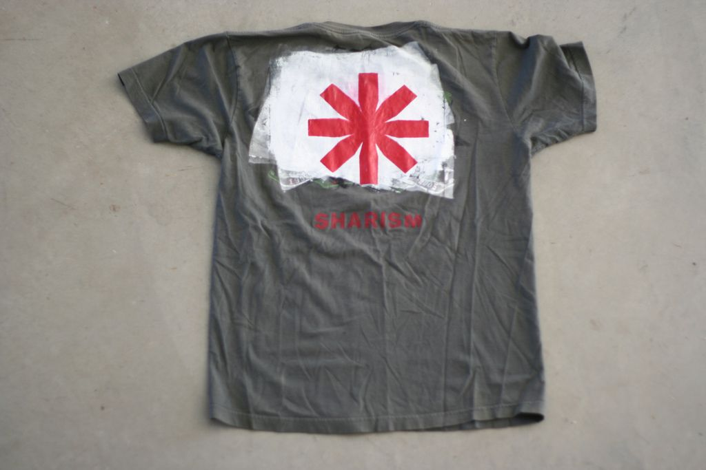
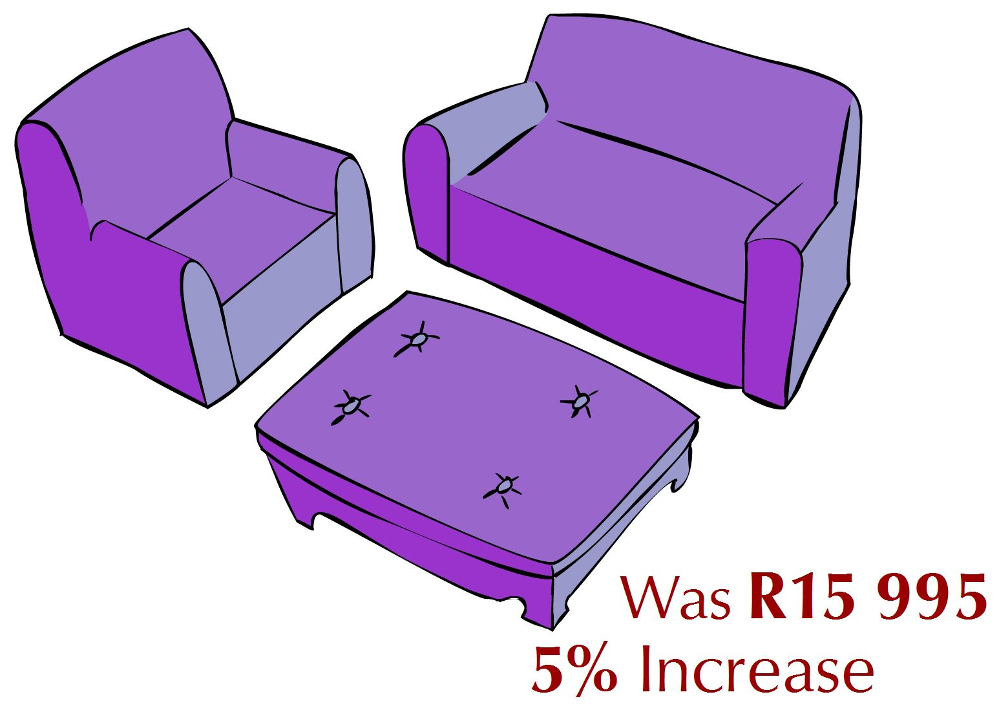
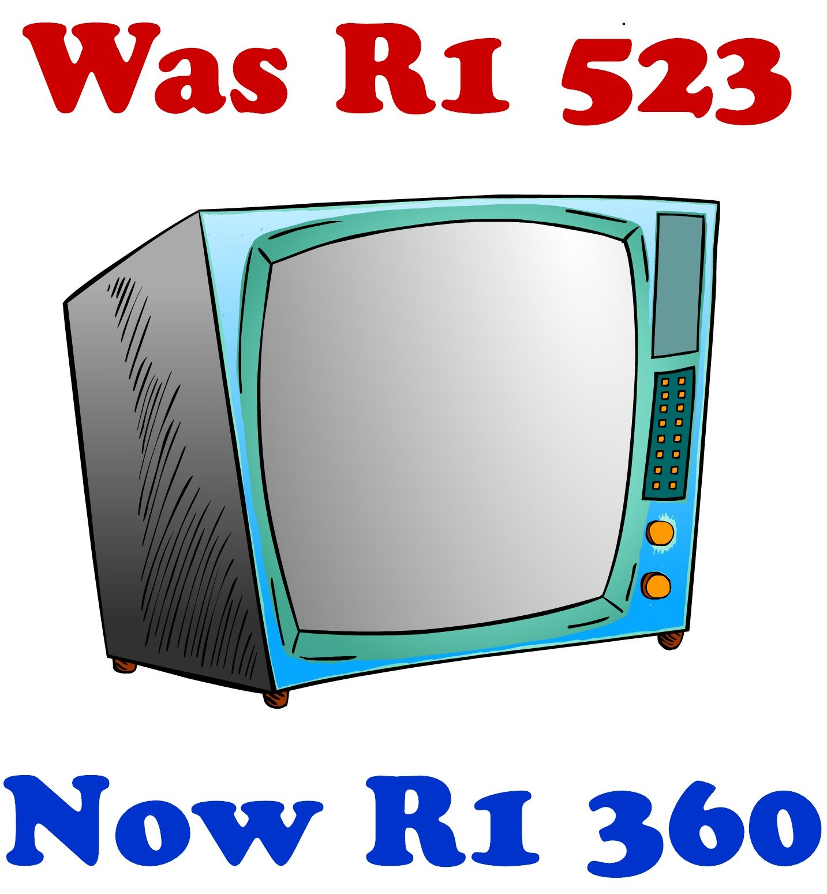
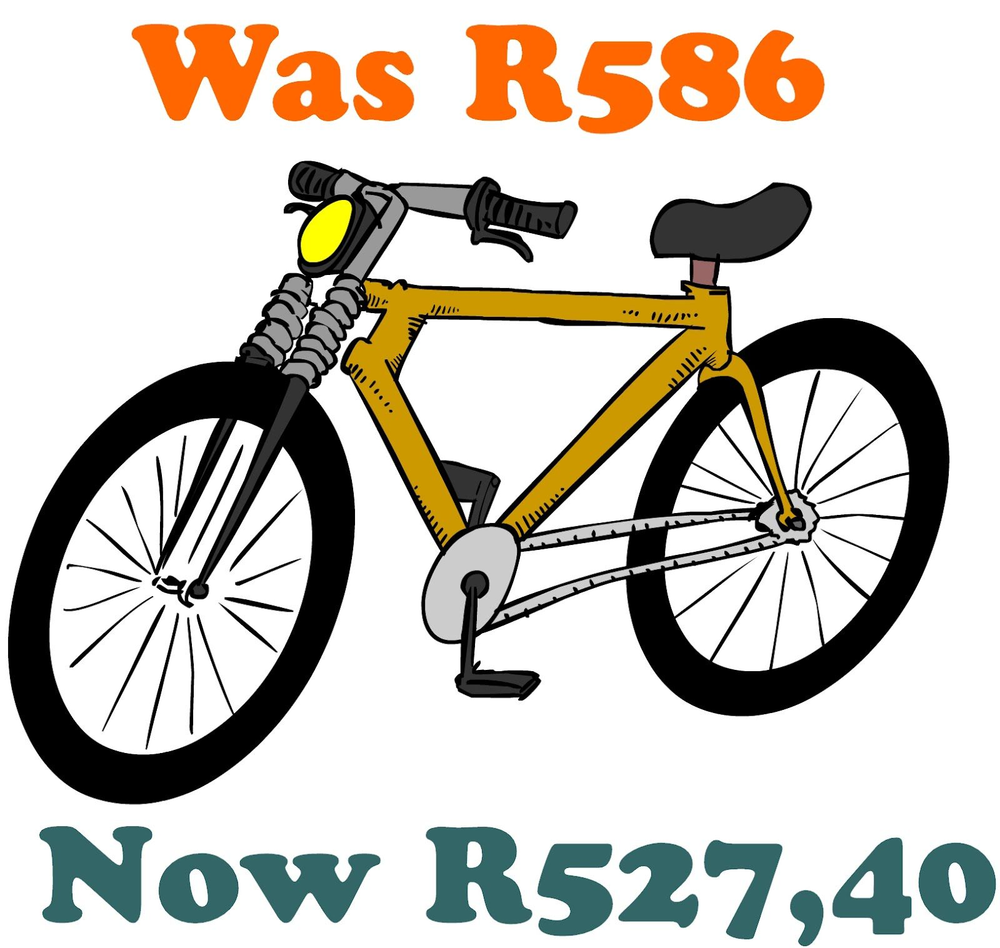

## 1.7 Percentages (EMGZ)

PercentageA number represented as a part of \(\text{100}\).

### How to calculate a percentage of an amount (EMG32)

1. Write the percentage as a fraction with the denominator \(\text{100}\), for example \(\text{20}\% = \frac{\text{20}}{\text{100}}\).
             OR write the percentage as a decimal fraction, for example \(\text{20}\% = \text{0,2}\).
3. Multiply this fraction / decimal fraction with the amount that is given.

Let's see how this works in an example.

<Callout type="tip" title="Worked example 16: Working out percentages of amounts">
**Question:**
Use a calculator to answer the following questions:

1. 
    How many people live in rural areas?
3. 
   How many T.B. patients are H.I.V. positive?
5. 
   How many people had never voted before the 1994 election?

1. \(\text{43}\% = \text{43} \div \text{100}\)
     \(\frac{\text{43}}{\text{100}} \times \text{50 586 757} = \text{21 752 305}\) people live in rural areas.
   With a calculator:
   To find \(\text{43}\%\) of \(\text{50 586 757}\) key in:
    \(\text{43} \div \text{100} \times \text{50 586 757} =\)
   OR
   \(\text{43}\% \times \text{50 586 757} =\)
3. \(\text{80}\% = \text{80} \div \text{100}\)
   \(\frac{\text{80}}{\text{100}} \times \text{1 291} = \text{1 032}\) patients
5. \(\text{73}\% = \text{73} \div \text{100}\)
   \(\frac{\text{73}}{\text{100}} \times \text{21 700 000} = \text{15 841 000}\) people had never voted before.
</Callout>

<Callout type="tip" title="Worked example 17: Working out one amount as a percentage of another amount">
**Question:**
Top Teenage T-shirts printed \(\text{120}\) T-shirts. They sold \(\text{72}\) T-shirts immediately. What percentage of the T-shirts were sold?

\(\text{72}\) of the \(\text{120}\) T-shirts were sold

\(\text{72} \div \text{120} \times \text{100} = \text{60}\%\). So \(\text{60}\%\) of the T-shirts were sold.
</Callout>

## Calculating the percentages of amounts

### Exercise 1.10

Calculate the following without a calculator:

**Problem:**
\(\text{25}\%\) of \(\text{R}\,\text{124,16}\)

**Solution:**
\(\text{25}\% = \frac{\text{1}}{\text{4}}\). \(\frac{\text{1}}{\text{4}} \text{ of } \text{R}\,\text{124,16} = \text{R}\,\text{124,16} \div \text{4} = \text{R}\,\text{31,04}\)

**Problem:**
\(\text{50}\%\) of \(\text{30}\) \(\text{mm}\)

**Solution:**
\(\text{50}\% = \frac{\text{1}}{\text{2}}\). \(\frac{\text{1}}{\text{2}} \text{ of } \text{30}\text{ mm} = \text{30}\text{ mm} \div \text{2} = \text{15}\text{ mm}\)

Using your calculator and calculate:

**Problem:**
\(\text{15}\%\) of \(\text{R}\,\text{3 500}\)

**Solution:**
\(\text{R}\,\text{525}\)

**Problem:**
\(\text{12}\%\) of \(\text{25}\) litres

**Solution:**
\(\text{3}\) litres

**Problem:**
\(\text{37,5}\%\) of \(\text{22}\) \(\text{kg}\)

**Solution:**
\(\text{8,25}\) \(\text{kg}\)

**Problem:**
\(\text{75}\%\) of \(\text{R}\,\text{16,92}\)

**Solution:**
\(\text{R}\,\text{12,69}\)

**Problem:**
\(\text{18}\%\) of \(\text{105}\) \(\text{m}\)

**Solution:**
\(\text{18,9}\) \(\text{m}\)

**Problem:**
\(\text{79}\%\) of \(\text{840}\) \(\text{km}\)

**Solution:**
\(\text{663,6}\) \(\text{km}\)

Calculate what percentage the first amount is of the second amount (you may use your calculator):

**Problem:**
\(\text{120}\) of \(\text{480}\)

**Solution:**
\(\text{25}\%\)

**Problem:**
\(\text{23}\) of \(\text{276}\)

**Solution:**
\(\text{8,3}\%\)

**Problem:**
\(\text{3 500}\) \(\text{ml}\) of \(\text{5}\) litres

**Solution:**
\(\text{70}\%\)

**Problem:**
\(\text{750}\) \(\text{g}\) of \(\text{2}\) \(\text{kg}\)

**Solution:**
\(\text{37,5}\%\)

**Problem:**
\(\text{4}\) out of \(\text{5}\) for a test

**Solution:**
\(\text{90}\%\)

**Problem:**
\(\text{2}\) out of \(\text{14}\) balls

**Solution:**
\(\text{14,3}\%\)

### Percentage discounts and increases (EMG33)

Look at the following extracts from newspaper articles and adverts:

Cost priceThe amount that the dealer / trader / merchant pays for an article.Marked priceThis is the price of the article.Selling priceThis is the price after discount.ProfitSale price \(-\) cost price.

## Discounts and increases

### Exercise 1.11

**Problem:**
The price of a tub of margarine is \(\text{R}\,\text{6,99}\). If the price rises by \(\text{10}\%\), how much will it cost?

**Solution:**
New price is \(\text{R}\,\text{6,99}\) + \(\text{10}\%\) of \(\text{R}\,\text{6,99}\)= \(\text{R}\,\text{6,99}\) + \(\text{70}\) \(\text{c}\) (rounded off) = \(\text{R}\,\text{7,69}\) OR New price is (\(\text{100}\) + \(\text{10}\))\% of \(\text{R}\,\text{6,99}\) = \(\text{110}\%\) of \(\text{R}\,\text{6,99}=\frac{\text{110}}{\text{100}} \times \frac{\text{6,99}}{\text{1}}= \text{R}\,\text{7,69}\) (rounded off)

**Problem:**
Top Teenage T-shirts have a \(\text{20}\%\) discount on all T-shirts. If one of their T-shirts originally cost \(\text{R}\,\text{189,90}\), what will you pay for it now?

**Solution:**
You only pay \(\text{80}\%\) (\(\text{100}\%\) \(-\) \(\text{20}\%\) discount). Thus: \(\frac{\text{80}}{\text{100}} \times \text{189,901} = \text{R}\,\text{151,92}\) OR \(\text{20}\%\) of \(\text{R}\,\text{189,90} = \frac{\text{20}}{\text{100}} \times \text{189,901}\). The discount is thus \(\text{R}\,\text{37,98}\). You pay \(\text{R}\,\text{189,90} - \text{R}\,\text{37,98} = \text{R}\,\text{151,92}\).

Look at the pictures below. What is the value of each of the following items, in rands?

**Problem:**

**Solution:**
\(\text{R}\,\text{239,96} - \text{R}\,\text{59,75} = \text{R}\,\text{180,21}\)

**Problem:**

**Solution:**
\(\text{R}\,\text{299,50} - \text{R}\,\text{44,925} = \text{R}\,\text{1 254,58}\)

**Problem:**

**Solution:**
\(\text{R}\,\text{9 875} + \text{R}\,\text{790} = \text{R}\,\text{10 665}\)

**Problem:**

**Solution:**
\(\text{R}\,\text{15 995} +  \text{R}\,\text{799,75}= \text{R}\,\text{16 794,75}\)

Calculate the percentage discount on each of these items:

**Problem:**

**Solution:**
\(\frac{\text{R}\,\text{1 360}}{\text{R}\,\text{1 523}} = \text{89}\%\). So discount is \(\text{100}\% - \text{89}\% = \text{11}\%\)

**Problem:**

**Solution:**
\(\frac{\text{R}\,\text{527,40}}{\text{R}\,\text{586}} = \text{90}\%\). So discount is \(\text{100}\% - \text{90}\% = \text{10}\%\)
