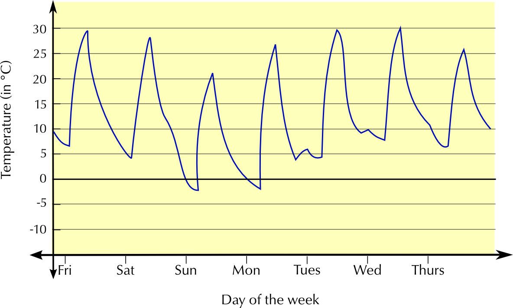

## 2.2 Making sense of graphs that tell a story (EMG36)

The first section of this chapter is intended to give learners a feeling for how graphs “tell a story”, by using a visual representation of the relationship between quantities. We give learners the basic tools to interpret graphs that they see in the media.

This section is particularly useful for learners who have previously been intimidated by graphs and don't understand how representations work, so it is vital to keep this section informal. Do not ask learners to read points off a graph or to work with independent and dependent variables in this section. They will do this in the following sections.

In Maths Literacy, almost every problem begins with a story, which then needs to be analysed and solved (if possible). It is easier to understand the meaning of a picture than a list of numbers. A graph is just a mathematical picture of the relationship between two quantities, such as distance and time. The advantage of a graph is that you can see and understand the whole picture at a glance.

In this section we will look at the messages that graphs give us. You will develop the skill of interpreting graphs and you will learn to identify some important features of graphs.

### Graphs going up and going down (increasing and decreasing) (EMG37)

<Callout type="tip" title="Worked example 1: Looking at a graph in a newspaper">
**Question:**
Jabu sees the following graph in a newspaper article:

What information can Jabu extract from this graph?

- The graph shows the inflation rate for each year for seven years.
- Following the line of the graph, you can see that inflation increases (goes up) in general.
- The graph is steepest in the last year. This means that inflation increased the most during this time.
</Callout>

InflationThe increase in the price of goods in a country.

If a graph is increasing, the slope goes up from left to right.

If a graph is decreasing, the slope goes down from left to right.

How do we know when a line is steeper than another line? You can see the difference by looking at the slope or gradient:

A steeper graph shows a quicker change.

A gradual slope shows a slower change.

Hiking up a steep slope.

<Callout type="tip" title="Worked example 2: A graph of the maximum temperature over one week">
**Question:**

Answer the following questions and explain your answers by referring to the graph:

1. On which day is the temperature the lowest during the week?
3. When is the temperature the highest?
5. On which day(s) does the temperature stay the same?
7. Between which days do you see the biggest increase in temperature?
9. Which part of the graph shows a decrease in temperature?

1. The graph is at the lowest point on Monday, showing that the temperature was at its lowest on Monday.
3. The highest point of the graph is on Thursday.
5. From Tuesday to Wednesday and from Saturday to Sunday, the graph is flat, showing that the temperature is constant.
7. The biggest increase in temperature takes place from Wednesday to Thursday, because the steepest part of the graph is here.
9. The graph is decreasing from Thursday to Saturday, showing a drop in temperature.
</Callout>

The 2nd worked example in Chapter 2 deals with very important concepts in graph work, which learners need to master at the beginning of Grade 10: increasing, decreasing, constant, gradients, maximum and minimum points. They do not need to use the formal terminology; but they must be able to interpret these features of graphs correctly. Using realistic contexts for these graphs is a good way to check whether learners understand the meaning of the features. The following activity is a good opportunity to assess this informally.

### Continuous and discrete graphs (EMG38)

In Chapter 1 we learnt that some types of values can only be whole numbers, while others, like measurements, can have decimal fraction values. This is important when drawing graphs, because whole numbers must be shown by points on a graph, connected by dotted lines. We call these kinds of values, and graphs, **discrete**. **Continuous** values, such as length, should be connected by solid lines, to show that the values in between the points are included too.

The use of dotted lines in a discrete graph is to help us see the differences between the points and the steepness of the slope between them, rather than indicating a connection between the points.

<Callout type="tip" title="Worked example 3: Continuous or discrete graphs">
**Question:**
Look at the graphs below. The first graph shows the number of passengers on a bus for six different trips. The second graph shows the distance that a bus travels for one trip. Explain why the first graph has dotted lines connecting the points while the second has solid lines.

The first graph has discrete variables, as both the number of passengers and the number of trips can only be whole numbers (there can't be half a passenger on the bus, for example!).

The second graph shows measurement values, which are continuous. The solid line shows that all of the points along the graph are part of the relationship. Any measurement of time and distance would be valid, because the bus trip took place over a continuous number of minutes, and the bus drove all the way, along a continuous distance.

</Callout>

## Interpreting graphs

### Exercise 2.1

Lindi and Thabang went on a day hike and drew this graph to show their progress.

**Problem:**
What was the total distance of the hike and how many hours did it take?

**Solution:**
Total distance is \(\text{16}\) \(\text{km}\), Total time is \(\text{7}\) hours, \(\text{30}\) minutes

**Problem:**
Give the times when Lindi and Thabang were resting (where the distance stayed constant).

**Solution:**
08:30 - 09:00, 10:30-11:30, 13:00-14:00

**Problem:**
One part of the graph is steeper than the others. Identify this part.

**Solution:**
G to H

Pumeza's car takes \(\text{45}\) litres of petrol. The graph below shows the amount of petrol in the tank over one week.

**Problem:**
Is there any time when her petrol tank is completely empty? How do you know?

**Solution:**
No. At no point does the graph touch the horizontal axis

**Problem:**
Pumeza was ill for two days during the week and stayed at home. Identify the two days and explain your answer.

**Solution:**
Tuesday and Wednesday - her petrol consumption did not change at all, this suggests she did not use her car, and was therefore at home.

**Problem:**
How many times does she fill up her car with petrol? Where do you see this on the graph?

**Solution:**
Once, On Tuesday the amount of petrol in the tank spikes suddenly.

The graph below shows the temperature in Bloemfontein, measured over one week in September.

**Problem:**
Is this graph continuous or discrete? Explain.

**Solution:**
Continuous - there are no gaps in the graph, temperature is measured all day, from Friday to Thursday.

**Problem:**
What was the highest temperature recorded during the week? On what day was this?

**Solution:**
\(\text{30}\)\(\text{°C}\), on Wednesday

**Problem:**
What was the lowest temperature recorded during the week? On what day was this?

**Solution:**
approximately \(--\text{2}\)\(\text{°C}\), on Sunday.

**Problem:**
Write down the maximum and minimum temperatures on Wednesday. Calculate the difference between them.

**Solution:**
Minimum temperature is approximately \(\text{7}\)\(\text{°C}\) maximum is approximately \(\text{30}\)\(\text{°C}\). \(\text{30}\)\(\text{°C}\) - \(\text{7}\)\(\text{°C}\) = \(\text{23}\)\(\text{°C}\) difference.

Naledi makes and sells beaded necklaces. Look at the graph below and answer the questions:

**Problem:**
Where is the highest point on the graph?

**Solution:**
The highest point is on Tuesday (\(\text{17}\) necklaces sold).

**Problem:**
On which day were there no sales?

**Solution:**
Sunday.

**Problem:**
Between which two days is the biggest increase in sales? Explain.

**Solution:**
The graph is steepest between Monday and Tuesday, and there is a change from \(\text{8}\) to \(\text{17}\), so the biggest increase is here.

**Problem:**
Between which two days do the sales stay the same?

**Solution:**
Between Thursday and Friday - the graph is constant between these two points.

**Problem:**
Describe what happens to the sales between Wednesday and Thursday.

**Solution:**
There is a small increase in sales from Wednesday to Thursday - from \(\text{8}\) to \(\text{10}\) necklaces.

**Problem:**
Why is the graph drawn with a dotted line?

**Solution:**
There is a dotted line to indicate that the graph is not continuous between the plotted points. The sales are discrete points because Naledi only sells a whole number of necklaces each day.

### Dependent and independent variables (EMG39)

VariableThe quantity you are measuring or calculating.

An **independent variable** is a variable that stands alone and isn't changed by the other variables you are trying to measure. For example, someone's age might be an independent variable. Other factors (such as what they eat, how they go to school, how much television they watch) aren't going to change a person's age.

A **dependent variable** depends on other factors. For example, a test score could be a dependent variable because it could change depending on several factors such as how much you studied, how much sleep you got the night before you took the test, or even how hungry you were when you took it.

An easy way to remember which is the dependent variable and which is the independent variable is to put the names of the two variables you are using in a sentence in a way that makes the most sense. Then you can see which is the independent variable and which is the dependent variable.

For example, time causes a change in distance travelled and it isn't possible that distance travelled could cause a change in time.

When we plot graphs of variables, we usually put the independent variable on the horizontal axis and the dependent variable on the vertical axis.

### Touching the axes (EMG3B)

What does it mean when a graph touches the horizontal axis or the vertical axis?

- If the graph touches the vertical or "\(y\)"-axis, it means that the quantity on the horizontal axis has reached \(\text{0}\).
- If a graph touches the horizontal or "\(x\)"-axis, it means that the quantity on the vertical axis has reached \(\text{0}\).

Another name for the horizontal axis is the \(x\)-axis. We plot the independent variable in a relationship on this axis. Another name for the vertical axis is the \(y\)-axis. We plot the dependent variable in a relationship on this axis.

You will not see these features on all graphs, but they are important to look for on a graph. The following worked examples show you how to interpret this in graphs.

<Callout type="tip" title="Worked example 4: Interpreting a graph that touches the vertical axis">
**Question:**
Nicola buys biltong in fancy packaging as a present for her dad. Look at this graph of the price of biltong per weight.

1. What is the price when the weight of biltong is 0 kg Explain your answer.
3. Explain which is the independent and which is the dependent variable.

1. The price of buying the biltong at 0 kg is R10, which we read where the graph touches the vertical axis. This means that there is a starting cost of R10, which is constant, no matter how much biltong is bought. This is probably the cost of the packaging.
3. The cost depends on the weight bought, so weight is independent and cost is dependent.
</Callout>

<Callout type="tip" title="Worked example 5: Interpreting a graph that touches the horizontal axis">
**Question:**
Tumelo empties his 500 ml water bottle at a constant rate.

1. Describe what you see in this graph.
3. Explain which is the independent and which is the dependent variable.

1. The volume starts at 500 ml, showing that the bottle is full. It decreases steadily as Tumelo empties it. At 0 minutes, it reaches 0 ml. This means it has taken 5 minutes to empty the bottle completely.
3. The volume changes with time, so time is the independent variable, and volume is dependent.
</Callout>

By now, you have a good idea about what kinds of things to look at when you 'read' a graph. Do the following activity to put all of this information together.

### Exercise 2.2

Tumelo has a long day at work ahead and takes a one litre bottle of water to work with him. Look at this graph carefully and then answer the questions below.

**Problem:**
What are the two variables plotted on this graph?

**Solution:**
Time, on the horizontal axis, and the volume of water in Tumelo's bottle, on the vertical axis.

**Problem:**
Which variable is dependent and which is independent? Explain fully.

**Solution:**
The volume of water is dependent on time, the independent variable.

**Problem:**
What happens to the amount of water in the bottle during the first two hours?

**Solution:**
It remains constant.

**Problem:**
What happens at hour number 5? Explain.

**Solution:**
The amount of water in the bottle increases suddenly. This implies that Tulemo refilled his water bottle.

**Problem:**
Between which two hours does Tumelo drink his water the fastest?

**Solution:**
Between hour

 and hour

.

**Problem:**
Does he finish all the water in his bottle at any point? How do you know this?

**Solution:**
No. At no point does the graph touch the horizontal axis - i.e. at no point is the volume of water in the bottle

.
