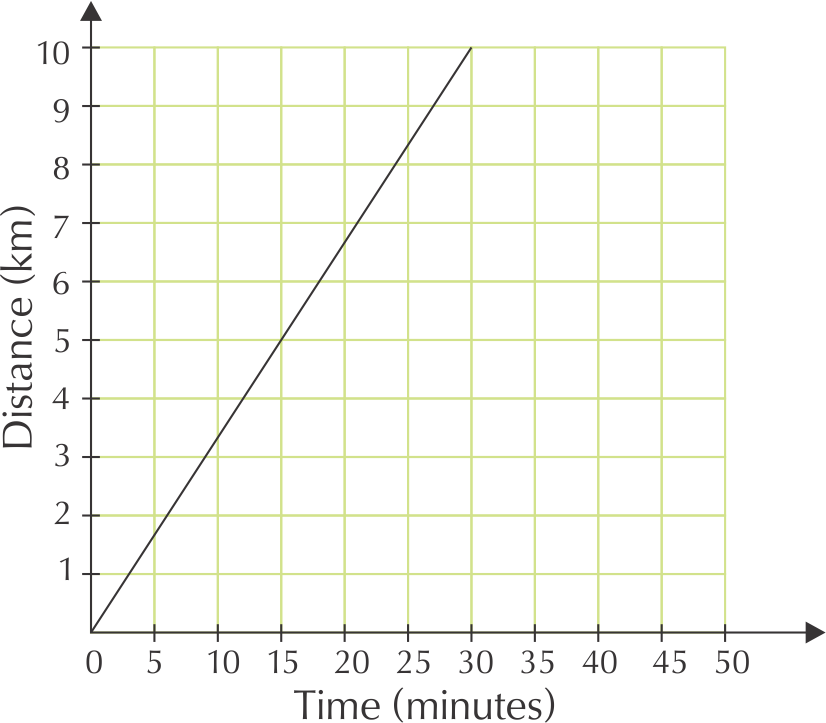
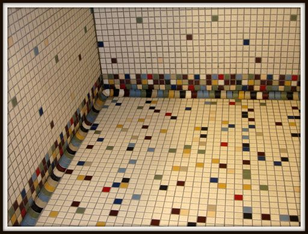
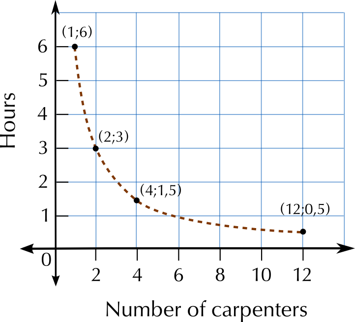

### Exercise 2.5

The two graphs below show how Dikeledi cycled to the Post Office and back home.  Compare the two graphs to answer the questions that follow.

**Problem:**
What relationship is shown in each graph?

**Solution:**
The relationship between distance from home and time.

**Problem:**
Explain why the first graph has a positive slope.

**Solution:**
The longer Dikeledi cycles, the further she gets from home (so the greater the distance becomes), because she is cycling **away** from home.

**Problem:**
Explain why the second graph has a negative slope for most of the way.

**Solution:**
The longer Dikeledi cycles for, the closer she gets to home (so the smaller the distance becomes) because she is cycling **towards** home.

**Problem:**
How long did Dikeledi take to cycle to the Post Office?

**Solution:**
\(\text{30}\) minutes

**Problem:**
What is the distance between her home and the Post Office?

**Solution:**
\(\text{10}\) \(\text{km}\)

**Problem:**
How long did she take to cycle home from the Post Office?

**Solution:**
\(\text{50}\) minutes

**Problem:**
Dikeledi 's trip home has four parts, shown by four different line segments.

1. When did Dikeledi cycle the fastest?
3. How far did she cycle before she slowed down?
5. When did Dikeledi cycle the slowest?
7. How far from home was Dikeledi after \(\text{10}\) minutes?

**Solution:**
1. between time \(\text{25}\) and \(\text{35}\) minutes
3. \(\text{3}\) \(\text{km}\)
5. Between time \(\text{15}\) minutes and \(\text{25}\) minutes she stopped cycling altogether.
7. \(\text{8}\) \(\text{km}\)

It takes one carpenter at Jabulani Joinery \(\text{6}\) hours to make a wooden table. They need to make \(\text{20}\) wooden tables.

**Problem:**
What are the two variables in this relationship?

**Solution:**
The number of carpenters and the hours required to make \(\text{20}\) tables.

**Problem:**
How long would \(\text{2}\) carpenters take to make the table?

**Solution:**
\(\text{3}\) hours.

**Problem:**
How long would \(\text{4}\) carpenters take?

**Solution:**
\(\text{1,5}\) hours

**Problem:**
How long would \(\text{12}\) carpenters take?

**Solution:**
\(\text{30}\) minutes

**Problem:**
What kind of a relationship is there between the two variables?

**Solution:**
Inverse proportional relationship

**Problem:**
Draw up a table of values to plot a graph of this relationship.

**Solution:**
| No. of carpenters | \(\text{1}\) | \(\text{2}\) | \(\text{4}\) | \(\text{12}\) |
| --- | --- | --- | --- | --- |
| Hours to make \(\text{20}\) tables | \(\text{6}\) | \(\text{3}\) | \(\text{1,5}\) | \(\text{0,5}\) |

**Problem:**
Sketch a graph of these values.

**Solution:**

**Problem:**
Did you use a solid line or a dotted line? Explain why.

**Solution:**
The line must be dotted, because there can only be a whole number of carpenters (this is a discrete variable).

A computer game shop has a special deal for regular customers. Instead of paying \(\text{R}\,\text{30}\) to hire a game, you can join the Gamers Club for \(\text{R}\,\text{150}\) per year, and pay only \(\text{R}\,\text{15}\) per DVD.

**Problem:**
How would you calculate the cost of hiring \(\text{10}\) games if you did not belong to the club?

**Solution:**
You would add the cost of \(\text{10}\) games, at \(\text{R}\,\text{30}\) each.

**Problem:**
Write an equation for the calculation in a.

**Solution:**
Cost = \(\text{R}\,\text{30}\) \(\times\) number of games.

**Problem:**
How would Thomas calculate the cost of hiring five games if he belongs to the Gamers Club?

**Solution:**
Cost = \(\text{R}\,\text{150}\) + \(\text{R}\,\text{15}\) \(\times\) \(\text{5}\) games

**Problem:**
Write an equation for calculating the cost of hiring any number of games for the year for Gamers Club members.

**Solution:**
Cost = \(\text{R}\,\text{150}\) + \(\text{R}\,\text{15}\) \(\times\) number of games

**Problem:**
In the relationship between costs and the number of games hired, which is the independent variable? Explain.

**Solution:**
The number of games hired is the independent variable. How much Thomas pays for the games depends on how many games he hires.

**Problem:**
Which is the dependent variable?

**Solution:**
The cost of hiring the games is the dependent variable.

**Problem:**
Would a graph for this relationship have a positive or a negative slope? Give a reason for your answer.

**Solution:**
The slope is positive, because the cost increases as you hire more games.
