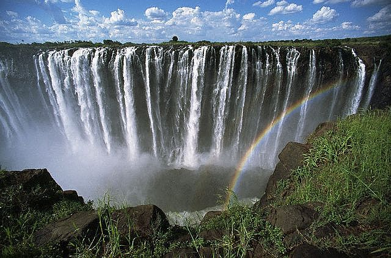
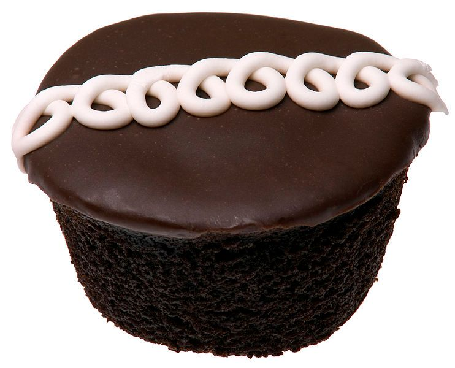
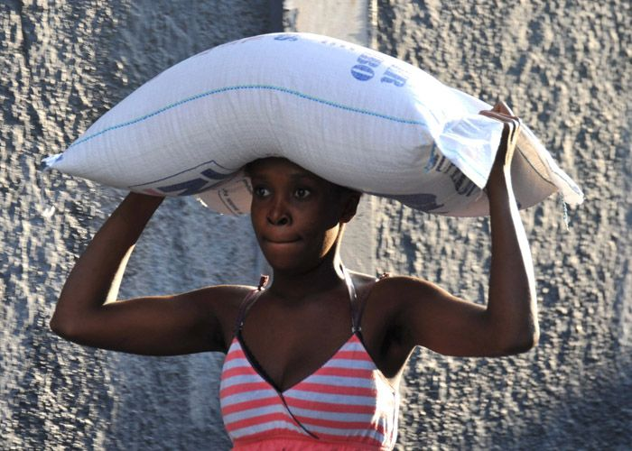

## 3.2 Converting metric units of measurement from memory (EMG3P)

When we measure length, volume and weight, we use various units of measurement depending on the size of what we are going to measure. Generally, the smaller the length, volume or weight of an object, the smaller the units we use. In the next sections we will look at what different units we should use and when, and how to convert between them.

### Length (EMG3Q)

Length is a measured distance between two points. For example, the length of a book would be the distance from the bottom of the book to the top (we would measure this in centimetres). The length of a table would be the distance from one end of the table to the other end (we would measure this in centimetres or metres).

The units we use for measuring length are as follows:

km:                 kilometres

m:                  metres

cm:                 centimetres

mm:                 millimetres

<Callout type="tip" title="Worked example 1: Deciding on units of length">
**Question:**
There are four pictures below. Decide on the most appropriate unit of length for each situation.

1. The width of one of this flower's petals:
   
3. The length of this caterpillar:
   
5. The length of this wooden bench:
   
7. The distance between Cape Town and Johannesburg:
   

1. The width of one of these small flower petals can be measured in millimetres (mm).
3. The length of a caterpillar can be measured in centimetres (cm).
5. The length of a wooden bench can be measured in metres (m).
7. The distance between Cape Town and Johannesburg will be measured in kilometres (km).
</Callout>

The sun and the Earth, as seen from space.

The average distance from the Earth to the Sun is approximately \(\text{150 000 000 000}\) metres!

Measuring distance or length using the same unit for everything can result in huge numbers with lots of zeros, which can be confusing to read. For this reason, we often convert between units to make the numbers simpler to work with.

The table below shows the relationship between the units.

| Conversion factors for length |
| --- |
| \(\text{10}\) millimetres (mm) = \(\text{1}\) centimetre (cm) |
| \(\text{1 000}\) millimetres (mm) = \(\text{1}\) metre (m) |
| \(\text{100}\) centimetres (cm) = \(\text{1}\) metre (m) |
| \(\text{1 000}\) metres (m) = \(\text{1}\) kilometre (km) |

Here is another visual representation of converting between units of length:

We can also reverse it to find lengths in larger units:

### Volume (EMG3R)

The volume of an object is a measure of how much space it takes up. So a tea cup will contain a certain amount, or volume, of tea (measured in millilitres), and bucket of water will contain a certain volume of water (measured in litres) and larger containers, like a dam, will contain kilolitres of water.

The capacity of an object is the maximum volume that it can hold. So, a bucket with a capacity of \(\text{10}\) litres can hold a maximum of \(\text{10}\) litres. If the bucket is only half full, the volume of water inside the bucket will be \(\text{5}\) litres.

The units and symbols we use for measuring volume are as follows:

kl:                 kilolitres

\(\ell\):                  litres

ml:                 millilitres

<Callout type="tip" title="Worked example 2: Deciding on units of volume">
**Question:**
There are three pictures below. Decide on the most appropriate unit of measurement for each situation.

1. The amount of coffee in this cup:
   
3. The amount of water in this bucket:
   
5. The amount of water in this water reservoir:
   

1. The amount of coffee in this cup would be measured in millilitres (ml).
3. The amount of water in this bucket would be measured in litres (\(\ell\)).
5. The amount of water in a water reservoir would be measured in kilolitres (kl).
</Callout>

Victoria Falls in Zimbabwe

The highest recorded amount of water that went over the Victoria Falls in one second was \(\text{12 800 000 000}\) litres! This is a massive number and difficult to work with. As with units of length, we can convert between the various units of volume to make our calculations and measurements simpler.

The table below shows how the units relate to each other.

| Conversion factors for volume |
| --- |
| \(\text{1 000}\) millilitres (ml) = \(\text{1}\) litre (\(\ell\)) |
| \(\text{1 000}\) litres (\(\ell\)) = \(\text{1}\) kilolitre (kl) |

Here is another visual representation of converting between units of volume:

And one can also reverse it:

### Weight (EMG3S)

The “weight” of an object commonly refers to how heavy the object is, when weighed on a scale. The scientific word for how much an object weighs on a scale is “mass” but in this book we will use the words “weight” and “mass” interchangeably, because both are used in our everyday language.

Here are the units and symbols we use for measuring weight:

t:                (metric) tonnes

kg:                 kilograms

g:                  grams

mg:                 milligrams

<Callout type="tip" title="Worked example 3: Deciding on units of mass">
**Question:**
There are four pictures below. Decide on the most appropriate unit of mass for each object.

1. The mass of a few grains of rice:
   
3. The mass of this cupcake:
   
5. The mass of a bag of maize:
   
7. The mass of this tractor:
   

1. The mass of a few grains of rice would be measured in milligrams.
3. The weight of a cupcake would be measured in grams.
5. A big bag of maize would be measured in kilograms.
7. The weight of a tractor would be measured in tonnes.
</Callout>

The person standing on the above scale weighs approximately \(\text{84 000 000}\) milligrams. Again, this large number is difficult to work with, and as with length and volume, we can convert between different units of weight to make our calculations simpler.

The table below shows how the units relate to each other.

| Conversion  factors for weight |
| --- |
| \(\text{1 000}\) \(\text{mg}\) (mg) = \(\text{1}\) gram (g) |
| \(\text{1 000}\) grams (g) = \(\text{1}\) kilogram (kg) |
| \(\text{1 000}\) kilograms (kg) = \(\text{1}\) tonne (t) |
