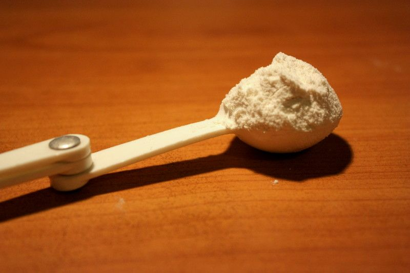

## 3.3 Converting units of measurement using given conversion factors (EMG3T)

### Cooking conversions (EMG3V)

In recipes used for cooking and baking we often find the measurements for the ingredients required in cups, teaspoons and tablespoons. Measuring cups and spoons come in standard sizes, and are common in the kitchen and in recipes because they are quick and simple to use. It's very easy to measure out a quantity of baking powder in a measuring spoon, for example - much quicker than it would be weighing it on a scale.

The pictures below are examples of measuring spoons and cups. Notice that there are half and quarter cups and spoons. This is to make it easy to accurately measure out the different quantities that are most commonly used in recipes. If you have a full set of cups (in all the different sizes), and need to measure \(\frac{\text{1}}{\text{2}}\) a cup of oil, for example, you don't have to fill a whole cup half way to the top (which is an approximation, at best). You can simply use the half measuring cup and fill it to the top.

Measuring spoons

Measuring cups

Sometimes recipes also call for “heaped” or “rounded” teaspoons, for example. This simply means that the substance in the spoon does not have to be levelled flat, in line with the top of the spoon - there can be a bit extra “heaped” on top of the quantity in the measuring spoon.

A heaped teaspoon of flour

A heaped cup of flour

If you don't have measuring spoons and cups, you can use everyday household objects to approximate the same quantity of ingredients. For example, a small tea cup is roughly the same size as a measuring cup and a heaped, normal-sized spoon is about the same quantity as a measuring tablespoon. When following a recipe though, it is important to be as accurate as possible with your measurements, so using these rough approximations is often not suitable.

The quantities that measuring cups and spoons hold can be converted to volume units (like ml and \(\ell\)) which is often useful, depending on what baking and cooking equipment you're using. For example, a recipe might call for \(\text{2}\) cups of mealie meal. If you don't have measuring cups but do have a measuring jug that measures ml, but know how to convert cups to ml, you can still measure out the mealie meal.

It is also useful to know how to convert between these units when you are making a larger quantity of food than a recipe is designed to produce, and you need to keep the proportions between ingredients the same.

The recipe extract below gives an example of the kinds of cooking measurements you may find:

The following table shows some of the conversions used in cooking:

| Conversions for cooking and baking |
| --- |
| \(\text{1}\) cup = \(\text{250}\) \(\text{ml}\) |
| \(\text{1}\) tablespoon (tbsp) = \(\text{15}\) \(\text{ml}\) |
| \(\text{1}\) teaspoon (tsp) = \(\text{5}\) \(\text{ml}\) |
