## 3.4 Reading and calculating time (EMG3W)

In this section we will learn how to convert between the different time formats, how to convert between different units of time and how to calculate elapsed time. Unlike units for measurement, volume and weight, units of time are not metric: the units are not multiples of \(\text{10}\) or \(\text{100}\). Rather, there are \(\text{60}\) seconds in \(\text{1}\) minute, \(\text{60}\) minutes in \(\text{1}\) hour, \(\text{24}\) hours in one day and so on. This means we need to be careful, particularly when converting from one unit of time to another.

Being able to convert between different time formats and units and being able to calculate elapsed time are immensely important skills in terms of self management and planning. Time occurs in many different formats in the real world, and it is important to understand the differences and similarities of these formats. Being able to calculate how long something is going to take, or how much free time we have to do a task between two events means we can plan accordingly and organise our time and our daily lives.

### Different time formats (EMG3X)

Time values can be expressed in different formats, such as 8 o'clock, 8:00 a.m., 8:00 p.m. and 20:00.

The two most common formats are the 12-hour format and the 24-hour format.

#### 12-hour clock/analogue

8:00 a.m. or 8:00 p.m. are examples of readings of time using the 12-hour format. This format is seen on analogue clocks and watches. In the diagram and the pictures below, the short hand shows us the hour and the long hand shows us the minutes. Sometimes a third hand shows the seconds.

When we use the 12-hour clock, we use the letters “a.m.” to show that the time is before midday (12 o'clock or noon) and “p.m.” to show that it is after midday. For example, school may start at 7:30 a.m. (in the morning) and finish at 2 p.m. (in the afternoon).

#### 24-hour clock/digital

20:00 is an example of the 24-hour time format. This format is seen on digital watches, clocks and on stopwatches. On digital clocks, the number on the left shows the hour and the number of the right shows the minutes. Some digital watches have a third, smaller number on the far right which shows us seconds.

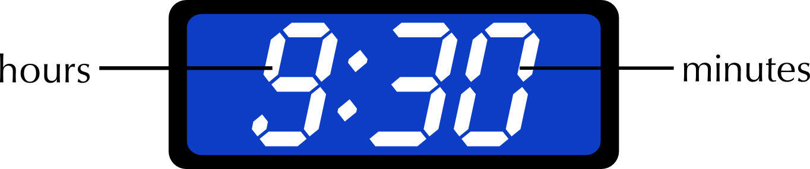

The table below gives examples of 12- and 24-hour time. Look carefully at how to tell the time when it is midnight.

| 12-hour clock | 12 a.m. (midnight) | 3:00 a.m. | 6:00 a.m. | 9:00 a.m. | 12 p.m. (midday) | 3:00 p.m. | 6:00 p.m. | 9:00 p.m. |
| --- | --- | --- | --- | --- | --- | --- | --- | --- |
| 24-hour clock | 0:00 | 3:00 | 6:00 | 9:00 | 12:00 | 15:00 | 18:00 | 21:00 |

Can you see how to convert from the 12-hour clock to the 24-hour clock?

If you compare the top line and bottom line of the table above, you will see that the times are written the same until midday. After midday, you simply **add** 12 to the the number of hours that have passed. For example: 3:00 p.m. is 3 hours after 12:00 p.m. (midday). 3 p.m. + 12 hours = 15:00. 8:30 p.m. is 8 hours 30 minutes after 12:00 p.m. 8 hours 30 minutes + 12 hours = 20:30.

To convert from the 24-hour clock to the 12-hour clock you **subtract** 12 from the number of hours. Don't forget to check whether your answer will be a.m. or p.m.! For example: 15:00 - 12 hours = 3:00. We know 15:00 is after midday, so the answer is 3:00 p.m.  20:00 - 12 hours = 8:00. 20:00 is long after midday, so the answer is 8:00 p.m.

<Callout type="tip" title="Worked example 4: Converting between the 12-hour and 24-hour time formats">
**Question:**
1. Write the following times in the 24-hour format (show all of your calculations):
   1. Jane goes to bed at 9:56 p.m.
   3. The local shop opens at 8:30 a.m.
   5. Archie's cricket practice ends at 4:05 p.m.
3. Write the following times in the 12-hour format (show all of your calculations):
   1. David's school day ends at 14:45
   3. Mrs Gwayi has morning tea at 10:25
   5. The Dube family eat dinner at 19:35

1. 1. 9:56 p.m. + 12 hours = 21:56
   3. 8:30 (This is before midday so it's written the same)
   5. 4:05 p.m. + 12 hours = 16:05
3. 1. 14:45 - 12 hours = 2:45 p.m.
   3. 10:25 a.m. (This is before midday so it's written the same - we simply add the “a.m.”)
   5. 19:35 - 12 hours = 7:35 p.m.
</Callout>

## Converting between 12-hour and 24-hour clock times

### Exercise 3.1

Write the following times in the 12-hour format:

**Problem:**
The soccer game starts at 21:00.

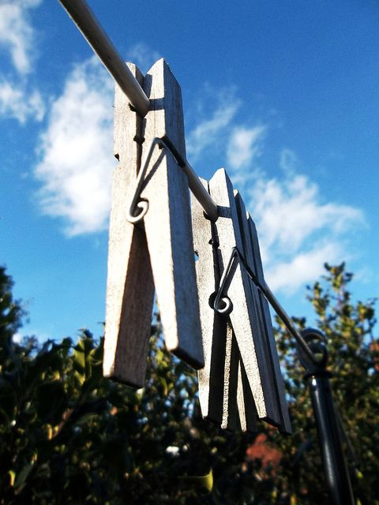

**Solution:**
9:00 p.m.

**Problem:**
Elvis left the building at 17:40.

**Solution:**
5:40 p.m.

**Problem:**
Karen went to bed at 23:40.

**Solution:**
11:40 p.m.

**Problem:**
The moon rose at 00:13.

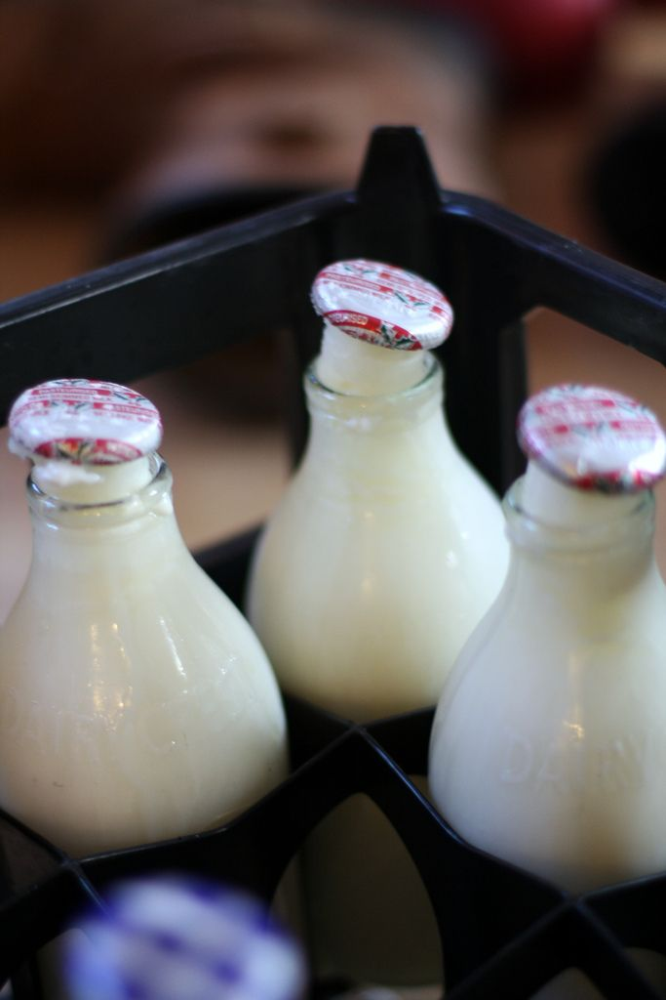

**Solution:**
12:13 a.m.

Write the following times in the 24-hour format:

**Problem:**
Lungile wakes up at 5:40 a.m.

**Solution:**
05:40

**Problem:**
Simphiwe ate dinner at 6:59 p.m.

**Solution:**
18:59

**Problem:**
Anna watched a movie that started at 7:18 p.m.

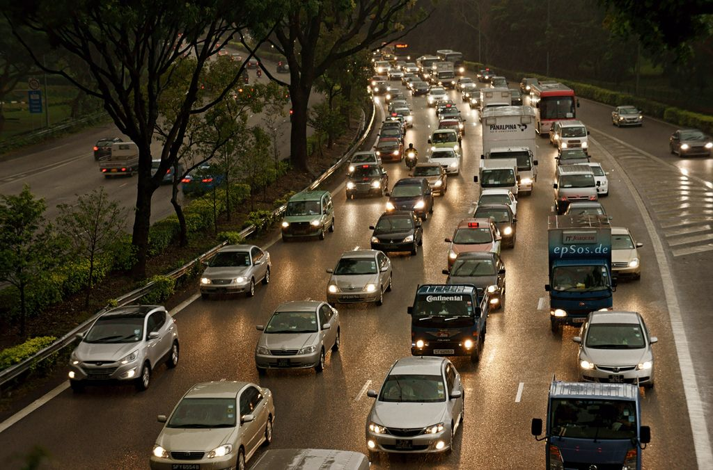

**Solution:**
19:18

**Problem:**
David got home from his night shift at 12:30 a.m.

**Solution:**
00:30

### Converting units of time (EMG3Y)

As with all the conversions we have already done, we use different units of time to measure different events. For example, you would measure the length of your school holidays in days or weeks, not seconds. But the time it takes to walk across a road would be measured in seconds, not years!

<Callout type="tip" title="Worked example 5: Deciding on units of time">
**Question:**
There are seven pictures below. Decide on the most appropriate unit of time for each situation.

1. The time it takes for a sprinter to run \(\text{100}\) metres.
   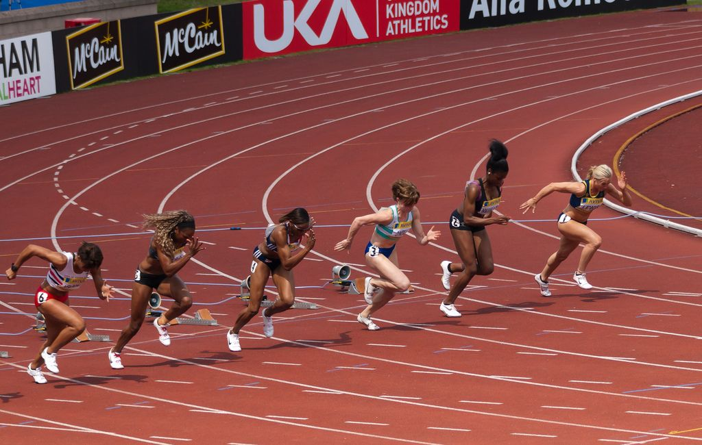
3. A short taxi ride.
   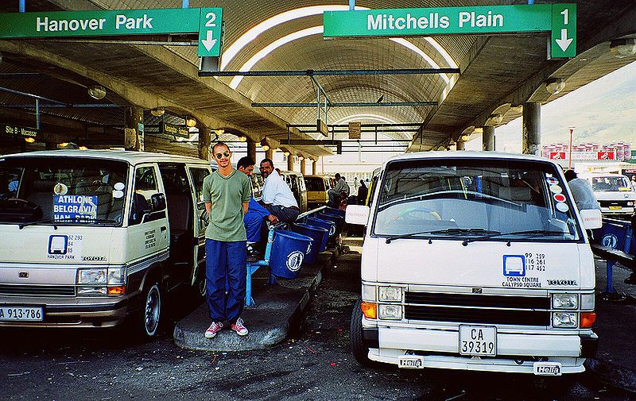
5. The amount of time you spend at school each day.
   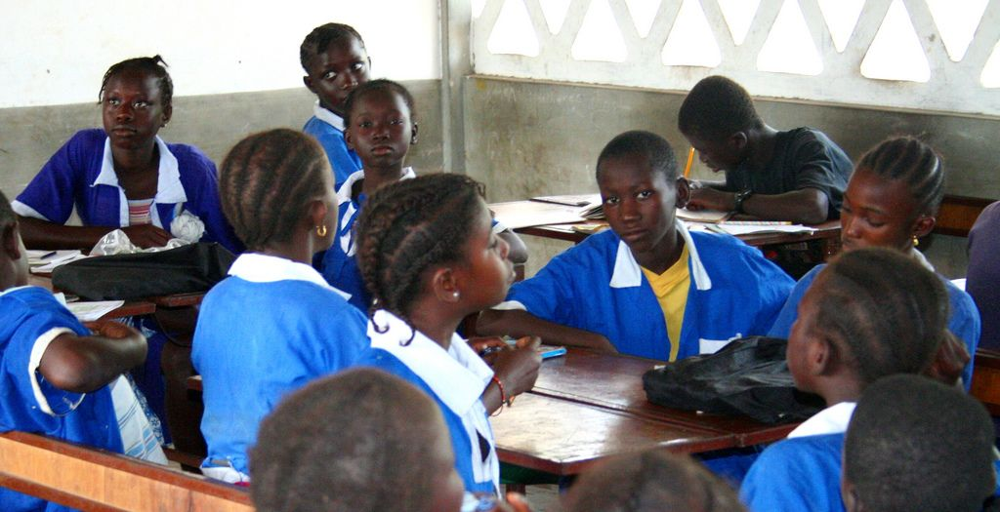
7. The duration of a cricket test match.
   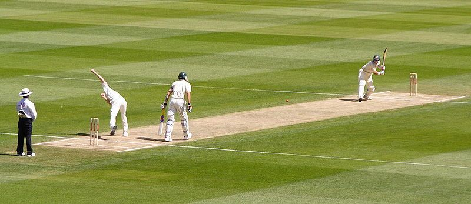
9. The length of the school holidays.
   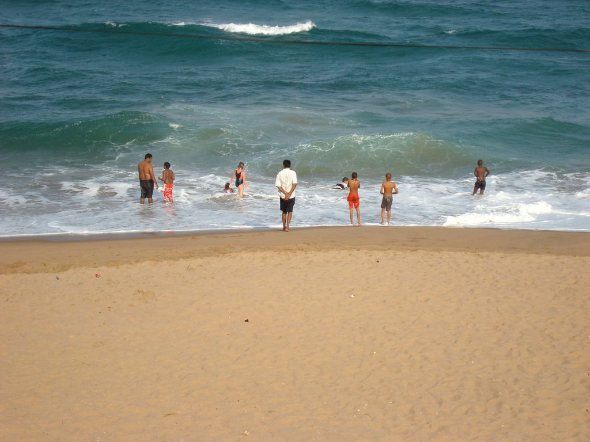
11. The time it takes crops to grow.
   
13. Your age.
   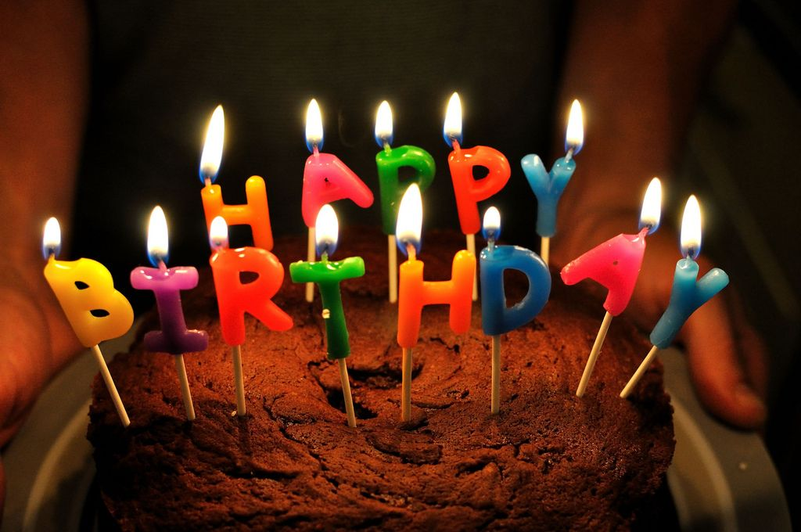

1. The amount of time it takes a sprinter to run \(\text{100}\) \(\text{m}\) would be measured in seconds.
3. A short taxi ride would be measured in minutes.
5. The amount of time you spend at school each day is measured in hours.
7. The length of a cricket test match is measured in days.
9. The length of the school holidays can be measured in weeks.
11. The time it takes crops to grow is measured in months.
13. Your age is measured in years.
</Callout>

There are \(\text{86 400}\) seconds in a day and \(\text{604 800}\) seconds in a week! These are large numbers and they are not always practical to work with. We can convert between different units of time to make our calculations simpler.

The relationship between the units are given in the table below.

| Conversions for time |
| --- |
| \(\text{60}\) seconds = \(\text{1}\) minute |
| \(\text{60}\) minutes= \(\text{1}\) hour |
| \(\text{24}\) hours = \(\text{1}\) day |
| \(\text{7}\) days = \(\text{1}\) week |
| \(\text{365}\) days = approximately \(\text{52}\) weeks = \(\text{12}\) months = \(\text{1}\) year |

### Calculating elapsed time (EMG3Z)

Being able to do calculations with time is a very useful skill to have. It is important to know how to plan and organise your time on a daily basis. For example, if it takes you a certain amount of time to walk to school, what time must you leave home in the morning to arrive in time for class? Or, if you need to help cook dinner at 7pm, how much time do you have to finish your homework?

In this section we will look at how to calculate elapsed time. When doing calculations like this, we add the units of time separately, and don't forget to be careful when working with remainders!

<Callout type="tip" title="Worked example 6: Calculating elapsed time">
**Question:**
1. School starts at 07:45. You are in class for \(\text{2}\) hours \(\text{30}\) minutes. What time will the bell ring for first break? Give your answer in the 24-hour format.
3. Palesa starts cooking dinner at 6:00 p.m. She has to leave for her choir practice in \(\text{1}\) hour and \(\text{45}\) minutes.
   1. What time must she leave? (Give your answer in the 12-hour format).
   3. Convert your answer to the 24-hour format.
      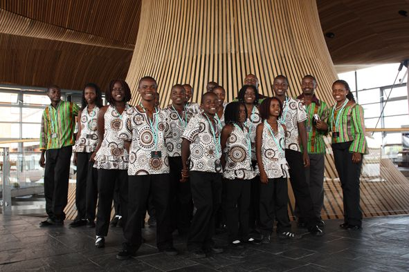
5. The bus leaves school at 14:30. It takes \(\text{70}\) minutes to get to Mulalo's house.
   1. What time will he arrive at home? (Give your answer in the 24-hour format).
   3. Convert your answer to the 12-hour format.
7. Mark leaves for work at 07:45. He arrives at 08:10. How long did it take him to get there? (Give your answer in minutes).
9. Lebogang goes for a walk around her neighbourhood at 4:20 p.m. She gets back home at 5:40 p.m. How long did she walk for? (Give your answer in hours and minutes).
11. Russel finishes soccer practice at 4:00 p.m. It takes him \(\text{10}\) minutes to walk home. He then spends \(\text{80}\) minutes doing his homework.
   1. What time will Russel finish his homework? (Give your answer in the 12-hour format).
   3. Convert your answer to the 24-hour format.
      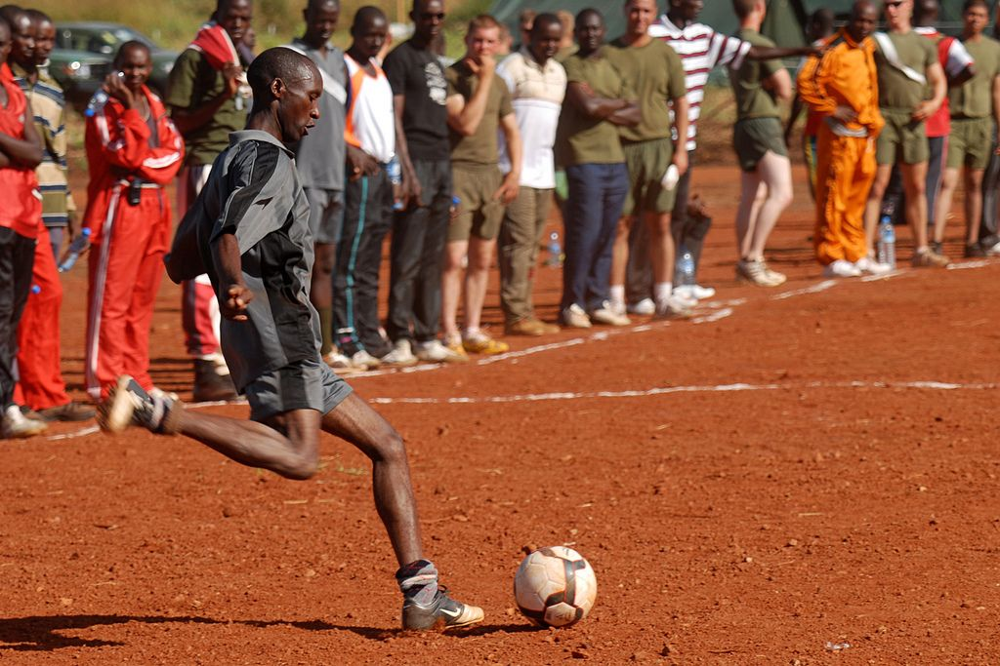
13. Ewald's hockey practice starts at 15:10 and ends at 16:30.
   1. How long was his hockey practice? (Give your answer in hours and minutes).
   3. If it takes him \(\text{40}\) minutes to get home from hockey, what time will he arrive at home? (Give your answer in the 12-hour format)

1. First add the hours: 07:00 + 2 hours = 9:00
   Then add the minutes:
   \(\text{45}\) minutes + \(\text{30}\) minutes  = \(\text{75}\) minutes
   \(\text{75}\) minutes  =  \(\text{60}\) minutes and \(\text{15}\) minutes = \(\text{1}\) hour and \(\text{15}\) minutes
   Calculate the total time elapsed:
   9:00  + \(\text{1}\) hour \(\text{15}\) minutes = 10:15
   So the bell will ring for break at 10:15.
3. 1. First add the the hours: 6:00 p.m. + 1 hour = 7:00 pm
      Then add the minutes: \(\text{0}\) minutes + \(\text{45}\) minutes = \(\text{45}\) minutes
      Calculate the total time that will elapse: 7:00 p.m. and \(\text{45}\) minutes = 7:45 p.m.
      So Palesa must leave at 7:45 p.m.
   3. To convert this to the 24-hour time format we simply **add** 12 hours to the time:
      7:45 p.m. + 12 hours = 19:45.
5. 1. First we break down \(\text{70}\) minutes into hours and minutes:
      We know that \(\text{60}\) minutes = \(\text{1}\) hour. \(\text{70}\) minutes - \(\text{60}\) minutes = \(\text{10}\) minutes, so the bus ride takes \(\text{1}\) hour and \(\text{10}\) minutes.
      Now we add the hours:
      14:30 + 1 hour = 15:30
      Next we add the minutes: 15:30 + 10 minutes = 15:40.
      So Mulalo will arrive home at 15:40
   3. To convert our answer to the 12-hour format we **subtract** 12 hours:
      15:40 - 12 hours = 3:40. We know that 15:40 is after midday, so Mulalo will arrive home at 3:40 p.m.
7. 7:45 to 8:10 is less than an hour. So in this case we only need to add the minutes it took Mark to get to work.
    7:45 + \(\text{15}\) minutes = 8:00
   8:00 + \(\text{10}\) minutes = 8:10
   \(\text{10}\) minutes + \(\text{15}\) minutes = \(\text{25}\) minutes
   So it took Mark \(\text{25}\) minutes to get to work.
9. 4:20 p.m. +  \(\text{1}\) hour = 5:20 p.m.
   5:20 p.m. + \(\text{20}\) minutes = 5:40 p.m.
   So Lebogang walked for \(\text{1}\) hour and \(\text{20}\) minutes.
11. 1. We need to add two values to get our answer here: the time it takes Russel to walk home and the time it takes him to finish his homework.
      First we add the time it took him to walk home after soccer practice:
      4:00 p.m. + \(\text{10}\) minutes = 4:10 p.m.
      Next we must add the time it took him to do his homework:
      We know that \(\text{60}\) minutes = \(\text{1}\) hour.
      \(\frac{\text{80}}{\text{60}} = \text{1,34}\) so \(\text{80}\) minutes is one hour plus some remainder of minutes.
      \(\text{80}\) minutes - \(\text{60}\) minutes = \(\text{20}\) minutes.
      So it takes Russel \(\text{1}\) hour and \(\text{20}\) minutes to do his homework.
      Now we add this to the time he got home:
      First we add the hours: 4:10 p.m. + \(\text{1}\) hour = 5:10 p.m.
      Then we add the minutes: 5:10 p.m. + \(\text{20}\) minutes = 5:30 p.m.
      So Russel finishes his homework at 5:30 p.m.
   3. To convert our answer to the 24-hour format we simply add 12 hours:
      5:30 p.m. + \(\text{12}\) hours = 17:30.
13. 1. 15:10 + \(\text{1}\) hour = 16:10.
      16:10 + \(\text{20}\) minutes = 16:30.
      \(\text{1}\) hour + \(\text{20}\) minutes = \(\text{1}\) hour and \(\text{20}\) minutes.
      So Ewald's hockey practice was \(\text{1}\) hour and \(\text{20}\) minutes long.
   3. We can divide the \(\text{40}\) minutes it takes Ewald to get home into \(\text{30}\) + \(\text{10}\) minutes to make it easier to add:
      16:30 + \(\text{30}\) minutes = 17:00
      17:00 + \(\text{10}\) minutes = 17:10
      So Ewald gets home at 17:10.
      To convert this to the 12-hour format we subtract 12 hours:
      17:10 - \(\text{12}\) hours = 5:10. We know that 17:10 is after midday so the converted time is 5:10 p.m.
</Callout>

## Calculating elapsed time

### Exercise 3.2

**Problem:**
Unathi's father goes to work at 8:00 a.m. He fetches her from school \(\text{7}\) hours and \(\text{30}\) minutes later. What time will he fetch Unathi? Give your answer in the 24-hour format.

**Solution:**
15:30

**Problem:**
Lauren finishes her music class at 15:30. It takes her \(\text{30}\) minutes to get home. She then does homework for \(\text{50}\) minutes. Lauren meets her friend \(\text{20}\) minutes after she finishes her homework. What time do they meet? Give your answer in the 12-hour format

**Solution:**
5:50 p.m.

Heather starts baking biscuits at 6:15 p.m. The biscuits must come out of the oven at 6:35 p.m. and need to cool for another \(\text{20}\) minutes before they can be eaten.

**Problem:**
How long will the biscuits be in the oven for?

**Solution:**
\(\text{20}\) minutes

**Problem:**
What time will they be ready to eat? (Give your answer in the 12-hour format)

**Solution:**
6:55 p.m.

**Problem:**
Alison's favourite TV show starts at 20:35. It is forty-five minutes long. What time will it finish?

**Solution:**
21:20

**Problem:**
If Alison watches the movie that follows her favourite show and it finishes at 10:50 p.m., how long was the movie (in hours and minutes)?

**Solution:**
\(\text{1}\) hour, \(\text{30}\) minutes

**Problem:**
Vinayak is meeting his brother for lunch at 13:15. He also wants to go to the shops before lunch. It will take him \(\text{20}\) minutes to get from the shops to the restaurant where he's meeting his brother. If he leaves home at 10:10 how much time does he have to do his shopping? Give your answer in hours and minutes.

**Solution:**
\(\text{2}\) hours, \(\text{45}\) minutes

### Calendars (EMG42)

Calendars are useful tools to help us keep track of events that are going to happen and to plan our lives accordingly. We can add information to them about important events and dates (like birthdays and school holidays) to a calendar, to help us remember what is happening when.  We can read off days, weeks and months on a calendar and do conversions between these units of time.

You may have come across one more time conversion that states that \(\text{4}\) weeks is approximately equal to one month. This is not correct. \(\text{4}\) weeks is equal to \(\text{28}\) days, and the months of the year (except February!) have \(\text{30}\) or \(\text{31}\) days in them. When working with calendars, be careful to count the right number of days in a particular month!

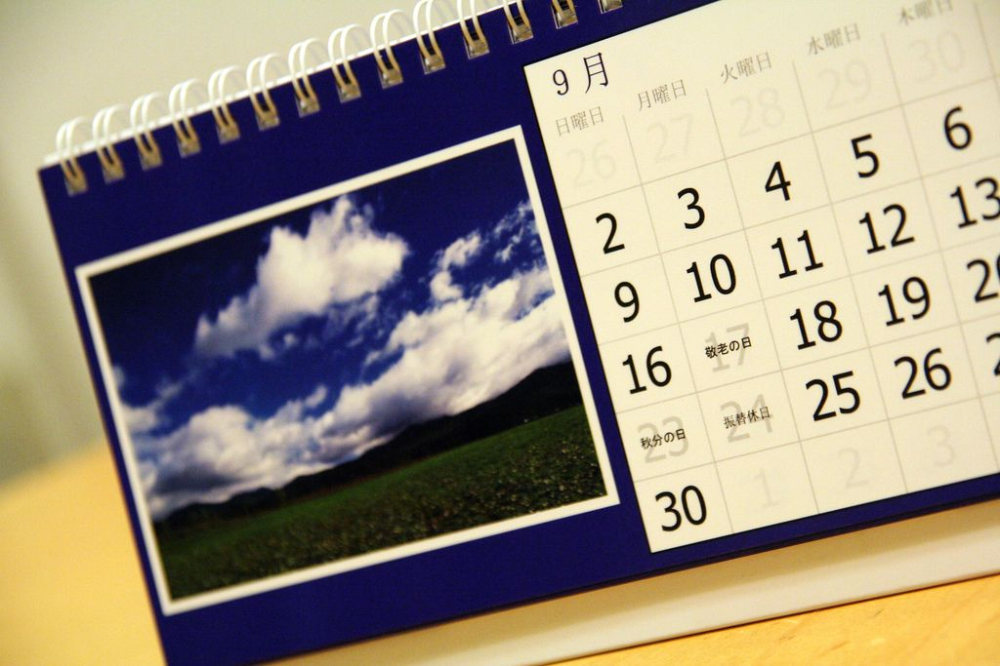

<Callout type="tip" title="Worked example 7: Using a calendar">
**Question:**
Jess's calendar for the month of May is given below. Study it carefully and answer the questions that follow:

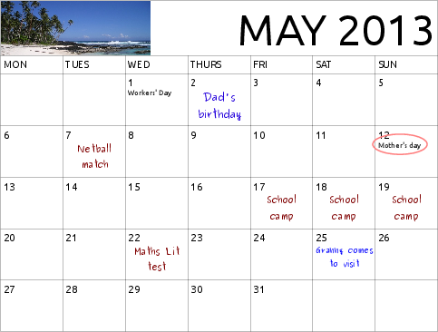

1. If it is Monday 6 May calculate how many days it is until:
   1. Mother's Day.
   3. Jess goes on her school camp.
   5. Jess's granny comes to visit.
3. If it is the 8 May:
   1. how many weeks does Jess have to study for her Maths Literacy test?
   3. How many days does she have to study for the test?
   5. How many weeks ago was her dad's birthday?
5. Will Jess go to school on 1 May? Give a reason for your answer.
7. Jess needs to buy a present for her mother for Mother's Day. If she has plans with friends on 11 May, by when should she have bought the present?
9. Jess is invited to a party on Saturday 18 May. Will she be able to attend?
11. Jess wants to bake a cake for her granny but has plans with a friend for the morning of 25 May.
   1. If her granny arrives in the evening of 25 May, when should Jess bake the cake?
   3. Given that she's busy on the morning of 25 May, when should Jess make time to buy the ingredients for the cake?

1. 1. \(\text{6}\) days
   3. \(\text{11}\) days
   5. \(\text{19}\) days
3. 1. \(\text{2}\) weeks
   3. \(\text{14}\) days
   5. \(\text{0}\) weeks ago - it was \(\text{6}\) days ago.
5. No. 1 May is Workers' Day which is a public holiday.
7. Jess should buy a present for her mother by Friday 10 May.
9. No. She will be away on her school camp.
11. 1. On the afternoon of Saturday 25 May.
   3. On or before Friday 24 May.
</Callout>

## Creating your own calendar

### Exercise 3.3

**Problem:**
You need to create a calendar (like the one in the previous worked example) for one month of the year. It should include the following:

- close relatives' birthdays (that happen in that month)
- any classmates' birthdays
- sports fixtures
- test and/or exam dates and times
- school functions or events.

**Solution:**
Learner-dependent answer

### Timetables (EMG43)

Timetables are similar to calendars in that they help us plan our time. Where calendars are useful for planning months and years, timetables are useful for planning shorter periods of time like hours, days and weeks. You may already be familiar with timetables like those for your different classes at school, and for TV shows. In this section we will learn how to read timetables and how to draw up our own.

<Callout type="tip" title="Worked example 8: Using a timetable">
**Question:**
Look at the timetable below and answer the following questions.

|  | SABC 1 | SABC 2 | SABC 3 | e-TV |
| --- | --- | --- | --- | --- |
| 5:30 p.m. | Siswati/Ndebele News | News | Days of Our Lives | It's My Biz |
| 6:00 p.m. | The Bold and the Beautiful | Leihlo La Sechaba |  | eNews Early Edition |
| 6:30 p.m. | Zone'd TV | 7de Laan | On The Couch | Rhythm City |
| 7:00 p.m. | Jika Majika | Nuus | News | eNews Prime Time |
| 7:30 p.m. | Xhosa News | American Idol | Isidingo | Scandal! |
| 8:00 p.m. | Generations |  | Welcome to The Parker | Mad About You |
| 8:30 p.m. | Shakespeare: uGugu No Andile | News |  | Panic Mechanic |
| 9:00 p.m. |  | Muvhango |  |  |

1. What is the difference in time between the English News at 5:30 p.m. and the English News at 8:30 p.m. (both on SABC 2)?
3. How long, in minutes, is American Idol?
5. If Zonke wants to watch Isidingo after dinner at 7:30 p.m., and she needs \(\text{90}\) minutes to cook and eat dinner, what time should she start cooking dinner?
7. Mandla wants to watch It's My Biz and Generations. He plans to do his homework in between the two shows. If he expects each subject's homework to take \(\text{30}\) minutes, how many subjects worth of homework will he be able to complete between the two shows?
9. Sipho wants to watch the news in English and in Afrikaans, at the same time. Would this be possible? Give a reason for your answer.
11. Why are the blocks on the timetable for SABC 3, blank for 8:30 p.m. and 9:00 p.m.? What do the blank blocks represent?
13. What is the **total** time period allocated to the News (in all languages) across all four TV channels?

1. \(\text{3}\) hours.
3. 7:30 to 8:30 p.m. = \(\text{1}\) hour = \(\text{60}\) minutes.
5. \(\text{90}\) minutes = \(\text{1}\) hour + \(\text{30}\) minutes
   7:30 p.m. - \(\text{1}\) hour = 6:30 p.m.
   6:30 p.m. - \(\text{30}\) minutes = 6:00 p.m.
7. It's My Biz finishes at 6:00 p.m. and Generations starts at 8:00 p.m. This gives Mandla \(\text{2}\) hours to do his homework.
   \(\text{2}\) hours = \(\text{120}\) minutes.
   \(\text{120}\) minutes \(\div\) \(\text{30}\) minutes = \(\text{4}\)
   So Mandla will be able to do homework for four subjects in between the two shows.
9. Yes, there is the English News on SABC 3 at 7:00 p.m. and on SABC 2 there is the Afrikaans Nuus at that same time. However, he cannot watch two channels at the same time. He would need to choose a channel to watch.
11. They are blank because the program “Welcome to the Parker” is still showing.
13. There are \(\text{8}\) sets of news slots appearing on the timetable. Each slot is \(\text{30}\) minutes. Therefore, a total of \(\text{4}\) hours of news will be shown between 5:30 p.m. and 9:00 p.m. on four channels.
</Callout>

## Writing up a timetable

### Exercise 3.4

**Problem:**
Sipho and Mpho are brothers. Their parents require them to do household chores every day. These chores need to fit into their school sports and homework timetables.

Using the information provided in the table below, construct a timetable for each brother for **one** day of the week.

The two brothers' timetables need to be clearly laid out and easy to read.

| SIPHO | MPHO |
| --- | --- |
| Soccer practice 15:30 - 16:30 | Piano lesson (\(\text{1}\) hour) |
| Feed the dogs | Walk the dogs for a minimum of \(\text{30}\) minutes |
| Do the dishes | Study for his Maths test - \(\text{45}\) minutes |
| Complete his Life Orientation task - \(\text{45}\) minutes | Set (and clear) the table before and after dinner |
| Watch the news at 19:00 for his history assignment | Look through the newspaper for any information on natural disasters for his geography homework. |

**Solution:**
Learner-dependent answer but an example:

**Sipho:**

| Time | Event |
| --- | --- |
| 15:30 -16:30 | Soccer practice |
| 18:00 | Feed dogs |
| 19:00 | Watch news for history assignment |
| 19:30 - 20:15 | Complete LO task |
| 20:15 | Do dishes |

**Mpho:**

| Time | Event |
| --- | --- |
| 15:30 -16:30 | Piano lesson |
| 17:00- 17:30 | Walk dogs |
| 18:00 | Set table for dinner |
| 19:00 | Clear table for dinner |
| 19:15 - 19:45 | Look through newspapers for geography homework |
| 19:45 - 20:30 | Study for Maths Lit test |
