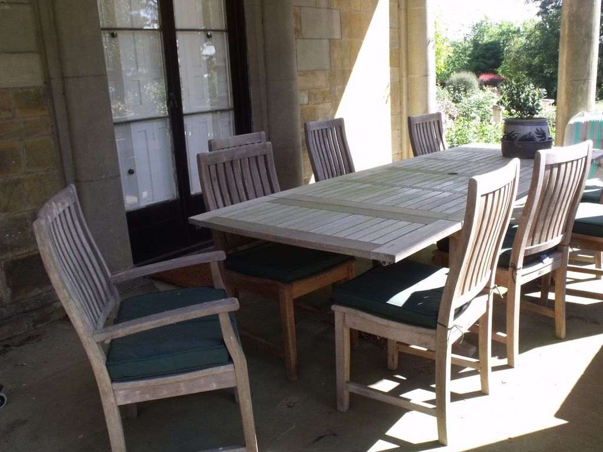
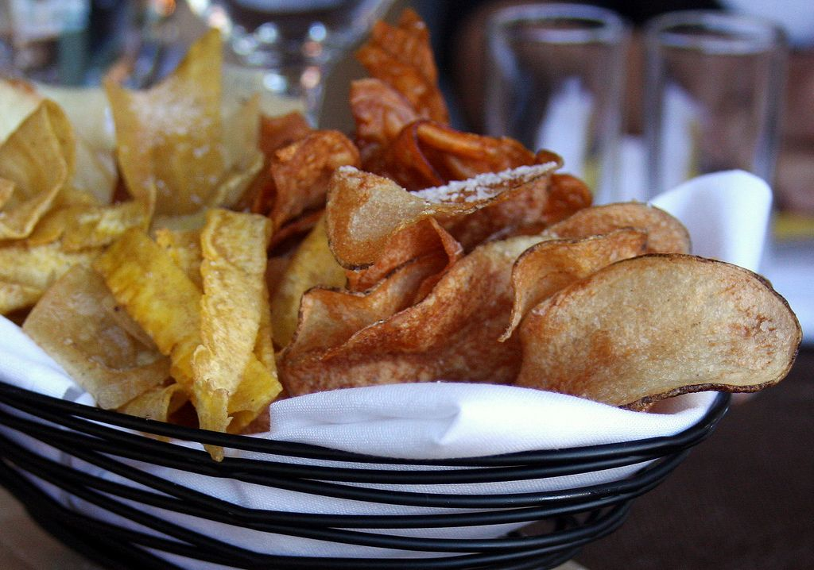
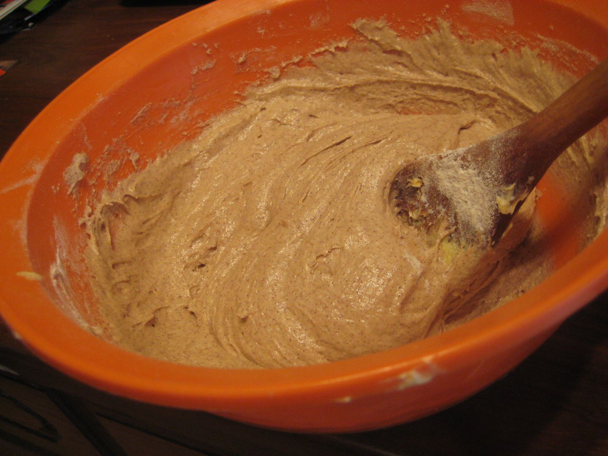
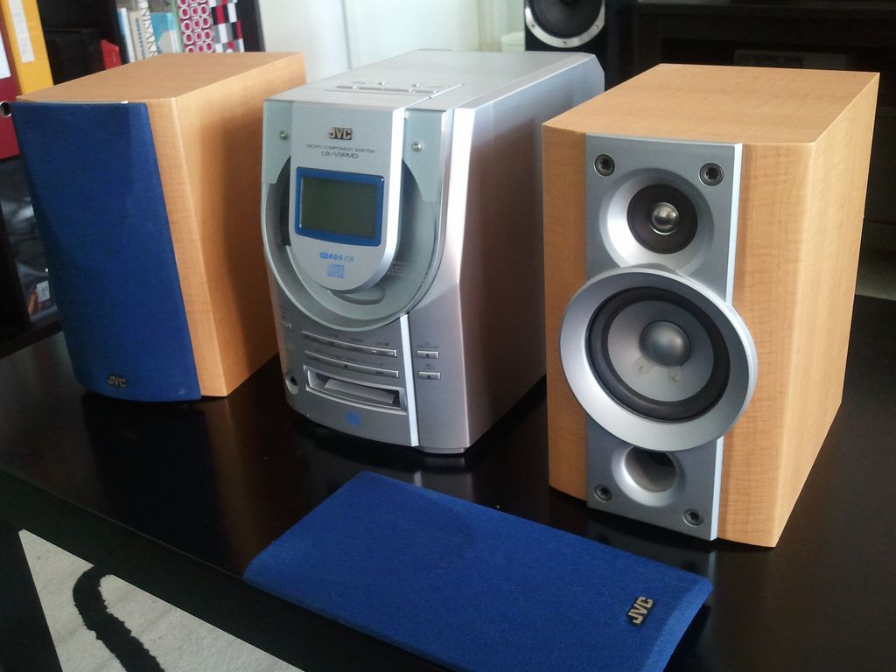
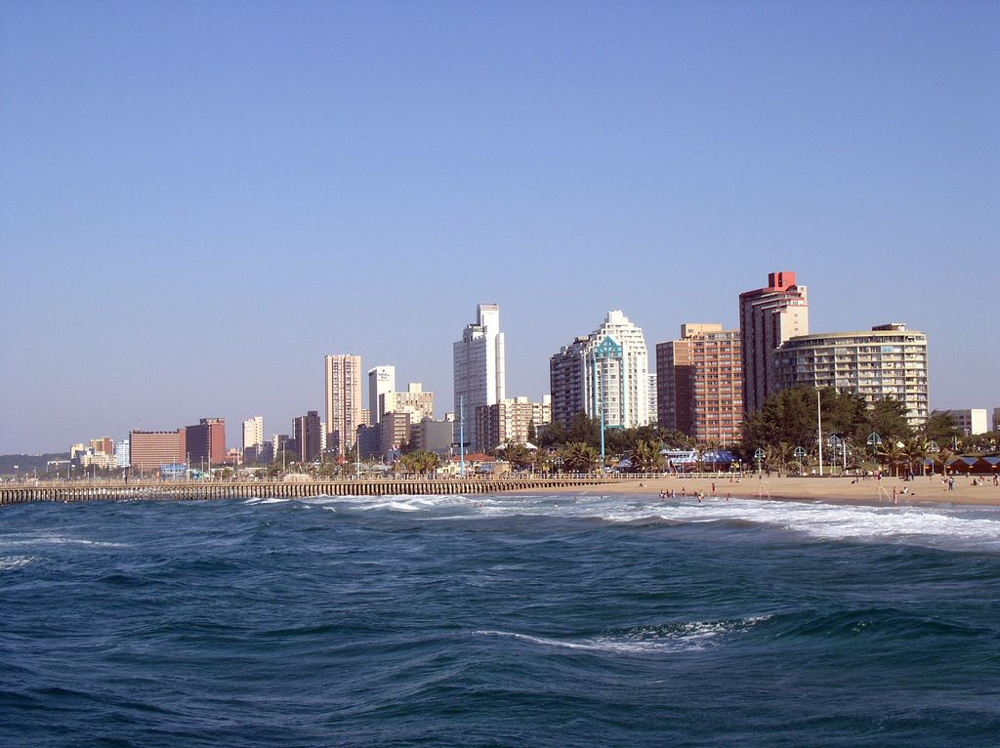

### Exercise 3.5

Thobeka is planning an end of term party for her classmates on a Saturday afternoon, and needs help with her measurement conversions and time management. Answer the questions that follow, and don't forget to show your working out.

Thobeka has a large table that she wants to use for drinks and snacks. She measures the table to be \(\text{164}\) \(\text{cm}\) wide.

**Problem:**
Convert the width of the table into metres.

**Solution:**
\(\text{1,64}\) \(\text{m}\)

**Problem:**
If she has a tablecloth that is \(\text{1 500}\) \(\text{mm}\) wide, will it fit over the table? If not, by how many cm will it be too short?

**Solution:**
\(\text{1 500}\) \(\text{mm}\) = \(\text{1,5}\) \(\text{m}\). The table is \(\text{1,64}\) \(\text{m}\) wide, so the table cloth will be \(\text{14}\) \(\text{cm}\) too short.

**Problem:**
Thobeka has chairs that are \(\text{0,4}\) \(\text{m}\) wide. How many chairs can she fit along one side of the table?

**Solution:**
\(\text{1 500}\) \(\text{mm}\) = \(\text{150}\) \(\text{cm}\). \(\text{150}\text{ cm}  \div \text{40} = \text{3,75}\) chairs. She can't have \(\text{0,75}\) of a chair, so she can fit \(\text{3}\) chairs along one side of the table.

Thobeka wants to make party packets for her friends, and decides to tie them closed with pieces of ribbon. Each bag needs \(\text{100}\) \(\text{mm}\) of ribbon.

**Problem:**
How many centimetres of ribbon does each bag require?

**Solution:**
\(\text{100}\) \(\text{mm}\) = \(\text{10}\) \(\text{cm}\)

**Problem:**
If Thobeka needs to tie \(\text{25}\) bags, how much ribbon will she need in total, in centimetres?

**Solution:**
\(\text{10}\) \(\text{cm}\) \(\times \text{25}\) bags = \(\text{250}\) \(\text{cm}\) Ribbon costs \(\text{R}\,\text{7,50}\) per metre and is only sold in full metres (not half metres).

**Problem:**
How many metres of ribbon will Thobeka need to buy?

**Solution:**
She will have to buy \(\text{3}\) metres.

**Problem:**
How much will it cost?

**Solution:**
\(\text{3}\) \(\times\) \(\text{R}\,\text{7,50}\) = \(\text{R}\,\text{22,50}\)

Thobeka is going to buy snacks, including chips and biscuits, for her friends.

**Problem:**
Each packet of chips weighs \(\text{50}\) \(\text{g}\). How much is this in kg?

**Solution:**
\(\text{50}\) \(\text{g}\) = \(\text{0,05}\) \(\text{kg}\)

**Problem:**
If each packet of chips weighs \(\text{50}\) \(\text{g}\) and she wants to buy \(\text{1}\) \(\text{kg}\) of chips in total, how many packets will she have to buy?

**Solution:**
\(\text{1 000}\) \(\text{g}\) \(\div\) \(\text{50}\) \(\text{g}\) = \(\text{20}\) packets

**Problem:**
Thobeka buys \(\text{1}\) \(\text{kg}\) of chips and \(\text{400}\) \(\text{g}\) of biscuits. What is the ratio of the weight of chips to the weight of biscuits? Write the ratio in its simplest form.

**Solution:**
\(\text{1 000}\) \(\text{g}\) chips : \(\text{400}\) \(\text{g}\) biscuits = \(\text{5}\) : \(\text{2}\).

**Problem:**
Thobeka asks each of her friends to bring a bag of sweets. If each friend brings a \(\text{500}\) \(\text{g}\) bag and \(\text{20}\) friends arrive, how many kilograms of sweets will there be in total?

**Solution:**
\(\text{20}\) \(\times\) \(\text{500}\) \(\text{g}\) = \(\text{10 000}\) \(\text{g}\) = \(\text{10}\) \(\text{kg}\)

Thobeka is also planning to make orange juice using orange concentrate and water. According to the concentrate bottle, she needs to mix \(\text{1}\) part concentrate with \(\text{10}\) parts water.

**Problem:**
What is the ratio of juice to water that Thobeka needs to mix?

**Solution:**
\(\text{1}\):\(\text{10}\)

**Problem:**
If she uses \(\text{300}\) \(\text{ml}\) of concentrate, how much water must she add to dilute it? (in ml)

**Solution:**
\(\text{3 000}\) \(\text{ml}\)

**Problem:**
How much juice will she have in total (concentrate + water), in litres?

**Solution:**
\(\text{3 300}\) \(\text{ml}\)

**Problem:**
If each paper cup at the party can hold \(\text{200}\) \(\text{ml}\), how many cups of juice will Thobeka be able to fill completely?

**Solution:**
\(\text{3 300}\)\(\div\) \(\text{200}\) = \(\text{16,5}\). So she will be able to fill \(\text{16}\) cups.

**Problem:**
If Thobeka mixes \(\text{400}\) \(\text{ml}\) of concentrate, and \(\text{4}\) \(\ell\) of water, so that the total volume of juice is \(\text{4,4}\) \(\ell\) of juice, what percentage of the juice is concentrate?

**Solution:**
\(\dfrac{\text{400} \text{ ml concentrate}}{\text{4 400} \text{ ml mixture}} = \text{0,09}\). \(\text{0,09} \times \text{100} = \text{9}\%\).

In addition to chips, biscuits and sweets Thobeka also wants to bake a cake.

**Problem:**
According to the recipe she has, Thobeka needs \(\text{4}\) cups of flour for one cake. If she wants to bake \(\text{3}\) cakes, how much flour does she need (in ml)? (\(\text{1}\) cup = \(\text{250}\) \(\text{ml}\))

**Solution:**
\(\text{12}\) cups = \(\text{3 000}\) \(\text{ml}\)

**Problem:**
The recipe also calls for \(\text{25}\) \(\text{ml}\) of milk. How much milk does Thobeka need, in tablespoons and teaspoons? (\(\text{1}\) tbsp = \(\text{15}\) \(\text{ml}\) and \(\text{1}\) tsp = \(\text{5}\) \(\text{ml}\))

**Solution:**
\(\text{1}\) tbsp and \(\text{2}\) tsp

**Problem:**
Before each cake goes into the oven, Thobeka measures the amount of wet cake mixture to be \(\text{4}\) litres. How many cups of cake mixture is this if \(\text{1}\) cup = \(\text{250}\) \(\text{ml}\)?

**Solution:**
\(\text{4 000}\) \(\text{ml}\) \(\div\) \(\text{250}\) \(\text{ml}\) = \(\text{8}\) cups of cake mixture

On the invitations, Thobeka tells her friends to arrive at 2:00 p.m.

**Problem:**
She thinks she needs at least \(\text{1}\) hour and \(\text{20}\) minutes to set up the tables, chairs, food and drink. What time should she start setting up to be ready for guests?

**Solution:**
12:40 p.m.

**Problem:**
Thobeka needs to bake her cakes before she sets up. If the cakes will take \(\text{2}\) hours and \(\text{15}\) minutes (in total) to make, what time should she start baking? Write your answer in the 24-hour format.

**Solution:**
10:25

**Problem:**
Thobeka has asked her friends to bring music on CD's. She has \(\text{3}\) albums she wants to play that are \(\text{45}\) minutes, \(\text{50}\) minutes and \(\text{67}\) minutes long. If she plays her \(\text{3}\) albums back-to-back, how long will the music play for? Give your answer in hours and minutes.

**Solution:**
\(\text{45}\) + \(\text{50}\) + \(\text{67}\) minutes = \(\text{162}\) minutes = \(\text{2}\) hours, \(\text{42}\) minutes

**Problem:**
Thobeka decides she needs to be organised in her party planning and wants to make a timetable, to carefully plan her day and make sure she gets everything ready in time. She has some free time the night before the party and time in the morning, on the day of the party.

She draws up the following list and estimates how long everything will take:

- Sweep floors (\(\text{1}\) hour, \(\text{15}\) mins)
- Set up table and chairs (\(\text{15}\) minutes)
- Make party packs (\(\text{1}\) hour \(\text{40}\) minutes)
- Bake cakes (\(\text{45}\) minutes to prepare, \(\text{1}\) hour \(\text{30}\) minutes to bake in oven)
- Get dressed (\(\text{10}\) minutes)
- Wash dishes (\(\text{20}\) minutes)

She also really wants to watch a movie on TV the night before the party, that starts at 8:30 p.m. Bearing this in mind, and the fact that she needs \(\text{8}\) hours of sleep, draw up a timetable for Thobeka that includes all the things she has to do. Remember, some things she may be able to do at the same time - for example, do the dishes while the cakes are baking in the oven. Also, some things should be done before others (there is little point sweeping the floor before she bakes the cakes, because she may spill flour, for example!)

**Solution:**
Learner-dependent answer.

Thobeka has made the calendar below for the month of September. Answer the questions that follow:

**Problem:**
Given that Thobeka wants her party to be an end of term celebration, what would be the best date to have it? (Remember, she wants the party to be on a Saturday).

**Solution:**
Saturday 21 September.

**Problem:**
How many days after Thobeka's birthday would this be?

**Solution:**
\(\text{9}\) days

**Problem:**
How many days after her Maths Lit exam would it be?

**Solution:**
\(\text{4}\) days

**Problem:**
If she changed her mind and decided she wanted the party to rather be a birthday celebration, when should she have it? (Remember, she wants to have it on a Saturday afternoon).

**Solution:**
Saturday 14 September.

Thobeka decides to study \(\text{2}\) hours every day for her Maths Lit exam, and wants to study for a total of \(\text{9}\) hours for the exam.

**Problem:**
How many days before the exam should she start her studies?

**Solution:**
\(\text{9}\) hours \(\div\) \(\text{2}\) = \(\text{4,5}\) days. She should start studying \(\text{5}\) days before the exam.

**Problem:**
How many minutes in total is she planning to study?

**Solution:**
\(\text{9}\) hours = \(\text{540}\) minutes.

**Problem:**
Is Thobeka likely to be directly affected by the public holiday on the 24th September? Explain your answer.

**Solution:**
No - she will be on holiday.

Thobeka is going to Durban for part of her school holidays.

**Problem:**
For how many days will she be away from home?

**Solution:**
\(\text{5}\) days

**Problem:**
For how many hours will she be away from home?

**Solution:**
\(\text{120}\) hours (depending on what time she leaves and comes back!)

Thobeka lives in the Northern Cape and decides to take the train to Durban. The journey will take \(\text{37}\) hours in total.

**Problem:**
How long will the train trip take in days and hours?

**Solution:**
\(\text{1}\) day and \(\text{13}\) hours

**Problem:**
If Thobeka is planning to leave for Durban at 08:00 on Monday 23 September, on what date and at what time will she get to Durban?

**Solution:**
Tuesday 24 September at 21:00.
