## 4.2 Financial documents (EMG46)

### Household bills (EMG47)

Household bills include municipal bills for electricity and water, telephone bills and shopping documents like till slips and account statements. You will receive a bill when you have used a service or utility (like electricity or a phone line) or made purchases using a store or credit card, which will require monthly payments on the outstanding balance. You will learn more about buying items on credit later in this chapter.

BillA document detailing what items or services you have bought, how much you paid for them or the amount you still need to pay. Bills can also be called invoices or account statements, depending on what information they provide.

Some stores allow you to have a store account. You can then buy items “on your account”, without having to pay cash for them at the time. You will receive an account statement once a month, detailing what you bought, what you paid into the account (called credit) and what you still owe. Municipal bills work in much the same way - you use the services before you pay for them, and receive a monthly account detailing all your usage and the associated costs.

CreditMoney paid into an account.DebitMoney paid from an account.DebtMoney owed.

#### Municipal bills

Many houses in South Africa have access to electricity, water and waste disposal (rubbish removal). These utilities and services are provided by the local government (municipality) and each household has to pay a monthly amount, depending on how much electricity and water was used. In this section we will look at municipal electricity and water bills.

The City of Johannesburg provided its residents with the following example of a municipal invoice, to explain to people how to read their municipal bills. Whilst no two municipalities send out identical bills, the kind of information provided in the document is usually very similar.

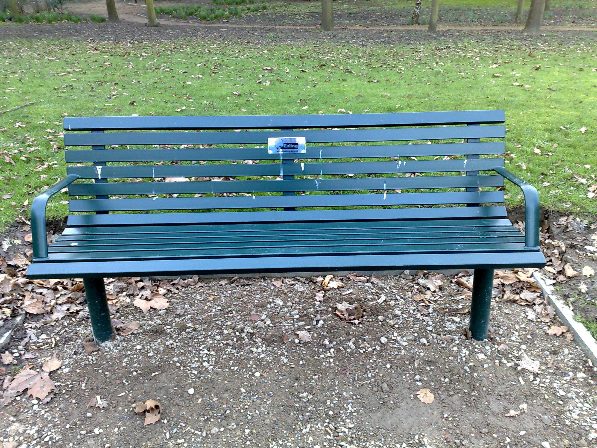

Joburg municipal bill, Page 1

As you can see from the above document (the first page of the bill), there are several important pieces of information included in this bill.

1. This box gives the name of the property owner and the address.  This address  is often the same as the address to which the services and utilities are being delivered, though in some cases people may have their bills posted to a Post Office box instead.
3. gives us information about the size and estimated value of the property. (Stand size, number of dwellings, date of valuation and municipal valuation). Basic municipal rates depend on the size of your property and often the area in which you live too. A large house (and garden) in an expensive suburb will usually pay more expensive rates than a small house in a less wealthy suburb.
5. shows us the number of this invoice. If you phone the municipality to query an invoice, they may ask you for this invoice number to find your details on their system.
7. is the account number. This is a unique number assigned to each and every person who has a municipal account. This can also be used as a reference number if you need to contact the municipality.
9. are the contact details for the municipality. You should use these if you have queries or problems with your bill.
11. shows the Value Added Tax (V.A.T) numbers of the different municipal departments that have provided services to you. In Grade 10 we don't need to work with these, it is only necessary to know that they are numbers assigned to companies and businesses for tax reasons.
13. shows the date on which the invoice was issued.
15. is a special number that you can use when paying your bill at an EasyPay pay-point. These are special machines found around the city of Joburg that allow you to pay your bill electronically.
17. are the banking details for the municipality. You will use these if you pay your bills at the bank instead of at an EasyPay pay-point.
19. shows the total amount due and the date by which it must be paid.
21. is a special code that you can use to access your account on the internet.

The second page of the bill looks as follows:

Joburg municipal bill, Page 2

1. shows you what your basic municipal rates will cost for the month. As mentioned already, these are determined by the size, location and value of your property and house.
3. details how much you owe for electricity for the month.
5. shows how much you owe for water and sanitation (sewerage) for the month.
7. shows how much you owe for rubbish collection for the month.
9. lists any additional charges added to your bill. This section includes a Value Added Tax (VAT) charge of \(\text{14}\%\) on the total amount owed.
11. shows you the total amount of money due for all of your municipal services combined.

Value Added Tax (VAT)Value Added Tax is a fixed, extra cost that is added automatically to the cost of most items and services in South Africa. it is calculated as \(\text{14}\%\) of the total amount owed. We will study VAT in greater detail in Chapter 11.

Not all municipalities bundle together electricity, water and refuse charges in one account. It differs from one city to the next, but in some places you may get two separate bills - one for electricity and another for water and refuse, for example.

Also, invoices from different municipalities or companies will look different, and may use different terms to describe the same thing. You need to know a few more definitions before we move on to worked examples about municipal bills:

Opening balanceThe opening balance is the amount due on the account before the current month's expenses have been added. this often includes the balance brought forward from a previous invoice, if the last bill was not paid.Closing balanceThe closing balance is the total amount due after all the current month's expenses have been added together. this may or may not include vat or other extra charges.

<Callout type="tip" title="Worked example 1: Understanding a municipal invoice">
**Question:**
Look at the municipal bill below and answer the questions that follow:

1. Mrs Gwayi received the above municipal invoice for electricity and refuse.
   1. What is her address (including the city that she lives in)?
   3. What is her account number?
   5. At which four stores or outlets can she pay this invoice?
   7. If Mrs Gwayi wants to query this bill, what number should she phone?
3. 1. According to the bill, when last did Mrs Gwayi make a payment to the municipality?
   3. How much was her last payment?
   5. If Mrs Gwayi receives the invoice on 10 September 2013,
      1. what is the minimum amount that she needs to pay immediately?
      3. what additional amount must she pay before 19 September?
   7. If Mrs Gwayi wants to pay her invoice in full, what is the total amount she owes?
5. Why do you think the amount due, if paying with cash, differs from the amount if not paying with cash?
7. The  total amount due (total liability) includes \(\text{14}\%\) VAT but that percentage is not listed separately on this invoice. Calculate what \(\text{14}\%\) of the total amount due is (round your answer to \(\text{2}\) decimal places).

1. 1. 145 Gordon Ave, Mowbray, Cape Town, 7853
   3. 634812459
   5. Absa, Checkers, Shoprite and the Post Office
   7. 086 010 3089
3. 1. 29/07/2013
   3. \(\text{R}\,\text{349,63}\)
   5. 1. \(\text{R}\,\text{1 683,00}\)
      3. \(\text{R}\,\text{393,72}\)
   7. \(\text{R}\,\text{2 076,72}\)
5. The total amount includes \(\text{2}\) cents, but we no longer use 2c coins in South Africa, so, when paying with cash, the amount is rounded down to exclude the \(\text{R}\,\text{0,02}\). Notice that the rounded down amount is not discarded - it is carried forward to the next invoice.
7. Total amount = \(\text{R}\,\text{2 076,72}\)
   \(\text{14}\%\) of \(\text{2 076,72}\) = \(\text{2 076,72} \times \frac{\text{14}}{\text{100}}\)
   = \(\text{R}\,\text{290,7408}\)
   = \(\text{R}\,\text{290,74}\)
   So the included VAT is \(\text{R}\,\text{290,74}\).
</Callout>

In South Africa we get metered electricity and pre-paid electricity.

With metered electricity, you use first and pay later. The amount of electricity you use in a month is counted by an electricity meter - a special box that may be inside your house or outside on the property, that adds up all the units of electricity you use. Once a month a meter reader from the municipality will come to the house and read your meter and make a note of how much electricity you have used. This reading then gets uploaded to the system and you receive a bill for the electricity you used in that month.

Electricity meters outside a building

With pre-paid electricity, you pay first and use later. Much like cellphone airtime, you buy electricity vouchers (usually from your local shop) which you can then load into a special pre-paid meter at home. The pre-paid meter counts downwards, and shows you how many units worth of electricity you have left to use. No one from the municipality needs to read the meter, and you will not receive accounts because you have already paid for the electricity you have used. Pre-paid electricity is usually cheaper, per unit, than normal electricity. Buying it in advance can also make it easier to plan how much electricity you're going to use in a month, and how much you can afford to spend. However, it can be frustrating if you forget to buy a new voucher and you run out of electricity in the middle of cooking dinner!

Before you do the next worked example you need to know that electricity is measured in units called kilowatt hours (kWh), and it is charged for using set rates, or tariffs, in Rands per kWh. we shall study tariffs later in this chapter. In the meantime, you just need to understand that generally, the more electricity you use, the more expensive it becomes, per unit.

<Callout type="tip" title="Worked example 2: Understanding an electricity account">
**Question:**
Mr du Plessis gets the account below for his electricity consumption over \(\text{2}\) months. He has three electricity meters on his property (let's assume there are two small houses and a flat on the premises) and they are billed for together. Study his invoice and answer the questions that follow.

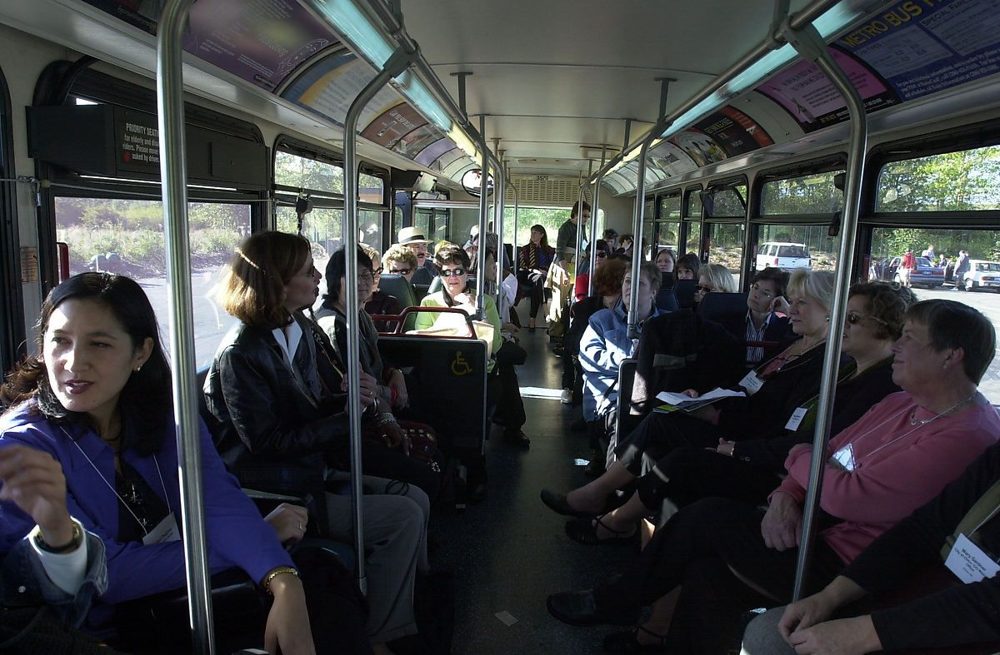

1. 1. Mr du Plessis has his electricity bill delivered to his postal (P.O. Box) address. What is the address of the property for which this electricity bill was issued?
   3. What is the total amount due?
   5. What does “billing period” mean and how long is it in this case?
   7. When last did Mr du Plessis pay his electricity account and how much did he pay?
   9. Why is the amount for “Payment(s) Received” negative (\(-\)\(\text{R}\,\text{2 520,25}\))?
   11. What do you think “Balance brought forward” means?
3. The consumption levels for the first two meters listed (meter numbers 356413 and 382471) are fairly similar - they are both close to \(\text{3 000}\) kWh. The consumption level for the third meter (number 382709) is much lower, however.
   1. Why do you think this is so?
   3. Give examples of factors that might increase a household's electricity consumption.
5. The graph in the bottom left corner of the invoice shows the meter readings for Mr du Plessis' electricity consumption over the previous \(\text{12}\) months.
   1. What do you think the letters under the horizontal axis mean? Is there anything unusual about their order?
   3. What does the spiky shape of the graph indicate? Give a possible reason for why the consumption (in kWh) is high for some months and at zero for others?
   5. Can you see a pattern between the high points (spikes) on the graph and the number of months that has passed? What does this pattern suggest about how often Mr du Plessis' meter is read?

1. 1. 128 Oak Street
   3. \(\text{R}\,\text{4 963,42}\)
   5. The billing period is a specific number of days or months covered by the invoice in question. The standard billing period is one month, in this case it is \(\text{61}\) days - in other words, this invoice includes electricity consumption for the \(\text{61}\) days before the billing date.
   7. His last payment was on 2012-06-27, for \(\text{R}\,\text{2 520,25}\)
   9. The amount is negative to indicate that \(\text{R}\,\text{2 520,25}\) was subtracted from what Mr du Plessis owed. (This payment is called a credit - it is money being paid into the account.)
   11. “Balance brought forward” is the amount of money from the previous invoice that must still be paid, or is outstanding. In this invoice, the amount still outstanding was due to be paid by 2012-07-14, and Mr du Plessis paid it in full on 2012-06-27.
3. 1. If the third meter is for a small flat on the property, for example, then the consumption will be lower because there will be fewer lights and plugs.
   3. One major factor that affects how much electricity people use is the weather. In winter for example, people use more lighting (because it gets dark earlier), heaters, electric blankets and appliances like tumble dryers.
5. 1. The letters under the graph stand for the months of the year. They are not in the usual order (J (January), F (February), M, A etc) but are arranged in the order of the last \(\text{12}\) months, starting \(\text{12}\) months ago and ending with the most recent month (J (July), A (August), S (September) to J (June)).
   3. The large spikes indicate when the meter reading for consumption was high, and the flat segments of the graph indicate that it was at \(\text{0}\) kWh. It is unlikely that Mr du Plessis used no electricity in the months when the meter reading was zero - it is more likely that the meter was not read at all (for example, if no one was home when the meter reader arrived) in those months, and so consumption was entered into the system as being \(\text{0}\) kWh.
   5. Initially, the peaks in the graph occur once every three months (July, October, January, April). Then the graph changes and there are non-zero readings for April and May; no reading for June and again a reading for July. So, from July 2011 to April 2012, the meter was read once every 3 months. Then it was read for 2 consecutive months (April and May), and then again two months later.
</Callout>

## Understanding a municipal bill

### Exercise 4.1

Mr Mukondwa receives the following municipal bill. Study the document and answer the questions that follow.

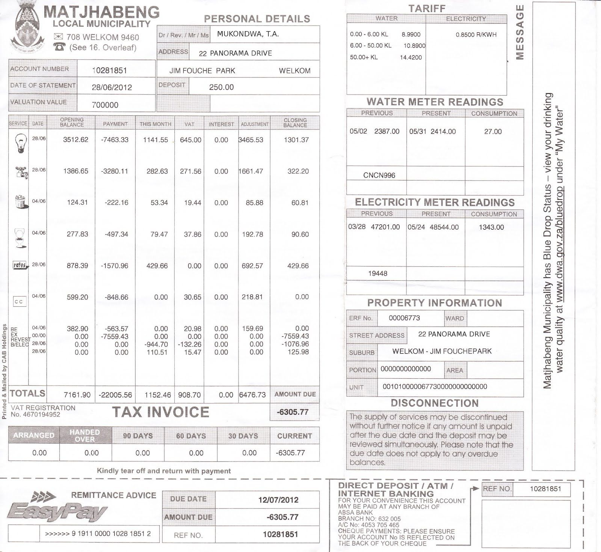

**Problem:**
Name three kinds of services included in this invoice.

**Solution:**
Electricity, water, refuse sewerage, municipal rates

**Problem:**
Which service used costs the most on this invoice?

**Solution:**
electricity

**Problem:**
Name two different ways in which this invoice can be paid.

**Solution:**
EasyPay, direct deposit, ATM, Internet banking

**Problem:**
When is payment for this invoice due?

**Solution:**
12/07/2012

**Problem:**
What may happen if the invoice is not paid on time?

**Solution:**
The services may be disconnected.

**Problem:**
What is the total amount due?

**Solution:**
\(-\)\(\text{R}\,\text{6 305,77}\)

**Problem:**
Why is this a negative number?

**Solution:**
Because Mr Mukondwa has already paid more money into the account (credit) than he owed, so he is \(\text{R}\,\text{6 305,77}\) in credit.

**Problem:**
Is there any amount brought forward from the last invoice?

**Solution:**
No. There are no outstanding amounts listed for the previous \(\text{30}\), \(\text{60}\) or\(\text{90}\) days.

Water consumption is typically measured in kilolitres (kl).

**Problem:**
What is the consumption level of water on this invoice?

**Solution:**
\(\text{27}\) \(\text{kl}\).

**Problem:**
How much is this in litres?

**Solution:**
\(\text{27 000}\) \(\ell\).

Mr Mukondwa thinks that the closing balance for his electricity consumption is much higher than normal.

**Problem:**
What does this suggest?

**Solution:**
Either he used much more electricity than usual, or there was a mistake with his electricity meter reading.

**Problem:**
How many units of electricity were consumed in the previous month?

**Solution:**
\(\text{1 343,00}\) kWh

**Problem:**
Can Mr Mukondwa verify this in any way? Explain your answer.

**Solution:**
Yes. He can check the meter himself and see if the reading corresponds to the reading the municipality took.

**Problem:**
What should Mr Mukondwa do if he thinks the latest meter reading for his electricity is incorrect?

**Solution:**
He should call the municipality and query the bill.

#### Telephone bills

If your household has a fixed phone line or 'landline' (like those provided by Telkom and Neotel) or you have a cellphone on a contract (not “Pay-as-you-go”) you will receive monthly bills for these services that are much like the electricity and water bills we have just looked at.

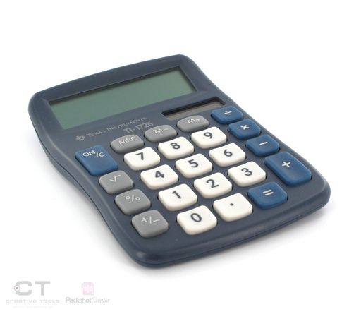

It is also possible to have a prepaid landline. To use a prepaid landline, you simply buy a voucher and load the airtime onto your account, much like a prepaid cellphone account. Prepaid landlines are advantageous for people who don't have a credit record, or have a bad credit record, because you don't need a credit history or proof of employment and bank statements to have a prepaid fixed line. (A credit record shows how good you are about paying back money that you owe. If you are in debt and don't pay your bills, you will have a bad credit record.)

With phone bills for fixed lines, you are usually charged one fixed amount for rental of the phone line, and then for any calls you made. Call costs also vary depending on where you phone, as we shall see later in this chapter.

<Callout type="tip" title="Worked example 3: Understanding a fixed telephone line bill">
**Question:**
Look at the Telkom bill provided below and answer the questions that follow:

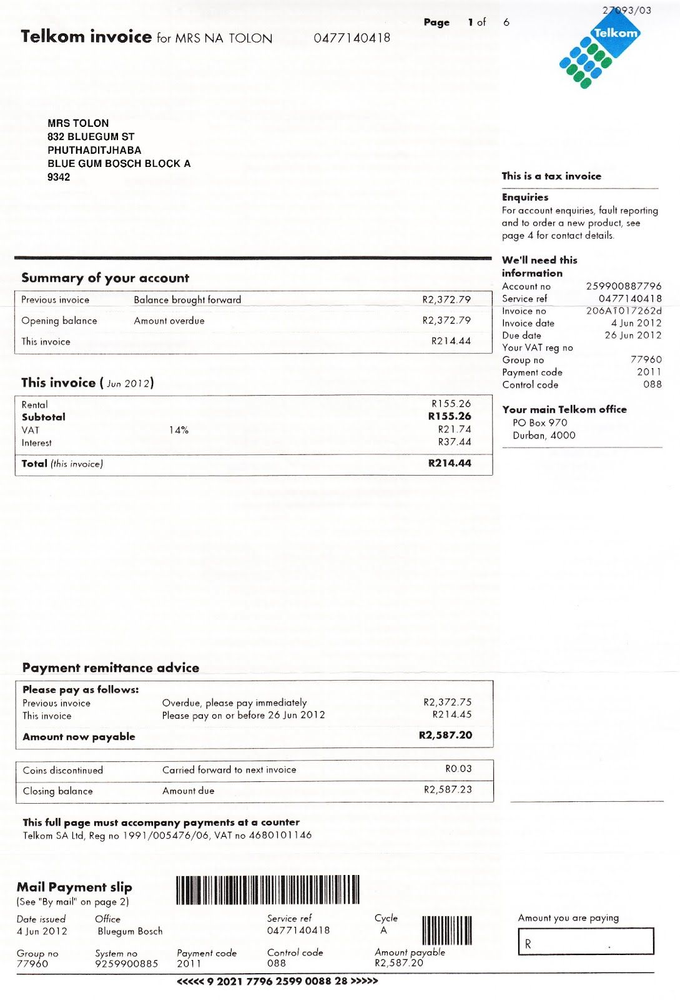

1. How much did Mrs Tolon owe Telkom before this bill arrived?
3. How much does she owe for this invoice alone?
5. For what month is this invoice?
7. What amount must be paid immediately and why do you think this differs slightly from the opening balance?
9. What is total amount now payable?
11. What is the closing balance, and why does it differ slightly from the total amount now payable?
13. Name two options for where or how this invoice can be paid.
15. Where is Mrs Tolon's *nearest* Telkom Office?
17. What is Mrs Tolon's landline phone number? What does Telkom refer to this number as?
19. If Mrs Tolon wants to contact Telkom to query this invoice, name two pieces of information she can use as a reference.

1. The opening balance or balance brought forward is \(\text{R}\,\text{2 372,79}\)
3. \(\text{R}\,\text{214,44}\)
5. June 2012.
7. \(\text{R}\,\text{2 372,75}\). This is \(\text{R}\,\text{0,04}\) less than the opening balance - the amount has been rounded down to the nearest value payable with a 5c coin, because we no longer use 2c or 1c coins in South Africa.
9. \(\text{R}\,\text{2 587,20}\)
11. \(\text{R}\,\text{2 587,23}\). This is \(\text{3}\) cents more than the amount now payable. The amount now payable has also been rounded down to the nearest multiple of \(\text{5}\) cents.
13. Mrs Tolon can pay the invoice at a Telkom counter or by posting a cheque in the mail.
15. The Bluegum Bosch Telkom branch.
17. Her phone number is 047 714 0418. Telkom calls this the “service ref” which means “service reference”
19. She can use her phone number or her account number.
</Callout>

Different cellular providers in South Africa (like MTN, Vodacom, Cell C, 8ta and Virgin Mobile) offer different packages. You can have a contract with them, where you pay a monthly subscription and then pay for your calls and messages at the end of the month; or you can buy prepaid airtime upfront and then have the cost of your calls and messages deducted from that airtime.

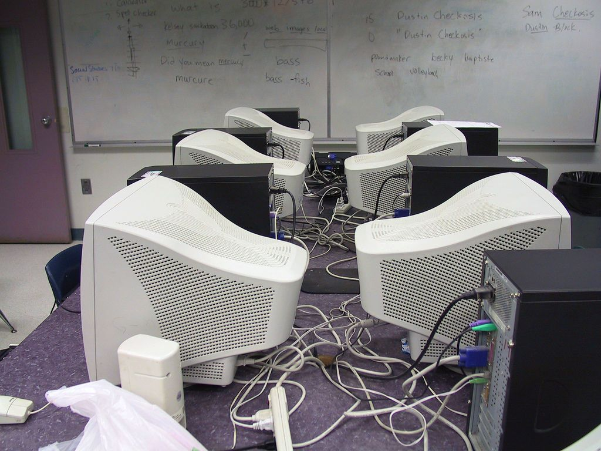

<Callout type="tip" title="Worked example 4: Understanding a cellphone account">
**Question:**
Study the following MTN invoice and answer the questions that follow:

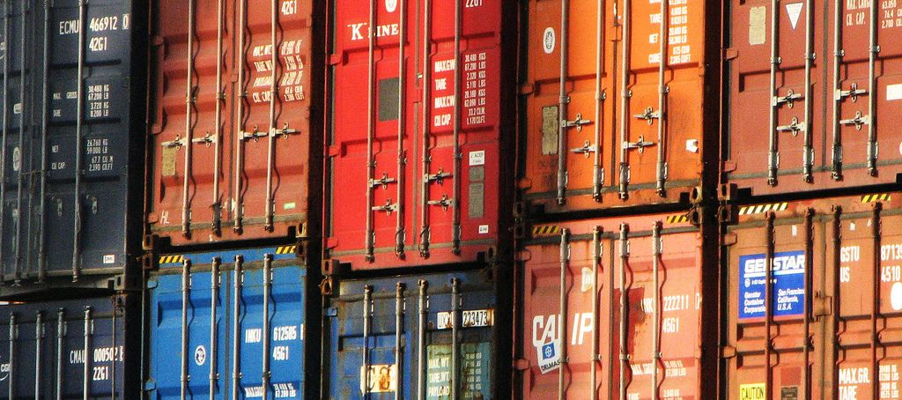

1. Which company is the service provider?
3. What is Mr Finlay's cell phone number?
5. What kind of cellphone do you think Mr Finlay owns? Explain your answer.
7. For which service did he receive a \(\text{100}\%\) refund? Explain your answer.
9. Does Mr Finlay receive any other discounts? If so, what where they?
11. What is the most expensive item in the list of transactions? What do you think this amount is for?
13. How do we know that Mr Finlay has been an MTN client since at least November 2011?
15. Can Mr Finlay make calls to international numbers on his phone? Explain your answer.
17. How many days does he have to query this invoice?
19. MTN includes the average spent per month, over the last \(\text{6}\) months. Show how they calculate this average.
21. Show how MTN calculated the \(\text{14}\%\) VAT that is added to the total excluding VAT

1. MTN
3. 081 423 7012
5. A Blackberry - the transaction column lists Blackberry internet services.
7. He received a full discount for his Blackberry Internet Service. We know this because the same amount that is added to his account (\(\text{R}\,\text{51,75}\)) is also subtracted.
9. Mr Finlay received a \(\text{R}\,\text{7,02}\) discount for “CLI Monthly Discount”
11. The most expensive item is “MTN 200 TopUp Subscription”. This is the fixed amount that Mr Finlay pays for his cellphone contract (an MTN TopUp 200 type contract) each month.
13. The invoice includes Mr Finlay's last 6 billing periods, the first of which is dated 11-2011.
15. Yes. One of the “Additional Services” listed in the grey column on the left hand side of the page is “Allow International Calling”
17. Mr Finlay has \(\text{30}\) days to query the invoice.
19. Average \(= \dfrac{\text{Total amount over 6 months}}{\text{Number of amounts}} =  \dfrac{ \text{R}\,\text{398} + \text{299} + \text{299} + \text{299} + \text{299} + \text{299}}{\text{6}}
   = \dfrac{\text{1 893}}{\text{6}}\)
   = \(\text{R}\,\text{315,50}\)
21. Total excluding VAT = \(\text{R}\,\text{262,28}\)
   \(\text{14}\%\) of \(\text{R}\,\text{262,28}\) = \(\text{R}\,\text{262,28}\) \(\times \frac{\text{14}}{\text{100}} =\) \(\text{R}\,\text{36,72}\)
</Callout>

## Understanding a phone bill

### Exercise 4.2

Oliver receives the following cell phone bill:

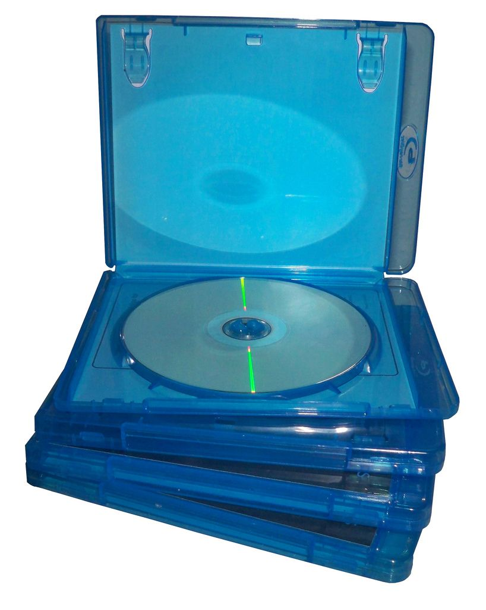

**Problem:**
What is the balance brought forward from the previous invoice?

**Solution:**
\(\text{R}\,\text{99,00}\)

**Problem:**
On what date was the payment of this balance made?

**Solution:**
02/07/2012

**Problem:**
When is the payment for the current outstanding amount due?

**Solution:**
31/07/2012

**Problem:**
What subscription service does Oliver get for free?

**Solution:**
HSDPA Voice Tariff

**Problem:**
What subscription does Oliver get a full refund for?

**Solution:**
VAS Balance Notification

**Problem:**
What is the billing period for this invoice?

**Solution:**
The month of July 2012

**Problem:**
Oliver wants to query the last payment he made. List four things he could use as a reference number.

**Solution:**
His cellphone number, his account number, the invoice  number and the payment reference number.

**Problem:**
Oliver wants to check that the VAT calculated on the total amount due is correct. Show how he can do this. Show all your calculations.

**Solution:**
Total without VAT = \(\text{R}\,\text{86,84}\). \(\text{14}\%\) of this = \(\text{86,84} \times
\frac{\text{14}}{\text{100}} =  \text{12,1576} \approx\) \(\text{R}\,\text{12,16}\).

### Shopping documents (EMG48)

#### Till slips

Every time you buy an item from a shop, you should receive a till slip indicating the value of the item you bought, how much money you offered the cashier for it, how much change you received and so on. Till slips come in many different forms depending on which shop you're buying things from. By law however, South African till slips must include:

- The name of the shop
- The address of the shop
- The VAT number of the shop
- The words “Tax Invoice”
- The shop's invoice number
- The date and time of the sale
- A description of the items or services bought
- The amount of VAT charged (\(\text{14}\%\))
- The total amount payable

It is important to know that VAT is not charged on some essential groceries in South Africa. These include: paraffin; brown bread; maize meal; samp; mealie rice; dried mealies; dried beans; lentils; tinned sardines; milk powder; milk, rice; vegetables; fruit; vegetable oil and eggs.

<Callout type="tip" title="Worked example 5: Understanding till slips">
**Question:**
Boiketlo goes to buy her groceries at the Sunshine Superette. Study the till slip below and answer the questions that follow:

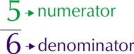

1. How did Boiketlo pay for her shopping?
3. How much does \(\text{1}\) litre of vegetable oil cost at the Sunshine Superette?
5. If there are \(\text{6}\) muffins in the pack of chocolate muffins that Boiketlo buys, how much does each muffin cost?
7. What is the last date for a refund and why might Boiketlo need one?
9. Boiketlo gave the cashier \(\text{R}\,\text{150,00}\) and received \(\text{R}\,\text{19,75}\) change.
   1. Calculate what she paid for her shopping.
   3. Why do you think amount slightly different to the balance due?
11. Why do you think three items (vegetable oil, brown bread and milk) have stars next to them?
13. 1. Add up the total of the items which to which are subject to VAT.
   3. Calculate the VAT (\(\text{14}\%\)) of  the total value of these items. Which letter (A, B, C or D) on the till slip does this correspond to?
   5. Add the \(\text{14}\%\) VAT to the total value of the items which are subject to VAT. Which letter (A, B, C or D) on the till slip does this correspond to?
   7. Add up the total of the three items that are exempt from VAT. Which letter (A, B, C or D) on the till slip does this correspond to?
   9. Add together the total (including VAT) of the items that include VAT and the total of the VAT exempt items. Which letter (A, B, C or D) on the till slip does this correspond to?
      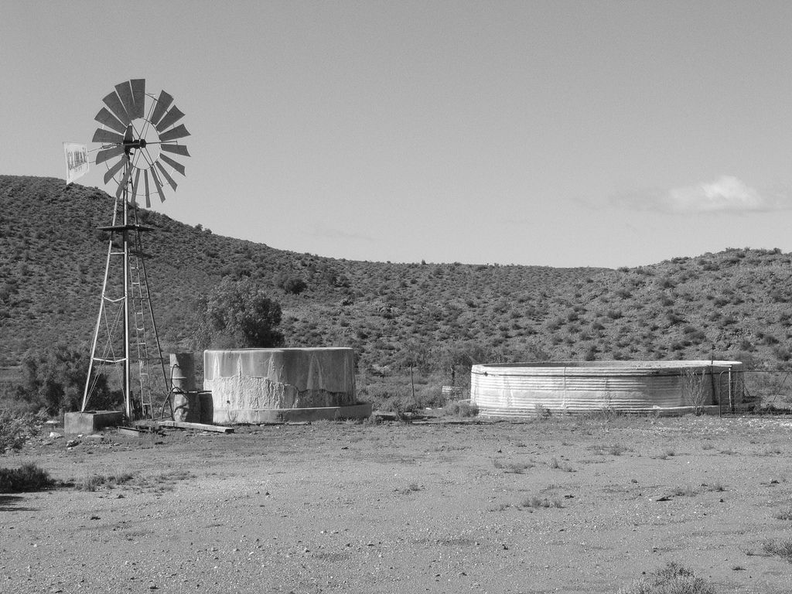

1. She paid with cash.
3. \(\text{500}\) \(\text{ml}\) of vegetable oil costs \(\text{R}\,\text{19,99}\), so \(\text{1}\) litre costs \(\text{R}\,\text{19,99}\) \(\times\) \(\text{2}\) = \(\text{R}\,\text{39,98}\).
5. \(\text{6}\) muffins cost \(\text{R}\,\text{13,95}\), so one muffin costs \(\text{R}\,\text{13,95}\) \(\div\) \(\text{6}\) = \(\text{R}\,\text{2,33}\)
7. 27/07/2013. She may need a refund if the food she bought is stale.
9. 1. \(\text{R}\,\text{150,00}\) - \(\text{R}\,\text{19,75}\) = \(\text{R}\,\text{130,25}\).
   3. The amount she paid is 2c less than the balance due. The total has been rounded down to the nearest multiple of 5c to accommodate for the fact that we no longer use 2c and 1c coins in South Africa.
11. The three starred items are exempt from VAT
13. 1. \(\text{R}\,\text{6,95}\) + \(\text{R}\,\text{3,95}\) + \(\text{R}\,\text{19,99}\) + \(\text{R}\,\text{0,44}\) + \(\text{R}\,\text{5,49}\) + \(\text{R}\,\text{15,99}\) + \(\text{R}\,\text{15,99}\) + \(\text{R}\,\text{13,95}\) = \(\text{R}\,\text{82,75}\)
   3. \(\text{14}\%\) of \(\text{R}\,\text{82,75}\) = \(\text{82,75}\) \(\times \frac{\text{14}}{\text{100}}\) = \(\text{R}\,\text{11,59}\)
      Letter B
   5. \(\text{R}\,\text{82,75}\) + \(\text{11,59}\) = \(\text{R}\,\text{94,34}\)
      Letter C
   7. \(\text{R}\,\text{16,99}\) + \(\text{R}\,\text{6,99}\) + \(\text{R}\,\text{11,95}\) =
      \(\text{R}\,\text{35,93}\)
      Letter D
   9. \(\text{R}\,\text{94,34}\) + \(\text{R}\,\text{35,93}\) = \(\text{R}\,\text{130,27}\)
      Letter A
</Callout>

## Understanding till slips

### Exercise 4.3

Sakhile goes to his local department store and buys some clothes and groceries.

He receives the following till slip. Study the slip and answer the questions that follow:

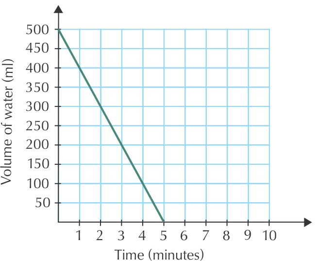

**Problem:**
What item did Sakhile buy on sale, and how much was the discount?

**Solution:**
A red T-shirt, \(\text{50}\%\) discount

**Problem:**
Can Sakhile return the sale item for refund? Explain your answer.

**Solution:**
No, full refunds are only available for non-sale items.

Sakhile finds a hole in the tracksuit pants that he bought.

**Problem:**
Can he return them for a refund?

**Solution:**
Yes - they were not sale items

**Problem:**
If so, by what date must he return them?

**Solution:**
Before or on 18 April 2013

**Problem:**
How many eggs did Sakhile buy?

**Solution:**
\(\text{2}\) packs of \(\text{6}\), so \(\text{12}\) eggs.

**Problem:**
Calculate the total value of the VAT exempt items Sakhile bought.

**Solution:**
\(\text{2}\)(\(\text{R}\,\text{5,99}\)) + \(\text{R}\,\text{6,95}\) + \(\text{11,95}\) +
\(\text{2}\)(\(\text{R}\,\text{7,99}\)) = \(\text{R}\,\text{46,86}\)

**Problem:**
Demonstrate how the amount indicated by Letter A was calculated. Show all your calculations.

**Solution:**
VAT incl items total \(\text{R}\,\text{151,15}\). \(\text{14}\%\) VAT of this = \(\text{R}\,\text{21,16}\)

**Problem:**
Demonstrate how the amount indicated by Letter B was calculated. Show all your calculations.

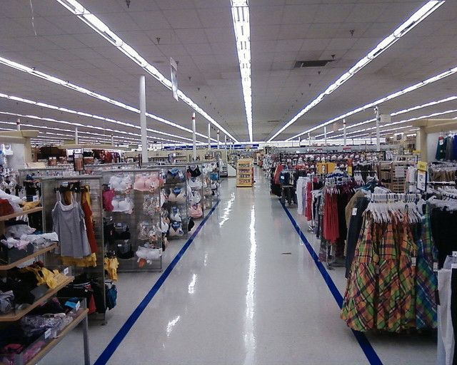

**Solution:**
VAT incl items total \(\text{R}\,\text{151,15}\). \(\text{14}\%\) VAT on this = \(\text{R}\,\text{21,16}\). Non-VAT items total \(\text{R}\,\text{46,86}\). VAT incl + \(\text{14}\%\) + VAT excl = \(\text{R}\,\text{219,17}\).

#### Account statements

At some clothing and food stores, it is possible to open an account, buy goods on credit and pay off what you owe the store on a monthly basis. Buying on credit basically means that you can take the items now and pay for them later. While this may seem like a good idea, it is all too easy to end up owing the shop more money you can pay them, which is a very bad position to be in. Many South Africans do have store accounts and manage them sensibly by paying back the shop each month, when they receive their monthly account statement.

In order to open a store account, you usually have to be 18 years or older, and be able to provide proof of employment and proof of residence. You are then issued with a store card (like a credit card but only for certain shops), and you receive monthly account statements detailing how much you've spent, how much you've paid back and how much you still owe the store.

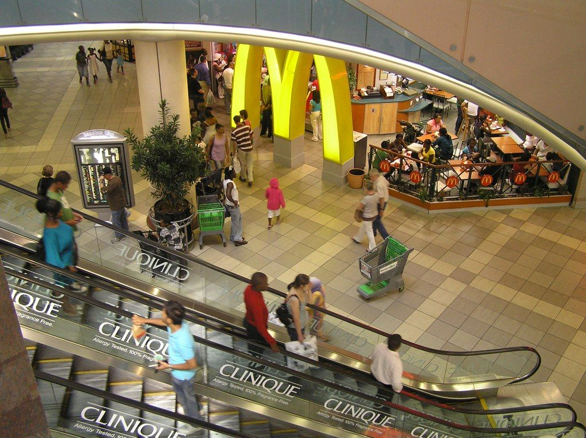

<Callout type="tip" title="Worked example 6: Understanding shop accounts">
**Question:**
Bulelwa has an Edgars store account. She receives the account statement below. Study the statement and answer the questions that follow:

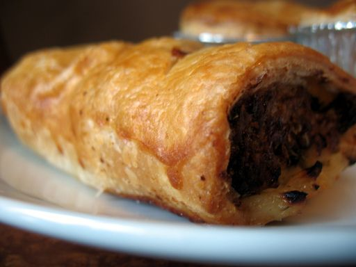

1. At which six stores can Bulelwa use her store card?
3. 1. How much does Bulelwa owe on her account?
   3. When is this amount due?
   5. Will Bulelwa incur extra costs if she pays the due amount late? If so, how much?
5. How much did Bulelwa pay into her account on 25/04/2012?
7. 1. How much credit does she still have available, and what do you think this means?
   3. What do you think the difference between “credit available” and “credit limit” is?
9. How much is the balance brought forward from the previous statement?
11. How much did Bulelwa spend at Edgars in the month of April 2012?
13. The closing balance on this statement includes \(\text{14}\%\) VAT. Calculate the VAT included in the closing balance of \(\text{R}\,\text{742,37}\).

1. Edgars, Boardmans, Prato, Temptations, CNA and Red Square
3. 1. \(\text{R}\,\text{240,00}\)
   3. 01/06/2012
   5. Not on this account, no. But if her payments remain overdue for a year or more there is an additional charge of \(\text{22,10}\%\) per annum (per year)
5. She paid \(\text{R}\,\text{240,00}\) into her account.
7. 1. Bulelwa has \(\text{R}\,\text{3 307,00}\) credit available. This means that she can still buy items up to the total value of
      \(\text{R}\,\text{3 307,00}\) on her account.
   3. Credit available is how much credit Bulelwa has left. Credit limit is how much credit she is allowed in total, at any one time (i.e. she can buy items totalling \(\text{R}\,\text{4 049}\) on credit).
9. \(\text{R}\,\text{692,42}\)
11. \(\text{R}\,\text{99,95}\) + \(\text{R}\,\text{190,00}\) = \(\text{R}\,\text{289,95}\)
13. \(\text{14}\%\) of \(\text{R}\,\text{742,37}\) = \(\text{R}\,\text{742,37}\) \(\times
   \frac{\text{14}}{\text{100}}\) = \(\text{103,9318}\) \(\approx\) \(\text{R}\,\text{103,93}\)
</Callout>

## Understanding shop accounts

### Exercise 4.4

Jane receives the following account statement from Woolworths. Answer the questions that follow.

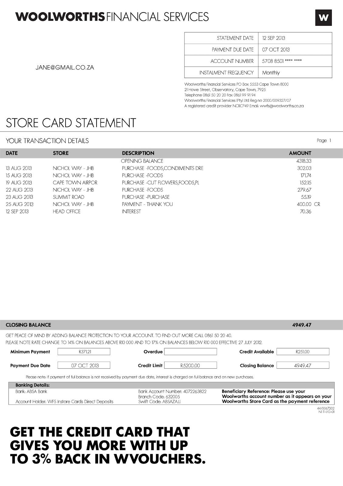

**Problem:**
Is there anything unusual about Jane's contact details, when compared to the bills we've worked with thus far?

**Solution:**
Her contact details only list her e-mail address, no physical or postal address.

**Problem:**
What is the opening balance on Jane's account?

**Solution:**
\(\text{R}\,\text{4 318,33}\)

**Problem:**
When last did she make a payment into her account and how much was it for?

**Solution:**
Jane's last payment was for \(\text{R}\,\text{400}\), on 25 August 2013.

**Problem:**
How many times did Jane shop at Woolworths in the month of August 2013?

**Solution:**
\(\text{5}\) times

**Problem:**
How much did she spend in total on goods from Woolworths in August 2013?

**Solution:**
\(\text{R}\,\text{302,03}\) + \(\text{R}\,\text{171,74}\) + \(\text{R}\,\text{152,15}\) +
\(\text{R}\,\text{279,67}\) + \(\text{R}\,\text{55,19}\) = \(\text{R}\,\text{960,78}\)

**Problem:**
Which Woolworths store did she shop at the most often?

**Solution:**
At Nichol Way, JHB

**Problem:**
Jane lives in Johannesburg. Did she travel at all in the month of August 2013? Explain your answer.

**Solution:**
Yes - on the 19th August she used her card at Cape Town Airport.

**Problem:**
What is the minimum amount that Jane must pay into her account this month, and when must she pay it by?

**Solution:**
\(\text{R}\,\text{371,21}\) must be paid by 7 October 2013.

**Problem:**
How much credit does Jane have available?

**Solution:**
\(\text{R}\,\text{251,00}\)

**Problem:**
How much does she owe in total to Woolworths?

**Solution:**
\(\text{R}\,\text{4 949,47}\)

**Problem:**
Jane is interested in getting the credit card advertised at the bottom of the account statement. With this new credit card, if she spent \(\text{R}\,\text{400}\) at Woolworths, how much would money would she get back in WVouchers?

**Solution:**
\(\text{3}\%\) of \(\text{R}\,\text{400}\) = \(\text{R}\,\text{400}\) \(\times
\frac{\text{3}}{\text{100}}\) = \(\text{R}\,\text{400}\) \(\times\) \(\text{0,03}\) = \(\text{R}\,\text{12,00}\).
