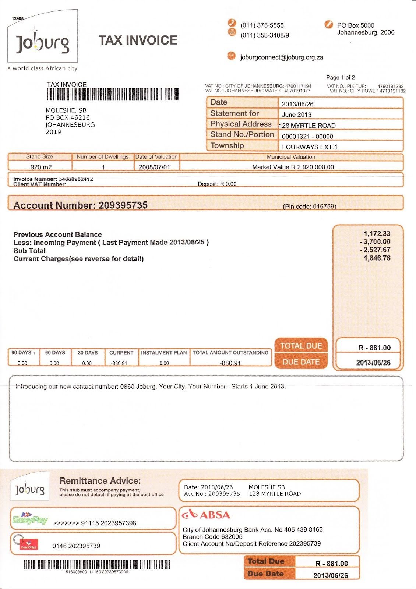
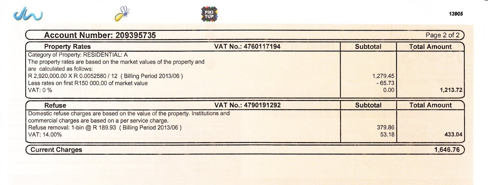
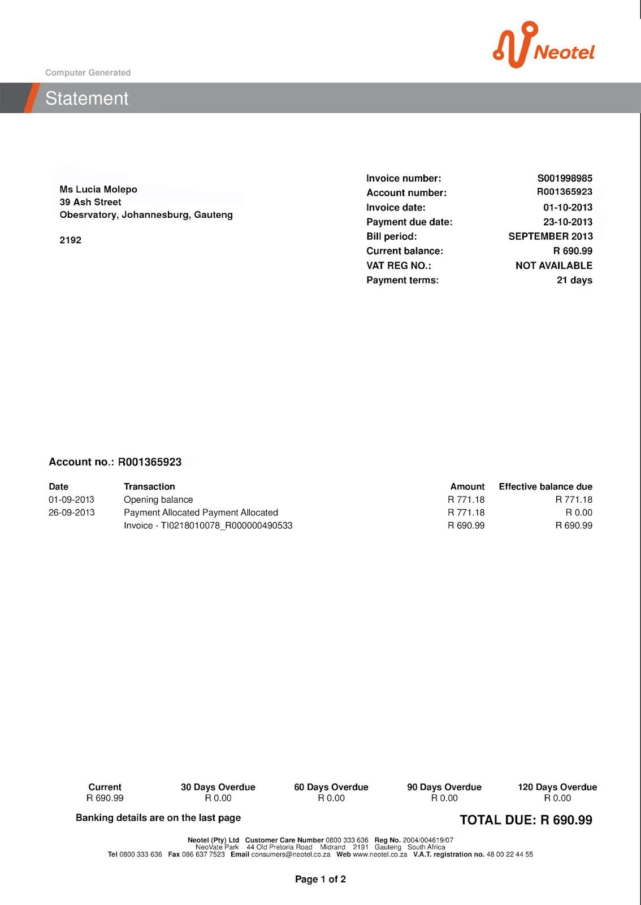
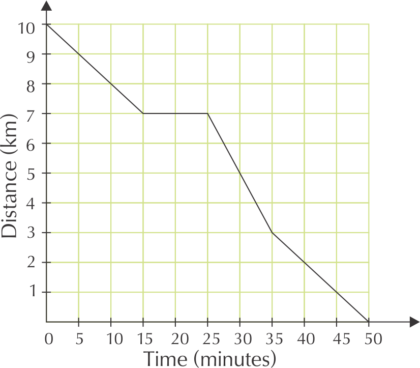
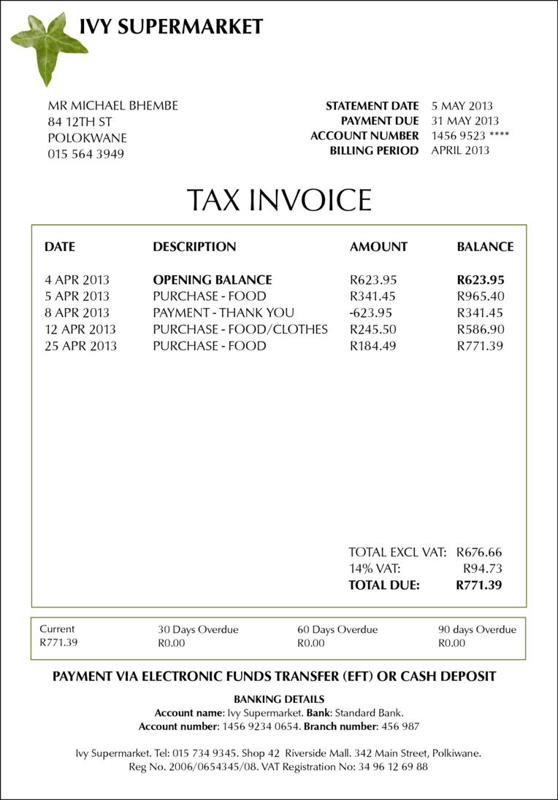
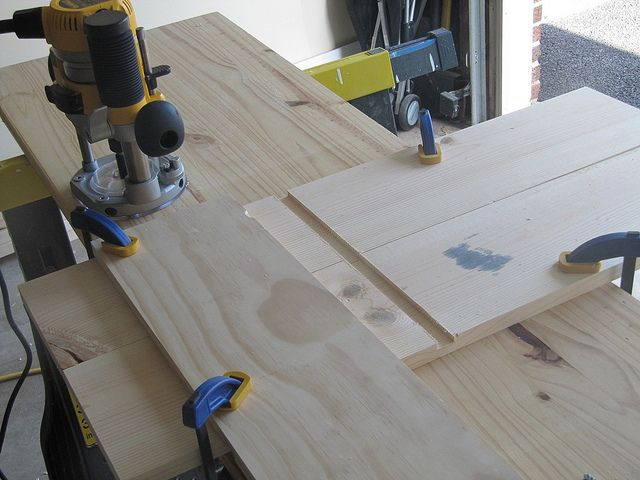

### Exercise 4.8

Simon gets the following municipal bill for his property rates and refuse removal.

**Problem:**
What city does he live in?

**Solution:**
Johannesburg

**Problem:**
When last did he make a payment into this account, and how much was this payment for?

**Solution:**
He paid \(\text{R}\,\text{3 700,00}\) on 2013/06/25

**Problem:**
How much was the balance brought forward from his previous account?

**Solution:**
\(\text{R}\,\text{1 172,33}\)

**Problem:**
How much is he being charged for property rates and refuse for the current billing period?

**Solution:**
\(\text{R}\,\text{1 646,76}\)

**Problem:**
Why is the total due a negative amount?

**Solution:**
Because Simon has paid more money into his account than is due - he is in credit.

**Problem:**
What does Simon pay for property rates per year?

**Solution:**
\(\text{R}\,\text{1 279,45}\) \(\times\) \(\text{12}\) = \(\text{R}\,\text{15 353,40}\), or
\(\text{R}\,\text{2 920 000}\) \(\times\) \(\text{R}\,\text{0,052580}\) = \(\text{R}\,\text{15 353,40}\).

**Problem:**
Does he get any deductions on his annual property rates?

**Solution:**
Yes. He gets a \(\text{R}\,\text{65,73}\) deduction.

**Problem:**
Does he pay VAT on his property rates?

**Solution:**
No. The VAT is listed at \(\text{0}\%\).

**Problem:**
Show how the municipality calculated the \(\text{R}\,\text{53,18}\) VAT on his refuse subtotal.

**Solution:**
\(\text{R}\,\text{379,86}\)\(\times\) \(\text{0,14}\) = \(\text{R}\,\text{53,18}\)

Lucia receives the following account for her phone line with Neotel:

**Problem:**
What is the billing period for this invoice?

**Solution:**
September 2013

**Problem:**
How many days does Lucia have to pay this bill?

**Solution:**
\(\text{21}\) days

**Problem:**
Do the numbers listed under “Effective balance due” include VAT? explain your answer.

**Solution:**
Yes, they are VAT inclusive. Neotel must charge VAT on the cost of their services, and there is nothing in the invoice to indicate that VAT has not yet been added to the totals due.

**Problem:**
When last did she make a payment to Neotel and how much was it for?

**Solution:**
She paid \(\text{R}\,\text{771,18}\) on 26 September 2013

**Problem:**
Does Lucia have any overdue payments?

**Solution:**
No - her payments are up to date.

**Problem:**
List two ways in which she can pay her account?

**Solution:**
She can make a cash deposit at Nedbank or she can pay via Electronic Fund Transfer (EFT)

**Problem:**
List four ways in which Lucia can contact Neotel if she wants to query this invoice.

**Solution:**
She can call their customer care number, she can send a fax to them, she can e-mail them or she can use their website.

**Problem:**
The Neotel invoice does not show how much VAT was added to Lucia's bill. If the total before VAT was \(\text{R}\,\text{606,13}\), calculate how much VAT was added to get the total due. Show your calculations.

**Solution:**
\(\text{R}\,\text{606,13}\) \(\times\) \(\text{0,14}\) = \(\text{R}\,\text{84,86}\) VAT.

Alison receives the following till slip from The General Store in Upington:

**Problem:**
How did Alison pay for her shopping?

**Solution:**
With cash.

**Problem:**
Calculate the total cost of VAT exempt items on the till slip.

**Solution:**
\(\text{R}\,\text{66,61}\)

**Problem:**
Calculate the total cost of items that are subject VAT.

**Solution:**
\(\text{R}\,\text{103,44}\)

**Problem:**
Calculate how much VAT is added to the VAT-inclusive items.

**Solution:**
\(\text{R}\,\text{103,44}\) \(\times\) \(\text{0,14}\) = \(\text{R}\,\text{14,48}\)

**Problem:**
Show how the above three amounts make up the total due.

**Solution:**
Total = \(\text{R}\,\text{66,61}\) + \(\text{R}\,\text{103,44}\) + \(\text{R}\,\text{14,48}\) =
\(\text{R}\,\text{184,53}\)

**Problem:**
Alison paid with cash, and received \(\text{R}\,\text{15,50}\) change. This means she paid \(\text{R}\,\text{184,50}\) for her shopping. Explain why this amount is different to the Total of \(\text{R}\,\text{184,53}\).

**Solution:**
The total is rounded down to the nearest multiple of \(\text{5}\), to accommodate for the fact that we no longer have 1c or 2c coins in South Africa.

**Problem:**
How much will \(\text{1}\) \(\text{kg}\) of potatoes cost at The General Store?

**Solution:**
\(\text{500}\) \(\text{g}\) costs \(\text{R}\,\text{19,99}\), therefore
 \(\text{1}\) \(\text{kg}\) costs \(\text{R}\,\text{19,99}\) \(\times\) \(\text{2}\) = \(\text{R}\,\text{39,98}\)

**Problem:**
If the store advertised a \(\text{20}\%\) discount on potatoes, how much will one kg of potatoes cost?

**Solution:**
\(\text{R}\,\text{39,98}\) \(\times\) \(\text{0,20}\) = \(\text{7,996}\). \(\text{R}\,\text{39,98}\) -
\(\text{R}\,\text{7,996}\) = \(\text{R}\,\text{31,98}\).

Michael receives the following invoice from Ivy Supermarket, where he has a store account:

**Problem:**
In what city does Michael live?

**Solution:**
Polokwane.

**Problem:**
How many times did Michael shop at Ivy Supermarket in April 2013?

**Solution:**
\(\text{3}\) times.

**Problem:**
How much money did he owe from his previous invoice?

**Solution:**
\(\text{R}\,\text{623,95}\)

**Problem:**
When last did he pay money into his account, and how much did he pay?

**Solution:**
He paid \(\text{R}\,\text{623,95}\) into his account on 8 April 2013.

**Problem:**
Name two ways in which Michael can pay his account.

**Solution:**
He can pay via EFT or cash deposit.

**Problem:**
If Michael receives his invoice in the post on 10 May 2013, how many **weeks** does he have to pay his bill?

**Solution:**
The payment is due on 31 May, so he has \(\text{21}\) days to pay his account. \(\text{21}\) days is \(\text{3}\) weeks.

**Problem:**
Show how the \(\text{R}\,\text{94,73}\) VAT is calculated.

**Solution:**
\(\text{R}\,\text{676,66}\) \(\times\) \(\text{0,14}\) = \(\text{R}\,\text{94,73}\).

**Problem:**
If Michael can only afford to pay \(\text{R}\,\text{350}\) into his account this month, what will his opening balance for June 2013 be?

**Solution:**
\(\text{R}\,\text{771,39}\) - \(\text{R}\,\text{350}\) = \(\text{R}\,\text{421,39}\).

**Problem:**
Do you think Michael is responsible about paying his account on time? Explain your answer.

**Solution:**
Yes - he has no overdue payments from previous invoices.

Buffalo City Metro gives the following tariffs for electricity for schools and sports fields in the East London area:

| Energy Charge | Total Rands Excl. VAT | VAT Rands \(\text{14}\%\) | Total Rands VAT Incl. |
| --- | --- | --- | --- |
| First \(\text{2 000}\) kWh | \(\text{1,24566}\) | \(\text{0,17439}\) | \(\text{1,4200}\) |
| Next \(\text{8 000}\) kWh | \(\text{0,92405}\) | \(\text{0,12937}\) | \(\text{1,0534}\) |
| Above \(\text{10 000}\) kWh | \(\text{1,29982}\) | \(\text{0,18198}\) | \(\text{1,4818}\) |
| Minimum charge per month, or part thereof | \(\text{164,32824}\) | \(\text{23,00595}\) | \(\text{187,3342}\) |

Buffalo High School uses \(\text{9 000}\) kWh of electricity in one month.

**Problem:**
How much will their electricity cost, before VAT is added?

**Solution:**
\(\text{2 000}\) kWh \(\times\) \(\text{R}\,\text{1,24566}\) = \(\text{R}\,\text{2 491,32}\). \(\text{9 000}\) kWh - \(\text{2 000}\) kWh = \(\text{7 000}\) kWh. \(\text{7 000}\) kWh \(\times\) \(\text{R}\,\text{0,92405}\) = \(\text{R}\,\text{6 468,35}\). \(\text{R}\,\text{2 491,32}\) + \(\text{R}\,\text{6 468,35}\) = \(\text{R}\,\text{8 959,67}\)

**Problem:**
Calculate what the \(\text{14}\%\) VAT on the school's electricity bill will be.

**Solution:**
\(\text{R}\,\text{8 959,67}\) \(\times\) \(\text{0,14}\) = \(\text{R}\,\text{1 254,35}\)

**Problem:**
Calculate the total the school will pay for electricity in a month, including VAT.

**Solution:**
\(\text{R}\,\text{8 959,67}\) + \(\text{R}\,\text{1 254,35}\) = \(\text{R}\,\text{10 214,02}\)

**Problem:**
Eastwood Primary School closes for the month of December, and uses no electricity during this period. What will the school's electricity bill be, including VAT?

**Solution:**
There is a minimum charge of \(\text{R}\,\text{187,3342}\).

Windyvale High School has a large campus and sports fields, and on average uses \(\text{11 000}\) kWh  of electricity per month.

**Problem:**
Calculate how much the school's electricity bill will be (including VAT).

**Solution:**
First \(\text{2 000}\) kWh: \(\text{2 000}\) \(\times\) \(\text{R}\,\text{1,4200}\) =
\(\text{R}\,\text{2 840,00}\). Next \(\text{8 000}\) kWh: \(\text{8 000}\)kWh \(\times\) \(\text{R}\,\text{1,0534}\) = \(\text{R}\,\text{8 427,20}\). Last \(\text{1}\) kWh (over \(\text{10 000}\) kWh) = \(\text{1 000}\) kWh \(\times\)
\(\text{R}\,\text{1,4818}\) = \(\text{R}\,\text{1 481,80}\). Total = \(\text{R}\,\text{2 840,00}\) +
\(\text{R}\,\text{8 427,20}\) +\(\text{R}\,\text{1 481,80}\) = \(\text{R}\,\text{12 749,00}\)

**Problem:**
List at least three things that the school do to reduce its electricity consumption.

**Solution:**
The school could turn off lights when they aren't being used (e,g, at night). They could install solar panels. They could turn off the geysers at night, or install solar panel geysers to save electricity.

Neotel  lists the following call tariffs for calls (per minute) from a Neotel phone to landlines (the prices below include VAT):

|  | Neotel to landline | Neotel to Neotel |
| --- | --- | --- |
| Local - peak | \(\text{R}\,\text{0,34}\) | \(\text{R}\,\text{0,17}\) |
| Local - off peak | \(\text{R}\,\text{0,17}\) | \(\text{R}\,\text{0,17}\) |
| Regional - peak | \(\text{R}\,\text{0,46}\) | \(\text{R}\,\text{0,34}\) |
| Regional - off peak | \(\text{R}\,\text{0,29}\) | \(\text{R}\,\text{0,34}\) |
| National - peak | \(\text{R}\,\text{0,57}\) | \(\text{R}\,\text{0,43}\) |
| National - off peak | \(\text{R}\,\text{0,33}\) | \(\text{R}\,\text{0,43}\) |
| After hours calling

(daily between 18h00 - 07h00, plus all day on weekends and public holidays) | - | Free |

Wendy calls her friend Karabo, who lives nearby, from her Neotel landline, on a Wednesday afternoon. They talk for \(\text{540}\) seconds.

**Problem:**
How much will the call cost if Karabo is with another phone provider?

**Solution:**
\(\text{540}\) seconds = \(\text{9}\) minutes. \(\text{9}\) \(\times\) \(\text{R}\,\text{0,34}\) =
\(\text{R}\,\text{3,06}\)

**Problem:**
How much will the call cost if Karabo is also with Neotel?

**Solution:**
\(\text{540}\) seconds = \(\text{9}\) minutes. \(\text{9}\) \(\times\) \(\text{R}\,\text{0,17}\) =
\(\text{R}\,\text{1,53}\)

Neo's mother lives in the Transkei. His mother has a Neotel phone line.

**Problem:**
Neo lives in Johannesburg and has a  non-Neotel phone line. If his mother calls him from the Transkei on a Saturday, what will the call cost her per minute?

**Solution:**
National, off peak per minute rate, to a non-Neotel line is \(\text{R}\,\text{0,33}\).

**Problem:**
Will the call be cheaper the call be if Neo had a Neotel phone line that his mother could call him on?

**Solution:**
Yes. After hours and on weekends a call from a Neotel line to a Neotel line is free.

**Problem:**
How much would a \(\text{420}\) second call cost, (from Johannesburg to the Tranksei, from a Neotel line to a Neotel line) if Neo called his mother at 20h30 on a Monday night?

**Solution:**
\(\text{420}\) seconds = \(\text{6}\) minutes. Per minute rate from Neotel tell to Neotel, between 18h00 and 07h00 is free.

Metrorail in Cape Town gives the following tariffs for normal Metro Class train travel from Cape Town Central Station:

| Zone (km distance) | Single | Week | Month |
| --- | --- | --- | --- |
| \(\text{1}\) - \(\text{10}\) | \(\text{R}\,\text{6,00}\) | \(\text{R}\,\text{39,00}\) | \(\text{R}\,\text{117,00}\) |
| Claremont, Esplanade, Hazendal, Kentemade, Koeberg Road, Maitland, Mowbray, Mutual, Ndabeni, Newlands, Observatory, Paarden Island, Pinelands, Rondebosch, Rosebank, Salt River, Thornton, Woltemade, Woodstock, Ysterplaat |  |  |  |
| \(\text{11}\) - \(\text{19}\) | \(\text{R}\,\text{6,50}\) | \(\text{R}\,\text{42,00}\) | \(\text{R}\,\text{126,00}\) |
| Akasia Park, Athlone, Avondale, Belhar, Bellville, Bontheuwel, Century City, Crawford, De Grendel, Diep River, Elsies River, Goodwood, Harfield Road, Heathfield, Heideveld, Kenilworth, Langa, Lansdowne, Lavistown, Monte Vista, Netreg, Oosterzee, Ottery, Parow, Plumstead, Retreat, Steurhof, Tygerberg, Vasco, Wetton, Wittebome, Wynberg |  |  |  |
| \(\text{20}\) - \(\text{30}\) | \(\text{R}\,\text{7,50}\) | \(\text{R}\,\text{49,00}\) | \(\text{R}\,\text{147,00}\) |
| Blackheath, Brackenfell, Clovelly, Eikenfontein, False Bay, Fish Hoek, Kalk Bay, Kuils River, Lakeside, Lentegeur, Mitchells Plain, Mandalay, Muizenberg, Nolungile, Nyanga, Pentech, Philippi, Sarepta, Southfield, St James, Steenberg, Stikland, Stock Road, Unibell |  |  |  |

**Problem:**
Naledi wants to take the train from the city centre to Kalk Bay. How much will a single ticket cost her?

**Solution:**
\(\text{R}\,\text{7,50}\)

**Problem:**
How much does a monthly ticket from Kuils Rivier to the Central Station cost?

**Solution:**
\(\text{R}\,\text{147,00}\)

Kevin takes the train every week day from Akasia Park to the Central Station and back.

**Problem:**
If he buys single tickets for each trip, how much will he pay per week for his train transport?

**Solution:**
\(\text{R}\,\text{6,50}\) \(\times\) \(\text{2}\) trips per day \(\times\) \(\text{5}\) days =
\(\text{R}\,\text{65,00}\) per week

**Problem:**
How much cheaper would a weekly ticket for the same route be?

**Solution:**
Weekly ticket costs \(\text{R}\,\text{42,00}\). This is \(\text{R}\,\text{22}\) cheaper.

**Problem:**
If he buys a monthly ticket for the same route, for \(\text{R}\,\text{126,00}\), how much will he pay per trip?

**Solution:**
He makes \(\text{10}\) trips per week, and \(\text{1}\) month \(\approx\) \(\text{4}\) weeks, so he makes \(\text{40}\) trips per month. \(\text{R}\,\text{126,00}\) \(\div\) \(\text{40}\) = \(\text{R}\,\text{3,15}\)

**Problem:**
How much cheaper is this than paying for a single ticket?

**Solution:**
\(\text{R}\,\text{6,50}\) \(-\) \(\text{R}\,\text{3,15}\) = \(\text{R}\,\text{3,35}\) cheaper
