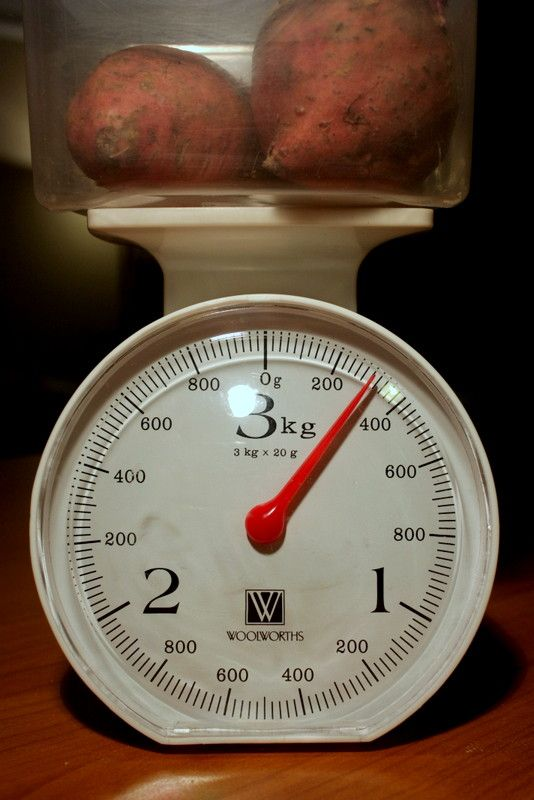

## 5.3 Measuring mass or weight (EMG4J)

The scientific word for how much an object weighs on a scale is “mass”. In this book we will use the words “weight” and “mass” interchangeably, because both are used in everyday language. For example “I weigh \(\text{60}\) \(\text{kg}\)” or “the car's mass is \(\text{1}\) tonne”.

In many contexts, we use scales to measure weight or mass. Different types of scales are used to measure different sizes of objects. Some examples are given in the table below:

|  | Kitchen scales can be used to measure small quantities of food usually up to \(\text{2}\) or \(\text{3}\) \(\text{kg}\). The scale on the left can measure weight between \(\text{0}\) and \(\text{2}\) \(\text{kg}\) in weight. The units are divided into kilograms and grams. |
| --- | --- |
|  | Scales for measuring larger quantities of food (like vegetables or fruit) are sometimes seen in shops or at markets. The scale on the left can measure weight from \(\text{0}\) to \(\text{10}\) \(\text{kg}\). |
|  | Bathroom scales can be analog or digital (like the scale on the left). They are used to measure a person's weight, and can measure weight from \(\text{0}\) to \(\text{150}\) \(\text{kg}\). Bathroom scales usually show units in kilograms and grams - e.g. \(\text{63,6}\) \(\text{kg}\). |
|  | Clinics and doctors' practices often use larger analog scales to measure a person's weight. These can also measure weight between \(\text{0}\) and \(\text{150}\) \(\text{kg}\). |
|  | Flat electronic scales, called platform scales, can be used to measure bulky objects like suitcases (at the airport) or dogs (at the vet). |
|  | Weighbridges are used to measure very large objects like trucks. The truck drives onto a special strip of road that is connected to a digital scale. The scale operator (shown in the picture on the left) then reads off the truck's weight in tonnes. |

Analogue scaleA scale that has no electronic devices attached to it, (e.g. LCD screens).Digital scaleA scale that has electronic devices on it like digital and LCD screens.CalibrationThis is process by which a scale is set in order to take accurate readings.

Most analogue scales can become inaccurate when they are moved around, because they have moving parts inside that can shift if the scale is bumped or dropped. Therefore, before we use an analogue scale we has to adjust the scale to make sure that it gives the most accurate readings possible. This process of adjusting the scales again is called re-calibration.

Digital scales are calibrated (adjusted for accuracy) in the factory when they are made and do not become inaccurate when they are moved. Other, larger scales like a weighbridge will be calibrated on-site (usually by a professional engineer or technician).

<Callout type="tip" title="Worked example 3: Measuring weight">
**Question:**
Study the following pictures of food on a scale and answer the questions that follow:

1. 
   1. How much does this rice weigh in grams?
   3. Convert this to kilograms.
3. 
   1. How much does this flour weigh in kilograms?
   3. Convert this to grams.
5. 
   1. How much do these sweet potatoes weigh in grams?
   3. Convert this to kg.
7. What is the maximum weight that the scale used for the above three questions can measure?

1. 1. \(\text{600}\) \(\text{g}\)
   3. \(\text{600}\) \(\text{g}\) \(\div\) \(\text{1 000}\) = \(\text{0,6}\) \(\text{kg}\)
3. 1. \(\text{1}\) \(\text{kg}\)
   3. \(\text{1}\) \(\text{kg}\) \(\times\) \(\text{1 000}\) = \(\text{1 000}\) \(\text{g}\)
5. 1. \(\text{300}\) \(\text{g}\)
   3. \(\text{300}\) \(\div\) \(\text{1 000}\) = \(\text{0,3}\) \(\text{kg}\)
7. \(\text{3}\) \(\text{kg}\).
</Callout>

## Calculating weight

### Exercise 5.2

**Problem:**
A lift in a shopping mall has a notice that indicates that it can carry \(\text{2,2}\) tonnes or a maximum of \(\text{20}\) people. Convert the tonne measurement to kilograms and work out what the engineer who built the lift estimated the maximum weight of a person to be.

**Solution:**
\(\text{2,2}\) \(\text{t}\) = \(\text{2 200}\) \(\text{kg}\). \(\text{2 200}\) \(\text{kg}\) \(\div\) \(\text{20}\) people = \(\text{110}\) \(\text{kg}\) each.

A long distance bus seats \(\text{50}\) passengers and allows every passenger to each have luggage of up to \(\text{30}\) \(\text{kg}\).

**Problem:**
If \(\text{50}\) people, with average weight of \(\text{80}\) \(\text{kg}\) per person, and one piece of luggage each that weighs an average of \(\text{29}\) \(\text{kg}\), what would be the total load being carried by the bus in tonnes?

**Solution:**
(\(\text{50}\) \(\times\) \(\text{80}\) \(\text{kg}\)) + (\(\text{50}\) \(\times\) \(\text{29}\) \(\text{kg}\)) = \(\text{4 000}\) \(\text{kg}\) + \(\text{1 450}\) \(\text{kg}\) = \(\text{5 450}\) \(\text{kg}\) = \(\text{5,45}\) \(\text{t}\).

**Problem:**
If the bus weighs \(\text{4}\) tonnes, how much does it weigh in total (in kg) including all the passengers and the luggage?

**Solution:**
\(\text{4}\) \(\text{t}\) = \(\text{4 000}\) \(\text{kg}\). \(\text{4 000}\) \(\text{kg}\) + \(\text{5 450}\) \(\text{kg}\) = \(\text{9 450}\) \(\text{kg}\).

John applied for a job as a flight attendant but was told that he had to lose at least \(\text{5}\) \(\text{kg}\) before he met their maximum weight allowance (so that the plane - full of passengers, luggage and fuel - is not too heavy) and could reapply.

**Problem:**
If John weighed \(\text{85}\) \(\text{kg}\) at the time he applied for the job, what is the maximum weight that he can weigh in order to re-apply for the job?

**Solution:**
\(\text{80}\) \(\text{kg}\)

**Problem:**
John weighs \(\text{78}\) \(\text{kg}\) when he weighs himself after six months. Do you think he can reapply for the job? Explain your answer.

**Solution:**
Yes - he weighs less than \(\text{80}\) \(\text{kg}\) and has lost more than the minimum \(\text{5}\) \(\text{kg}\).

Sweet Jam can be bought in bulk from a warehouse in boxes of \(\text{25}\) tins each.

**Problem:**
Suppose that a trader buys a box of \(\text{250}\) \(\text{g}\) Sweet Jam tins for resale. Calculate the total weight of the tins in the box, in kg.

**Solution:**
\(\text{250}\) \(\text{g}\) \(\times\) \(\text{25}\) = \(\text{6 250}\) \(\text{g}\) = \(\text{6,25}\) \(\text{kg}\).

**Problem:**
If he orders \(\text{15}\) boxes of Sweet Jam, calculate the total weight of his order in kg.

**Solution:**
\(\text{15}\) boxes \(\times\) \(\text{6,25}\) \(\text{kg}\) = \(\text{93,75}\) \(\text{kg}\)

<Callout type="tip" title="Worked example 4: Personal weight and health">
**Question:**
Annabelle weighs herself once a week (at the same time of day, wearing similar clothes) for two months and records the following measurements:

| Date | 1 Feb | 7 Feb | 14 Feb | 21 Feb | 1 March | 7 March | 14 March | 21 March |
| --- | --- | --- | --- | --- | --- | --- | --- | --- |
| Weight (kg) | \(\text{65,5}\) | \(\text{65,9}\) | \(\text{65,2}\) | \(\text{64,6}\) | \(\text{65,8}\) | \(\text{65,0}\) | \(\text{65,1}\) | \(\text{64,5}\) |

1. What is the difference (in kg) between her weight on 1 Feb and 21 March?
3. By how much did her weight increase between 21 Feb and 1 March?
5. Give two possible explanations for why her weight went up suddenly on 1 March.
7. Plot a graph showing Annabelle's weight changes per week (you should have dates on the horizontal axis and kilograms on the vertical axis).

1. \(\text{65,5}\) \(\text{kg}\) - \(\text{64,3}\) \(\text{kg}\) = \(\text{0,8}\) \(\text{kg}\). She weighs \(\text{0,8}\) \(\text{kg}\) less on the 21st March.
3. By \(\text{1,6}\) \(\text{kg}\).
5. Either she ate a lot of food in the week between 21 Feb and 1 March (which is unlikely - it is difficult to gain \(\text{1,6}\) \(\text{kg}\) of weight in one week!), or she did not check that the scale was set to “\(\text{0}\) \(\text{kg}\)” before she weighed herself.
7. 
</Callout>

## Monitor your weight at home

### Exercise 5.3

If you have a bathroom scale at home, monitor your weight every day for a week. Whilst you should weigh yourself at the same time and in the same kinds of clothes everyday to get consistent results, you may experiment with your measurements: for example, do you weigh more with your shoes on? Or do you weigh more before or after a meal? Don't forget to check that your scale is correctly calibrated before you take each measurement.

**Problem:**
What is the difference between your weight on Day 1 and Day 7, if any?

**Solution:**
Learner-dependent answer.

**Problem:**
Plot a graph showing your weight measurements.

**Solution:**
Learner-dependent answer.

**Problem:**
Are there any measurements that are unexpectedly low or high? If so, give reasons why you think this may be. (Hint: your weight shouldn't fluctuate much in a week but factors like how much water you've had to drink or how much you've had to eat can influence the measurements!)

**Solution:**
Learner-dependent answer.

## Calculating whether or not your school bag is too heavy

### Exercise 5.4

Read the following statements and complete the activities that follow:

According to mysafetyandhealth.com, you should never carry more than \(\text{15}\%\) of your body weight. Elias weighs \(\text{66}\) \(\text{kg}\) and his backpack, with school books, weighs \(\text{12}\) \(\text{kg}\). Elizabeth weighs \(\text{72}\) \(\text{kg}\) and her school bag, with school books, weighs \(\text{8}\) \(\text{kg}\).

**Problem:**
Determine \(\text{15}\%\) of Elias's weight.

**Solution:**
\(\text{9,9}\) \(\text{kg}\)

**Problem:**
Is his bag too heavy for him?

**Solution:**
Yes. It weighs more than \(\text{9,9}\) \(\text{kg}\).

**Problem:**
Determine \(\text{15}\%\) of Elizabeth's weight.

**Solution:**
\(\text{10,8}\) \(\text{kg}\)

**Problem:**
Is her bag too heavy for her?

**Solution:**
No. It weighs less than \(\text{15}\%\) of her body weight.

**Problem:**
Using a bathroom scale, weigh your school bag, with your school books inside it.

**Solution:**
Learner-dependent answer.

**Problem:**
Weigh yourself.

**Solution:**
Learner-dependent answer.

**Problem:**
Do the necessary calculations in order to write the weight of your school bag as a percentage of your own weight.

**Solution:**
Learner-dependent answer

**Problem:**
Is your school bag too heavy for you? Give a reason for your answer.

**Solution:**
Learner-dependent answer.

<Callout type="tip" title="Worked example 5: Calculating cost from weight">
**Question:**
Khuthele School has two soccer fields. The grass need to be covered with fertiliser. A bag of \(\text{30}\) \(\text{kg}\) of fertiliser costs \(\text{R}\,\text{42,60}\). The school will need to buy \(\text{96}\) bags. How much will they pay for the fertiliser? How many kg will they buy altogether?

Number of bags \(\times\) price: \(\text{96}\) \(\times\)  \(\text{R}\,\text{42,60}\) = \(\text{R}\,\text{4 089,60}\)

Number of bags \(\times\)  weight of one bag: \(\text{96}\) \(\times\)  \(\text{30}\) \(\text{kg}\) = \(\text{2 880}\) \(\text{kg}\)
</Callout>

<Callout type="tip" title="Worked example 6: Calculating cost from weight">
**Question:**
Mr. Booysens needs to buy sand to build a new room onto his house. Sand is sold for \(\text{R}\,\text{23}\) per kg. Suppose Mr. Booysens needs to buy \(\text{0,8}\) tonnes of sand in order to build the room.

1. Write the amount of sand needed in kg.
3. Calculate the total amount of money he will have to spend to buy enough sand for the project.
5. If sand is only sold in \(\text{50}\) \(\text{kg}\) bags, how many bags will Mr Booysens need to buy?

1. Remember that \(\text{1}\) tonne = \(\text{1 000}\) \(\text{kg}\)

so he needs \(\text{0,8}\) tonnes \(\times\) \(\text{1 000}\) \(\text{kg}\) = \(\text{800}\) \(\text{kg}\)

1. Quantity of sand needed \(\times\) Cost per kg
   \(\text{800}\) \(\times\) \(\text{23}\) = \(\text{R}\,\text{18 400}\)
3. \(\text{800}\) \(\text{kg}\) \(\div\) \(\text{50}\) \(\text{kg}\) = \(\text{40}\) bags of sand.
</Callout>

## Measuring weight and calculating costs

### Exercise 5.5

A chef is preparing a meal that needs \(\text{3,75}\) \(\text{kg}\) of rice and \(\text{1,5}\) \(\text{kg}\) of beef. The recipe will feed \(\text{8}\) people.

**Problem:**
Rice is sold in packets of \(\text{2}\) \(\text{kg}\). How many packets will he need for this meal?

**Solution:**
\(\text{2}\)

**Problem:**
Suppose it costs \(\text{R}\,\text{31,50}\) per \(\text{2}\) \(\text{kg}\) pack. Calculate the total cost of rice he will need.

**Solution:**
\(\text{2}\) \(\times\) \(\text{R}\,\text{31,50}\) = \(\text{R}\,\text{63,00}\)

**Problem:**
If beef costs \(\text{R}\,\text{41,75}\) per kg, calculate the total cost of beef needed for this meal.

**Solution:**
\(\text{R}\,\text{41,75}\) \(\times\) \(\text{1,5}\) \(\text{kg}\) = \(\text{R}\,\text{62,63}\)

**Problem:**
Calculate the total cost of preparing the meal. (Assume that all the other ingredients are available for free).

**Solution:**
\(\text{R}\,\text{63,00}\) + \(\text{R}\,\text{62,63}\) = \(\text{R}\,\text{125,63}\)
