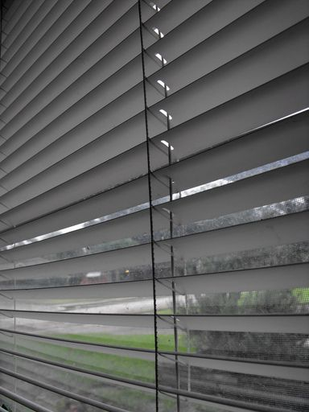

## 5.4 Measuring volume (EMG4K)

Volume is a measurement of how much space an object takes up (e.g. \(\text{600}\) \(\text{ml}\) of water). Capacity is a measure of how much liquid a container can hold when its full. (e.g. a \(\text{2}\) litre bottle). For example, if you have a \(\text{500}\) \(\text{ml}\) bottle of cola, with \(\text{200}\) \(\text{ml}\) of cola left inside it, the capacity of the bottle is \(\text{500}\) \(\text{ml}\), while the volume of cola inside it is \(\text{200}\) \(\text{ml}\).

As with length and weight, we use different containers or instruments to measure the volume of different quantities of liquid or dry ingredients. Some examples are given below:

|  | Measuring spoons come in different standard sizes or capacities, including a teaspoon (\(\text{5}\) \(\text{ml}\)) and a tablespoon (\(\text{15}\) \(\text{ml}\)). Some sets of spoons also include \(\frac{\text{1}}{\text{2}}\) and \(\frac{\text{1}}{\text{4}}\) teaspoons. |
| --- | --- |
|  | Measuring cups also come in standard capacities, including \(\text{1}\) cup (\(\text{250}\) \(\text{ml}\)), \(\frac{\text{1}}{\text{2}}\) a cup (\(\text{125}\) \(\text{ml}\)) and \(\frac{\text{1}}{\text{4}}\) cup (\(\text{63}\) \(\text{ml}\)). |
|  | Measuring jugs come in many different sizes, but the most common capacity is \(\text{1}\) litre. The measuring jug on the left gives measurements in litres and millilitres. It has a capacity of \(\text{1}\) \(\ell\). |
|  | Flasks, like measuring jugs, come in different capacities. They usually don't come with any calibrated measurements, (just a capacity measurement) so the only way to know what the volume of liquid inside a flask is, is to pour it out into a measuring jug. |
|  | The capacity of an average household bucket is \(\text{10}\) litres. Some buckets have litre markings on the inside that enable you to measure off a volume of liquid less than \(\text{10}\) litres. (This is only accurate to the nearest litre though!) |
|  | The capacity of a wheelbarrow is usually about \(\text{170}\) litres. |

As we learned in Chapter 3, it is possible to estimate the quantities of a substance that we need - for example heaped teaspoons. Another common way of estimating is using a fraction of a standard quantity, for example a quarter teaspoon of salt, or half a brick of butter.

<Callout type="tip" title="Worked example 7: Measuring volume">
**Question:**
1. An urn of boiling water in an office has a capacity of \(\text{20}\) litres.
   
   1. If it is filled to maximum capacity, calculate the number of \(\text{250}\) \(\text{ml}\) cups that can be shared from it.
   3. After everyone has their morning tea, there are only \(\text{6}\) litres of water left in the urn.
      1. How much water is this in ml?
      3. How many \(\text{250}\) \(\text{ml}\) cups of water are left in the urn now?
      5. What percentage of the urn still has water in it?
3. Jabu is building a new flower bed and is using a bucket to carry soil from another part of the garden to the new bed. He knows his bucket has a capacity of \(\text{10}\) \(\ell\).
   1. If he has \(\text{300}\) \(\ell\) of soil that needs to be moved, and for each trip he fills the bucket to the top with soil, how many trips will Jabu have to make with the bucket to move all the soil?
   3. Jabu decides that \(\text{10}\) litres of soil is too heavy to carry. How many trips will he have to make to move all the soil if he only fills the bucket with \(\text{7}\) litres of soil at a time?
   5. Jabu's friend Matthew arrives with his wheelbarrow and a spade. He suggests that Jabu should rather move the soil using the wheelbarrow. If the wheelbarrow has a capacity of \(\text{150}\) litres and they fill it to the brim, how many trips will Jabu have to make to move all the soil?
      
5. Dorothy goes hiking with her friends every Sunday morning. She always takes a flask of tea. She knows that the lid of the flask (which doubles as a cup) can hold \(\text{200}\) \(\text{ml}\) of water. If she can get five and a half cups of tea out of the flask, calculate the capacity of the flask, in litres.

1.
3. \(\text{20}\) litres = \(\text{20 000}\) \(\text{ml}\)
   \(\text{20 000}\) \(\text{ml}\) \(\div\) \(\text{250}\) \(\text{ml}\) = \(\text{80}\)
   \(\text{80 250}\) \(\text{ml}\) cups can be poured from the urn.
5. 1. \(\text{6}\) \(\ell\) = \(\text{6 000}\) \(\text{ml}\)
   3. \(\text{6 000}\) \(\text{ml}\) \(\div\) \(\text{250}\) \(\text{ml}\) = \(\text{24}\)
      There are \(\text{24}\) cups of water left in the urn.
   5. \(\frac{\text{6}\text{ ℓ}}{\text{20}\text{ ℓ}} \times \text{100} = \text{30}\%\)
      The urn is \(\text{30}\%\) full.
7. 1. \(\text{300}\text{ ℓ} \div \text{10}\text{ ℓ}\) = \(\text{30}\) trips.
   3. \(\text{300}\text{ ℓ} \div  \text{7}\text{ ℓ} = \text{42,8}\). Jabu can't make \(\text{0,8}\) of a trip so we round this up to \(\text{43}\) trips (even though the bucket won't have \(\text{7}\) litres of soil in it for the last trip).
   5. \(\text{300}\text{ ℓ} \div \text{150}\text{ ℓ}\) = \(\text{2}\) trips.
9. \(\text{200}\) \(\text{ml}\) \(\times\) \(\text{5,5}\) cups = \(\text{1 100}\) \(\text{ml}\) = \(\text{1,1}\) \(\ell\).
   The capacity of her flask is \(\text{1,1}\) litres.
</Callout>

## Measuring and comparing volume

### Exercise 5.6

**Problem:**
A six pack of soft drinks contains \(\text{6}\) cans of \(\text{330}\) \(\text{ml}\) each. What is the total volume of soft drink in a six pack? Give your answer in litres.

**Solution:**
\(\text{6}\) \(\times\) \(\text{330}\) \(\text{ml}\) = \(\text{1 980}\) \(\text{ml}\) = \(\text{1,98}\) litres

A large juice container has a capacity of \(\text{30}\) litres.

**Problem:**
If the container is \(\text{75}\%\) full, calculate the amount of juice in the container in litres.

**Solution:**
\(\text{30}\) litres \(\times\) \(\text{0,75}\) = \(\text{22,5}\) litres

**Problem:**
How many \(\text{300}\) \(\text{ml}\) cups of juice can you fill (to the top)?

**Solution:**
\(\text{22,5}\) litres \(\div\) \(\text{300}\) \(\text{ml}\) = \(\text{2 250}\) \(\text{ml}\) \(\div\) \(\text{300}\) \(\text{ml}\) = \(\text{6,8}\) cups = \(\text{6}\) full cups.

Jonathan uses the following recipe to make chocolate muffins:

\(\frac{\text{2}}{\text{3}}\) cup of baking cocoa

\(\text{2}\) large eggs

\(\text{2}\) cups of flour

\(\frac{\text{1}}{\text{2}}\) cup of sugar

\(\text{2}\) teaspoons of baking soda

\(\text{1}\frac{\text{1}}{\text{3}}\) cups of milk

\(\frac{\text{1}}{\text{3}}\) cup of sunflower oil

\(\text{1}\) teaspoon of vanilla essence

\(\frac{\text{1}}{\text{2}}\) teaspoon of salt

**Problem:**
If \(\text{1}\) teaspoon = \(\text{5}\) \(\text{ml}\), calculate how much baking soda Jonathan will use. Give your answer in ml.

**Solution:**
\(\text{2}\) \(\times\) \(\text{5}\) \(\text{ml}\) = \(\text{10}\) \(\text{ml}\).

**Problem:**
Calculate the amount of vanilla essence Jonathan will use in this recipe. Give your answer in ml.

**Solution:**
\(\text{1}\) tsp = \(\text{5}\) \(\text{ml}\).

**Problem:**
Jonathan does not own measuring cups but he does own a measuring jug calibrated in ml. How many ml of flour does he need? (\(\text{1}\) cup = \(\text{250}\) \(\text{ml}\)).

**Solution:**
\(\text{2}\) cups flour \(\times\) \(\text{250}\) \(\text{ml}\) = \(\text{500}\) \(\text{ml}\).

**Problem:**
If Jonathan buys a \(\text{100}\) \(\text{ml}\) bottle of vanilla essence, how many times will he be able to use the same bottle, if he bakes the same amount of muffins each time?

**Solution:**
\(\text{100}\) \(\text{ml}\) \(\div\) \(\text{5}\) \(\text{ml}\) = \(\text{20}\) times.

**Problem:**
The recipe above is used to make \(\text{30}\) muffins. Calculate how many cups of flour Jonathan will need to make \(\text{45}\) muffins.

**Solution:**
\(\dfrac{\text{2} \text{ cups flour}}{\text{30} \text{ cupcakes}} =   \dfrac{\text{3} \text{ cups flour}}{\text{45} \text{ cupcakes}}\) so he will need \(\text{3}\) cups of flour.

<Callout type="tip" title="Worked example 8: Calculating costs">
**Question:**
1. Suppose paraffin is sold at \(\text{R}\,\text{7,80}\) per litre at the local service station.
   1. How much will you pay for \(\text{5}\) litres of paraffin?
   3. How many litres of paraffin will you be able to buy for \(\text{R}\,\text{20}\)? Round off your answer to two decimal places.
   5. If you have a paraffin lamp at home that can hold \(\text{500}\) \(\text{ml}\) of paraffin, how many times will you be able to refill the lamp if you buy \(\text{3}\) litres of paraffin?
      
3. If petrol costs \(\text{R}\,\text{11,72}\) a litre:
   1. Calculate how much it costs to fill up a car that has a tank of \(\text{50}\) litres.
   3. Calculate how many litres you could buy with \(\text{R}\,\text{200}\). Round off your answers to two decimal places.
      

1. 1. Number of litres \(\times\) Cost per litre
      = \(\text{5}\) litres \(\times\) \(\text{R}\,\text{7,80}\) = \(\text{R}\,\text{39}\)
   3. Amount of money \(\div\) Cost per litre
      = \(\text{R}\,\text{20}\) \(\div\) \(\text{R}\,\text{7,80}\) = \(\text{2,56410256}\)\(\ldots\)
      \(\approx\) \(\text{2,56}\) litres (to two decimal places)
   5. \(\text{3}\) litres = \(\text{3 000}\) \(\text{ml}\)
      \(\text{3 000}\) \(\text{ml}\) \(\div\) \(\text{500}\) \(\text{ml}\) = \(\text{6}\)
      You would be able to refill the lamp \(\text{6}\) times.
3. 1. Number of litres \(\times\) Cost per litre
      = \(\text{50}\) litres \(\times\) \(\text{R}\,\text{10,72}\) = \(\text{R}\,\text{536}\)
   3. Amount of money \(\div\) Cost per litre
      = \(\text{R}\,\text{200}\) \(\div\) \(\text{R}\,\text{10,72}\) = \(\text{18,6567164}\)\(\ldots\)
      \(\approx\) \(\text{18,66}\) litres (to two decimal places)
</Callout>

## Measuring volume and calculating costs

### Exercise 5.7

Thandi is baking cupcakes and the recipe she has requires \(\text{1}\frac{\text{1}}{\text{3}}\) cups of milk.

**Problem:**
Calculate how many ml of milk she will need if \(\text{1}\) cup = \(\text{250}\) \(\text{ml}\).

**Solution:**
\(\text{1}\frac{\text{1}}{\text{3}}\) cups = \(\frac{\text{4}}{\text{3}}\). \(\frac{\text{4}}{\text{3}} \times \text{250}\) ml = \(\text{333}\) \(\text{ml}\) of milk.

**Problem:**
If the recipe is designed to produce \(\text{20}\) cupcakes, calculate the amount of milk required to bake \(\text{30}\) cupcakes. Give your answer in litres.

**Solution:**
\(\dfrac{\text{330}\text{ ml}}{\text{20} \text{ cupcakes}} = \dfrac{\text{500}\text{ ml}}{\text{30} \text{ cupcakes}}\). She will need \(\text{500}\) \(\text{ml}\) of milk.

**Problem:**
Milk is sold in bottles of \(\text{1}\) litre each for \(\text{R}\,\text{8,50}\) at the local store. Calculate the amount of money Thandi will need to spend on milk to make the \(\text{30}\) cupcakes.

**Solution:**
\(\text{1}\) bottle = \(\text{R}\,\text{8,50}\) (she will only use half).

Thabiso decides to sell homemade lemonade. He has made \(\text{5}\) litres of lemonade to sell at the local schools' rugby tournament.

**Problem:**
Thabiso will be selling his lemonade in \(\text{250}\) \(\text{ml}\) plastic cups. Calculate the number of cups of lemonade he will be able to sell.

**Solution:**
\(\text{5}\) litres = \(\text{5 000}\) \(\text{ml}\). \(\text{5 000}\) \(\text{ml}\) \(\div\) \(\text{250}\) \(\text{ml}\) = \(\text{20}\) cups.

**Problem:**
If he sells the lemonade at \(\text{R}\,\text{5}\) per cup, how much money will he make from the lemonade? (Assume that he sold all of his lemonade).

**Solution:**
\(\text{20}\) cups \(\times\) \(\text{R}\,\text{5}\) = \(\text{R}\,\text{100}\)

**Problem:**
If it cost Thabiso \(\text{R}\,\text{120}\) to make the lemonade, how many cups would he need to sell (at \(\text{R}\,\text{5}\) each) before he's made back the money he spent?

**Solution:**
\(\text{R}\,\text{120}\) \(\div\) \(\text{R}\,\text{5}\) = \(\text{24}\). He would need to sell \(\text{24}\) cups just to recoup his costs.
