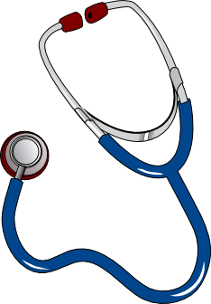
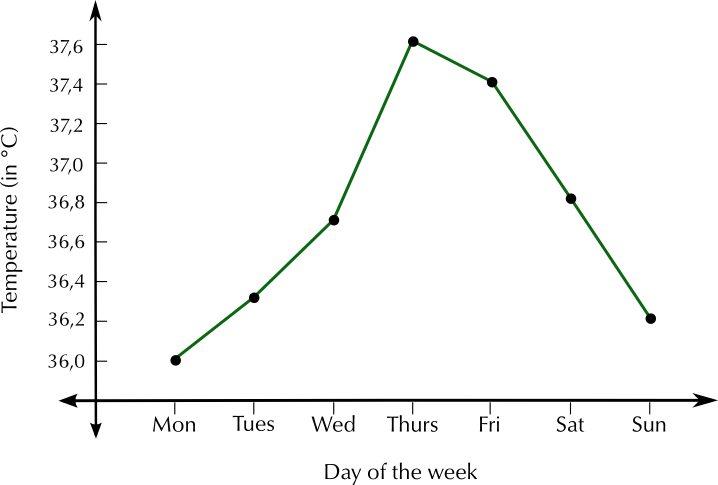
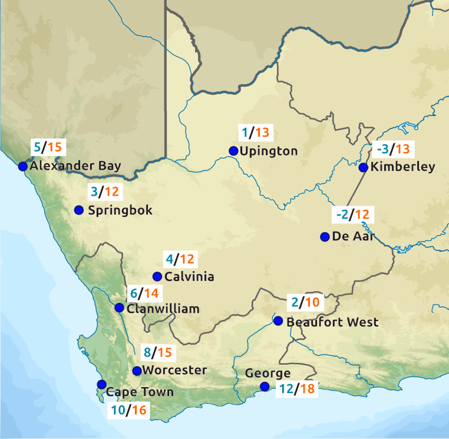
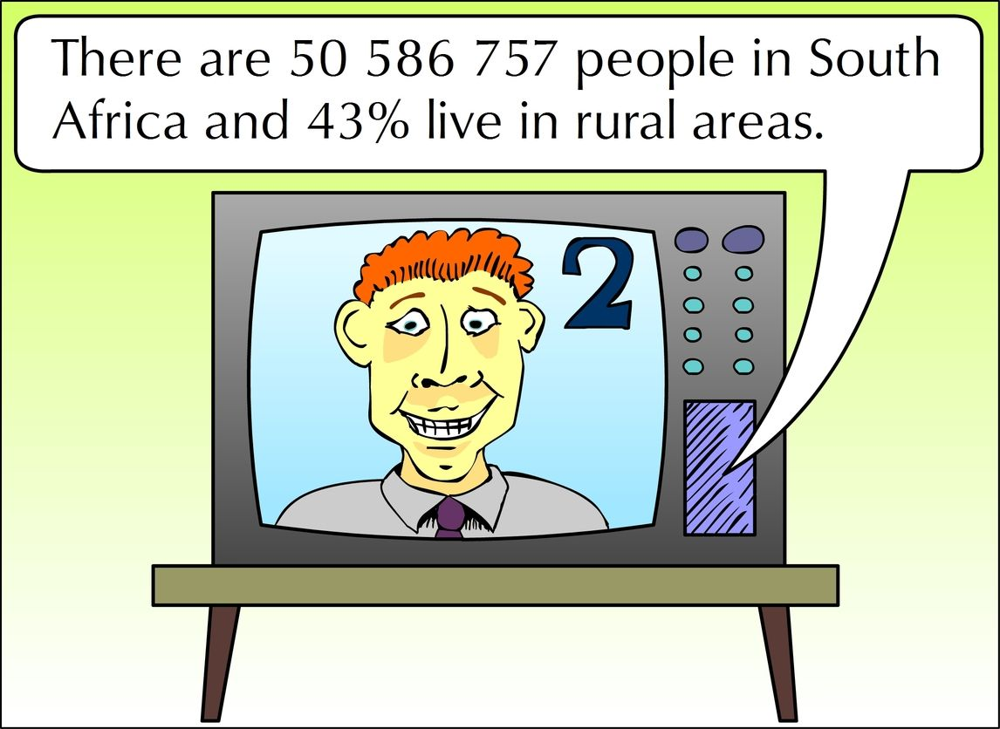
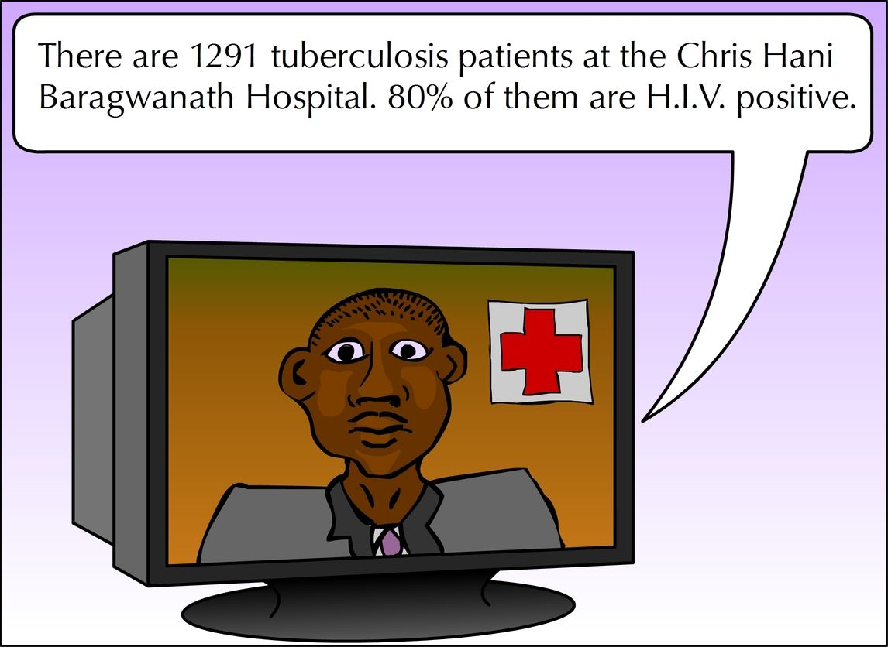
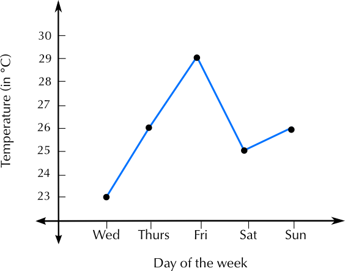
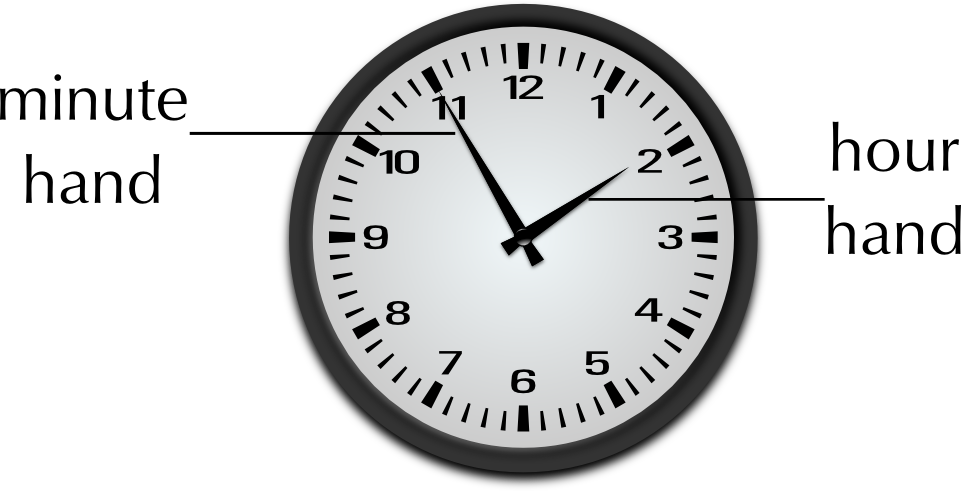

## 5.5 Measuring and monitoring temperature (EMG4M)

Temperature is involved in many aspects of our daily lives, including our own bodies and health; the weather and how warmly we must dress; and how hot the stove or oven must be in order to cook food.

Temperature can be negative or positive. The higher the positive temperature, the hotter it is. The lower the negative temperature, the colder it is.

Temperature is measured in degrees Celsius (°C). Water freezes and becomes ice at \(\text{0}\)\(\text{°C}\) and at sea level, it boils at \(\text{100}\)\(\text{°C}\). A normal temperature for a healthy person is between \(\text{36}\)\(\text{°C}\) and \(\text{37}\)\(\text{°C}\).

As with length, weight and volume, we use different instruments to measure temperature in different circumstances:

|  | An analogue thermometer is a thermometer that has no electronic parts fixed to it. The most common analogue thermometers are those used to measure your temperature when you're sick. They can usually measure temperature from about \(\text{32}\) - \(\text{42}\) degrees Celsius. (Anything lower or higher than that means you're extremely ill!) You can also get digital thermometers to measure human temperature. |
| --- | --- |
|  | An outdoor thermometer is a thermometer that is used to measure temperature outside. Some outdoor thermometers measure maximum and minimum temperature at the same time. The thermometer on the left measures the minimum temperature on the left hand side and the maximum temperature on the right. Both sides of the thermometer have mercury in them that expands when the temperature changes. A small blue bar indicates the highest/lowest temperature recorded since the thermometer was reset (by pushing the button in the middle). The mercury level shows the current temperature. |
|  | A stove dial does not give exact, accurate temperature but rather shows relative temperature settings. It has different heat levels (usually \(\text{1}\) - \(\text{6}\), coolest - hottest) for different cooking temperatures. |
|  | The oven temperature dial shows the actual temperature setting, not relative temperature. The numbers around the dial are in degrees Celsius. |
|  | A weather report may be a map, table or list, showing minimum and maximum temperature for a region or for the entire country.  Weather reports usually also contain information about rain forecasts and cloud cover. |

<Callout type="tip" title="Worked example 9: Measuring temperature">
**Question:**
Natalia feels like she is getting sick, and decides to measure her body temperature using a thermometer, once a day for a week to see if she is developing a fever. She knows that if her temperature rises above \(\text{37,5}\)\(\text{°C}\), she needs to see a doctor because this means she has an infection. Natalia records the following values:

| Day | Mon | Tues | Wed | Thurs | Fri | Sat | Sun |
| --- | --- | --- | --- | --- | --- | --- | --- |
| Temperature (°C) | \(\text{36,0}\) | \(\text{36,3}\) | \(\text{36,7}\) | \(\text{37,6}\) | \(\text{37,4}\) | \(\text{36,8}\) | \(\text{36,2}\) |

1. 1. What is the lowest temperature she records?
   3. What is the highest temperature she records?
   5. What is the difference between these two temperatures?
3. 1. Do you think Natalia should have seen a doctor? Give reasons for your answer.
   3. On what day was she the most ill?
   5. Do you think she was getting better by end of the week? Explain.
5. Draw a line graph plotting the information in the table.

1. 1. \(\text{36,0}\)\(\text{°C}\)
   3. \(\text{37,6}\)\(\text{°C}\)
   5. \(\text{37,6}\text{°C} - \text{37,6}\text{°C} = \text{1,6}\text{°C}\)
3. 1. Based on temperature alone, yes - her temperature on the Thursday was abnormally high. However, it started falling the next day. If it had remained at \(\text{37,6}\)\(\text{°C}\) or gotten higher, then she should definitely have gone to see the doctor.
   3. Thursday - her temperature was highest.
   5. Yes - her temperature was almost back to normal.
   
</Callout>

<Callout type="tip" title="Worked example 10: Reading a weather report">
**Question:**
The following weather report appears in the local newspaper in George, in the Western Cape. It gives the expected temperatures for one day in winter.

Study it and answer the questions that follow:

1. For which two South African provinces does this weather map show temperatures?
3. Explain why there are two temperatures given next to each town.
5. Which is the coldest town?
7. Which is the warmest town?
9. What is the difference between the two temperatures given for Alexander Bay?
11. What is the difference between the two temperatures given for De Aar?
13. Based on your own experience, at what time of day is it usually the coldest? (I.e. at what time of day is the minimum temperature likely to be reached?)
15. Harry is planning to drive from Cape Town to Beaufort West on the day for which these temperatures are forecast. Should he pack warm clothes? Explain your answer.

1. The Western and Northern Cape
3. The first temperature is the expected minimum temperature and the second one is the expected maximum temperature.
5. Kimberley.
7. George.
9. \(\text{15}\)\(\text{°C}\) - \(\text{5}\)\(\text{°C}\) = \(\text{10}\)\(\text{°C}\)
11. \(\text{12}\)\(\text{°C}\) - (\(--\text{2}\)\(\text{°C}\)) = \(\text{12}\) + \(\text{2}\) = \(\text{14}\)\(\text{°C}\)
13. It is usually the coldest late at night or very early in the morning - this is when the minimum temperature will occur.
15. Yes. Beaufort West is significantly colder than Cape Town, so Harry should pack warm clothes.
</Callout>

## Understanding temperature

### Exercise 5.8

**Problem:**
Katie is going to bake fish and potatoes for dinner. On the box of frozen fish, the instructions say “Cook for \(\text{20}\) min at \(\text{200}\)\(\text{°C}\)”. Her recipe for baked potatoes needs the oven temperature to be \(\text{120}\)\(\text{°C}\). What is the temperature difference between these two temperatures?

**Solution:**
\(\text{200}\)\(\text{°C}\) - \(\text{120}\)\(\text{°C}\) = \(\text{80}\)\(\text{°C}\)

**Problem:**
Bheki lives in Durban. He knows that at sea level, water boils at \(\text{100}\)\(\text{°C}\). He is trying to boil water in a kettle on the stove. If the water is \(\text{72}\)\(\text{°C}\), how much hotter does it need to be (in °C) before it will start boiling?

**Solution:**
\(\text{100}\)\(\text{°C}\) \(-\) \(\text{72}\)\(\text{°C}\) = \(\text{28}\)\(\text{°C}\) hotter

**Problem:**
Marie wants to make ice cubes. She knows that water freezes at \(\text{0}\)\(\text{°C}\). She measures the temperature of the water in the ice tray to be \(\text{23}\)\(\text{°C}\). How much colder (in °C) does the water have to be before it will freeze?

**Solution:**
\(\text{23}\)\(\text{°C}\) \(-\) \(\text{0}\)\(\text{°C}\) = \(\text{23}\)\(\text{°C}\) colder.

Thembile lives in Sutherland (the coldest town in South Africa) and records the following minimum temperatures, (in degrees Celsius), during winter:

\(\text{3}\); \(--\text{5}\); \(\text{6}\); \(\text{8}\); \(--\text{2}\); \(\text{4}\); \(\text{1}\); \(\text{0}\); \(\text{7}\)

**Problem:**
Arrange these temperatures from coldest to warmest.

**Solution:**
\(--\text{5}\); \(--\text{2}\); \(\text{0}\); \(\text{1}\); \(\text{3}\); \(\text{4}\); \(\text{6}\); \(\text{7}\); \(\text{8}\)

**Problem:**
What is the difference between the coldest and warmest temperature he recorded?

SALT Telescope, Sutherland

**Solution:**
\(\text{8}\text{°C} - (--\text{5}\text{°C}) = \text{13}\text{°C}\)

Aparna lives in Polokwane. She finds the following weather forecast for her city in the newspaper:

| Day | Wed | Thurs | Fri | Sat | Sun |
| --- | --- | --- | --- | --- | --- |
| Max Temp | \(\text{23}\) | \(\text{26}\) | \(\text{29}\) | \(\text{25}\) | \(\text{26}\) |
| Min Temp | \(\text{15}\) | \(\text{16}\) | \(\text{22}\) | \(\text{20}\) | \(\text{18}\) |

**Problem:**
What day is supposed to be the hottest?

**Solution:**
Friday

**Problem:**
On this hottest day, what will the difference between the maximum and minimum temperature be?

**Solution:**
\(\text{29}\text{°C} - \text{22}\text{°C} = \text{7}\text{°C}\)

**Problem:**
What is the difference between the minimum temperature on Wednesday and the minimum temperature on Sunday?

**Solution:**
\(\text{18}\text{°C} - \text{15}\text{°C} = \text{3}\text{°C}\)

**Problem:**
Draw a graph of the maximum temperatures.

**Solution:**

**Problem:**
On a separate set of axes, draw a graph of the minimum temperatures.

**Solution:**

**Problem:**
Do these two graphs have the same shape? Answer yes or no.

**Solution:**
No.
