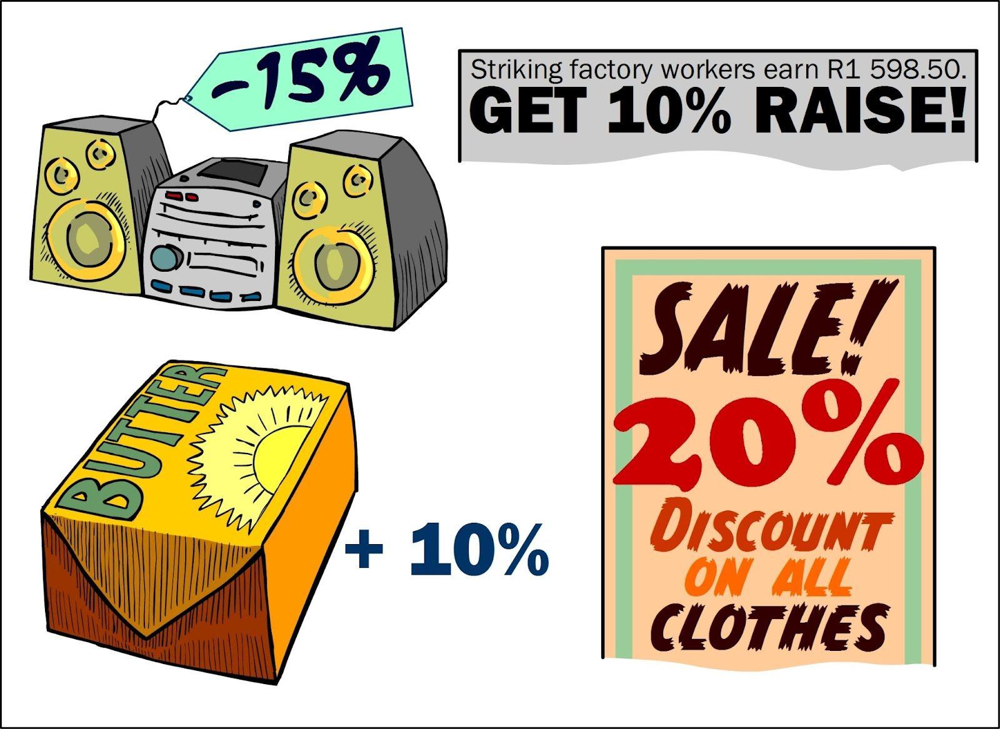
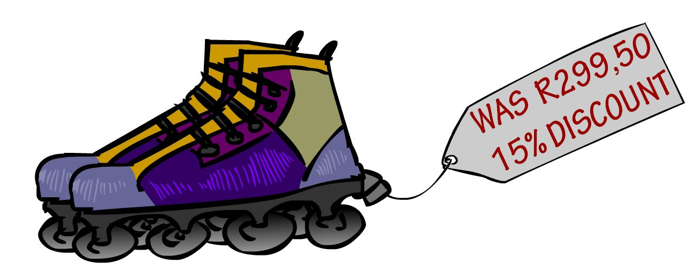
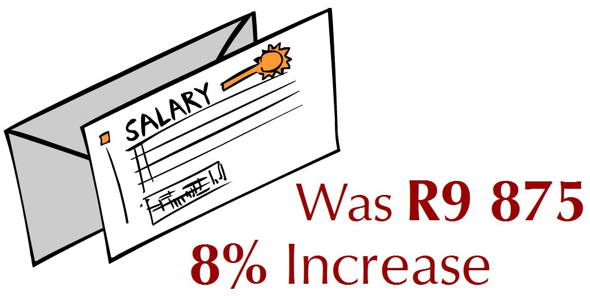

### Exercise 5.9

The Grade 10 class at Masibambane High School are organising a tea party for the residents of a nearby old age home.

Some of the class members are going to bake cake, using the following recipe:

\(\text{1}\) cup butter

\(\text{1}\) cup sugar

\(\text{1}\) teaspoon vanilla essence

\(\text{1}\) teaspoon lemon extract

\(\text{5}\) eggs

\(\text{2}\) cups flour

\(\text{1}\) teaspoon baking powder

\(\text{2}\) egg whites for icing

**Problem:**
The learners know that this recipe will make one cake, and that one cake yields \(\text{8}\) slices. If there will be \(\text{60}\) people at the tea party, and everyone has only one slice of cake, how many cakes do they need to make?

**Solution:**
\(\text{60}\) \(\div\) \(\text{8}\) = \(\text{7,5}\) cakes. They can't bake half a cake so they will have to bake \(\text{8}\).

The learners decide to bake \(\text{9}\) cakes, so that there will be more than enough cake to go around.

**Problem:**
How many cups of butter will they need?

**Solution:**
\(\text{9}\) cups.

**Problem:**
How many litres of flour will they need? (\(\text{1}\) cup = \(\text{250}\) \(\text{ml}\)).

**Solution:**
\(\text{1}\) cake requires \(\text{2}\) cups = \(\text{250}\) \(\text{ml}\) of flour. \(\text{9}\) \(\times\) \(\text{250}\) \(\text{ml}\) = \(\text{2 250}\) \(\text{ml}\) = \(\text{2,25}\) litres

**Problem:**
How many ml of vanilla essence will the learners need for \(\text{9}\) cakes? (\(\text{1}\) tsp = \(\text{5}\) \(\text{ml}\)).

**Solution:**
\(\text{1}\) cake requires \(\text{1}\) tsp = \(\text{5}\) \(\text{ml}\). \(\text{9}\) \(\times\) \(\text{5}\) \(\text{ml}\) = \(\text{45}\) \(\text{ml}\) of vanilla essence.

**Problem:**
If vanilla essence is sold in \(\text{25}\) \(\text{ml}\) bottles, how many bottles will the learners need to buy?

**Solution:**
\(\text{45}\) \(\text{ml}\) \(\div\) \(\text{25}\) = \(\text{1,8}\) bottles. They can't buy \(\text{0,8}\) of a bottle so they will have to buy \(\text{2}\) bottles.

**Problem:**
If vanilla essence costs \(\text{R}\,\text{7,85}\) a bottle, how much will the required vanilla essence for \(\text{9}\) cakes cost?

**Solution:**
\(\text{2}\) \(\times\) \(\text{R}\,\text{7,85}\) = \(\text{R}\,\text{15,70}\)

**Problem:**
How many eggs will the learners need for \(\text{9}\) cakes?

**Solution:**
\(\text{5}\) eggs \(\times\) \(\text{9}\) cakes = \(\text{45}\) eggs.

**Problem:**
If eggs are sold in boxes of \(\text{6}\), how many boxes will they need to buy and how many eggs will be left over?

**Solution:**
\(\text{45}\) \(\div\) \(\text{6}\) = \(\text{7,5}\) boxes. They can't buy \(\text{0,5}\) of a box so they will have to buy \(\text{8}\) boxes. \(\text{6}\) \(\times\) \(\text{8}\) boxes = \(\text{48}\) eggs. \(\text{48}\) - \(\text{45}\) = \(\text{3}\) eggs left over.

**Problem:**
If one box of eggs costs \(\text{R}\,\text{8,40}\), how much will enough eggs for \(\text{9}\) cakes cost?

**Solution:**
\(\text{R}\,\text{8,40}\) \(\times\) \(\text{8}\) boxes = \(\text{R}\,\text{67,20}\)

**Problem:**
The cakes are baked in square cake tins. If the width of one cake is \(\text{200}\) \(\text{mm}\), how wide will \(\text{6}\) cakes packed side by side be? (Give your answer in cm).

**Solution:**
\(\text{200}\) \(\text{mm}\) \(\times\) \(\text{6}\) = \(\text{1 200}\) \(\text{mm}\) = \(\text{120}\) \(\text{cm}\)

**Problem:**
If one cake weighs \(\text{700}\) \(\text{g}\), and there are \(\text{8}\) slices per cake, calculate how much one slice will weigh.

**Solution:**
\(\text{700}\) \(\text{g}\) \(\div\) \(\text{8}\) = \(\text{87,5}\) \(\text{g}\)

The cake needs to be baked in the oven for \(\text{40}\) minutes at \(\text{180}\)\(\text{°C}\). According to the oven's temperature dial, the temperature in the oven is \(\text{200}\)\(\text{°C}\).

**Problem:**
By how much must the oven cool before the cake can be baked?

**Solution:**
\(\text{200}\)\(\text{°C}\) - \(\text{180}\)\(\text{°C}\) = \(\text{20}\)\(\text{°C}\)

**Problem:**
What do you think will happen if they leave the oven temperature at \(\text{200}\)\(\text{°C}\) and bake the cake at this higher temperature?

**Solution:**
The cake will flop, or it may burn.

Other learners in the class are going to make fruit juice for the tea party.

**Problem:**
They estimate that each person will have \(\text{600}\) \(\text{ml}\) of juice. How many **litres** of juice will they need to make in total (for \(\text{60}\) people)?

**Solution:**
\(\text{600}\) \(\text{ml}\) \(\times\) \(\text{60}\) = \(\text{36 000}\) \(\text{ml}\) = \(\text{36}\) litres.

The class makes \(\text{40}\) litres of juice. They wish to transport it in \(\text{1,5}\) \(\ell\) flasks.

**Problem:**
How many flasks will they need?

**Solution:**
\(\text{40}\) litres \(\div\) \(\text{1,5}\) litres = \(\text{26,67}\) flasks. They can't have \(\text{0,67}\) of a flask so they will need \(\text{27}\) flasks.

**Problem:**
If they only have \(\text{15}\) flasks, (and can transport \(\text{15}\) flasks at once from the school to the home) how many trips will they have to make to get all the fruit juice to the tea party?

**Solution:**
\(\text{27}\) flasks \(\div\) \(\text{15}\) flasks = \(\text{1,78}\) trips. They can't make \(\text{0,78}\) of a trip so they iwll have to make \(\text{2}\) trips.

The old age home has a kettle that can hold \(\text{1,7}\) litres of water.

**Problem:**
How many \(\text{200}\) \(\text{ml}\) cups of water can be poured from the kettle when it is full?

**Solution:**
\(\text{1,7}\) litres = \(\text{1 700}\) \(\text{ml}\). \(\text{1 700}\) \(\text{ml}\) \(\div\) \(\text{200}\) \(\text{ml}\) = \(\text{8,5}\). So they can fill \(\text{8}\) full cups.

**Problem:**
What percentage of \(\text{1,7}\) litres is one \(\text{200}\) \(\text{ml}\) cup?

**Solution:**
\(\frac{\text{200}\text{ ml}}{\text{1 700}\text{ ml}} = \text{0,12}\) = \(\text{12}\) percent

**Problem:**
Alison measures the temperature of the water in the kettle (with a thermometer) to be \(\text{65}\)\(\text{°C}\). She knows that the water will boil at \(\text{100}\)\(\text{°C}\). How much hotter (in °C) does the water need to be in order to boil?

**Solution:**
\(\text{100}\)\(\text{°C}\) - \(\text{65}\)\(\text{°C}\) = \(\text{35}\)\(\text{°C}\)

**Problem:**
The class decide they also want to buy bags of sweets for their tea party. If one \(\text{250}\) \(\text{g}\) bag of jelly beans costs \(\text{R}\,\text{5,49}\), calculate how much \(\text{3}\) \(\text{kg}\) of jelly beans will cost.

**Solution:**
There are \(\text{4 250}\) \(\text{g}\) bags in \(\text{1}\) \(\text{kg}\), so \(\text{3}\) \(\text{kg}\) = \(\text{3}\) \(\times\) \(\text{4}\) = \(\text{12}\) bags. \(\text{12}\) \(\times\) \(\text{R}\,\text{5,49}\) = \(\text{R}\,\text{65,88}\)

The learners estimate that each person will eat \(\text{300}\) \(\text{g}\) of biscuits.

**Problem:**
If there are \(\text{60}\) people attending the party, how many kg of biscuits should they buy?

**Solution:**
\(\text{60}\) \(\times\) \(\text{300}\) \(\text{g}\) = \(\text{18 000}\) \(\text{g}\) = \(\text{18}\) \(\text{kg}\)

**Problem:**
If biscuits are only sold in \(\text{500}\) \(\text{g}\) boxes, how many boxes will they need to buy?

**Solution:**
\(\text{18 000}\) \(\text{g}\) \(\div\) \(\text{500}\) \(\text{g}\) = \(\text{36}\) boxes.

**Problem:**
If one box of biscuits costs \(\text{R}\,\text{3,99}\), calculate how much the learners will have to spend to buy enough biscuits for everyone.

**Solution:**
\(\text{36}\) boxes \(\times\) \(\text{R}\,\text{3,99}\) = \(\text{R}\,\text{143,64}\)

The Grade 10 class want to hang ribbons in the room where they are going to host their tea party. They want to cut the ribbons into \(\text{600}\) \(\text{mm}\) lengths.

**Problem:**
If they buy \(\text{5}\) \(\text{m}\) of ribbon, how many whole pieces of \(\text{600}\) \(\text{mm}\) ribbon will they be able to cut?

**Solution:**
\(\text{5}\) \(\text{m}\) = \(\text{5 000}\) \(\text{mm}\). \(\text{5 000}\) \(\text{mm}\) \(\div\) \(\text{600}\) \(\text{mm}\) = \(\text{8,33}\). So they can cut \(\text{8}\) whole pieces of ribbon.

**Problem:**
If the ribbon costs \(\text{R}\,\text{6,99}\) per metre, how much will the ribbon cost in total?

**Solution:**
\(\text{R}\,\text{6,99}\) \(\times\) \(\text{5}\) \(\text{m}\) = \(\text{R}\,\text{34,95}\)

The class checks the weather report for the week in which the want to have the party:

| Day | Mon | Tues | Wed | Thurs | Fri |
| --- | --- | --- | --- | --- | --- |
| Temperatures | \(\text{15}\)/\(\text{17}\) | \(\text{14}\)/\(\text{19}\) | \(\text{18}\)/\(\text{23}\) | \(\text{19}\)/\(\text{26}\) | \(\text{17}\)/\(\text{20}\) |

**Problem:**
If they want to have the tea party outside in the home's gardens, on which day should the plan to do it? Give reasons for your answer.

**Solution:**
Thursday - the weather will be warmest for an outdoor event.

**Problem:**
What is the lowest temperature predicted for the week?

**Solution:**
\(\text{14}\)\(\text{°C}\).

**Problem:**
What is the highest temperature predicted for the week?

**Solution:**
\(\text{26}\)\(\text{°C}\).

**Problem:**
What is the difference between the minimum and maximum temperatures forecast for the Tuesday?

**Solution:**
\(\text{19}\text{°C} - \text{14}\text{°C} = \text{5}\text{°C}\).
