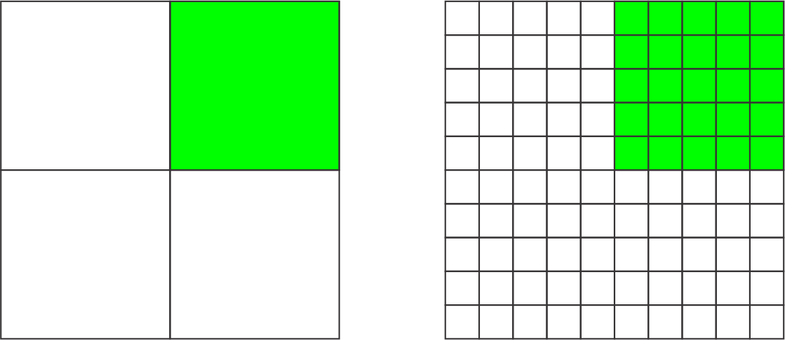
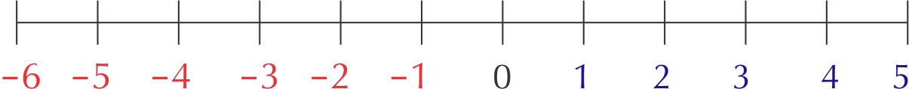
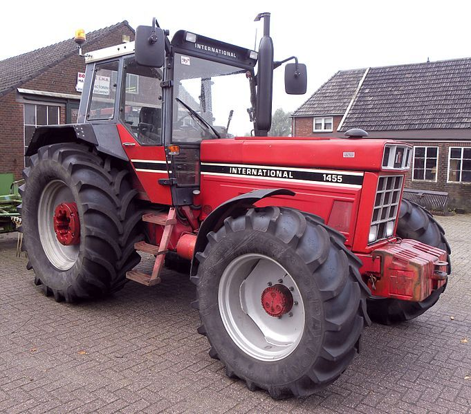
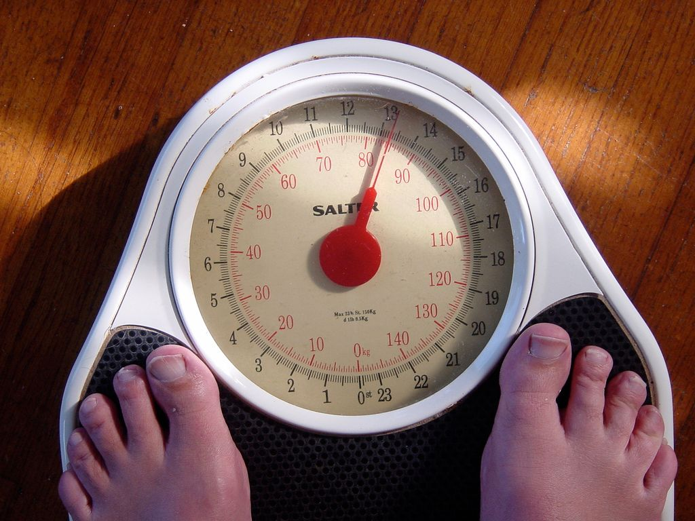

## 6.3 Maps, directions, seating and floor plans (EMG4W)

Knowing how to use scale maps is an important skill. It is also useful to know how to describe the position of an object (like a shop in a shopping centre, or classroom at your school) in relation to the objects around it.

For example, if you are at home and your friend is nearby and wants to visit you, you will need to give them instructions to get to your house, such as “turn left at the corner of Flower Street, walk straight down the road, pass the shop on your left, turn right into Yellow Street and my house is number \(\text{14}\), with the green gate”.

In this section we will continue to work with the number and bar scales. We will also learn how to interpret and write simple directional instructions, and how to read seating and floor plans.

<Callout type="tip" title="Worked example 6: Using the number scale and directional navigation on a classroom seating plan">
**Question:**
Study the classroom plan below and answer the questions that follow:

1. How many learners are in this class if there is one learner at each desk?
3. Which learner is sitting to the left of learner K?
5. Which learners are sitting closest to the windows?
7. The scale of this plan is given as \(\text{1}\) : \(\text{50}\). Using your ruler and calculator, calculate:
   1. The width of the classroom (from the windows to the bookshelf).
   3. The length of the classroom (from the blackboard to the wall behind learners M, N and O).
   5. The width of the teacher's desk.
9. You sit at desk K. Explain how you would get from the door to your desk, using words like “left, right, in front of” and “behind”.
11. Your friend forgets her bag in the classroom, and asks you to go and fetch it for her. She gives you the following directions: “Walk in through the door and turn right after the second row of desks. Walk past four rows of desks and look to your left, look over the desk next to you. My bag is on the floor.” Where did she leave her bag?

1. \(\text{15}\) learners
3. Learner J
5. Learners D, J and M
7. 1. On the seating plan, the classroom is \(\text{10,5}\) \(\text{cm}\) wide.
      \(\text{10,5}\) \(\text{cm}\) \(\times\) \(\text{50}\) = \(\text{525}\) \(\text{cm}\) = \(\text{5,25}\) \(\text{m}\)
   3. \(\text{15}\) \(\text{cm}\) \(\times\) \(\text{50}\) = \(\text{750}\) \(\text{cm}\) = \(\text{7,5}\) \(\text{m}\)
   5. \(\text{4,5}\) \(\text{cm}\) \(\times\) \(\text{50}\) = \(\text{225}\) \(\text{cm}\) = \(\text{2,25}\) \(\text{m}\)
9. Walk in through the door and turn right before desk B. Walk straight down the aisle passing desks E and H on the left. At desk K (behind desk H) turn around to face the blackboard and sit down in the seat.
11. Next to the bookshelf, or next to desk O.
</Callout>

## Using the bar scale and directional navigation on a school ground plan

### Exercise 6.4

**Problem:**
Measure the width and length of the sports field in mm.

**Solution:**
Width = \(\text{50}\) \(\text{mm}\). Length = \(\text{100}\) \(\text{mm}\).

**Problem:**
Use the bar scale to estimate the real (actual) width and length of the field in metres.

**Solution:**
\(\text{10}\) \(\text{mm}\) on ruler = \(\text{10}\) \(\text{m}\) on the ground. Width = \(\text{50}\) \(\text{mm}\). \(\text{50}\) \(\text{mm}\) \(\div\) \(\text{10}\) \(\text{mm}\) (length of one segment of bar scale) = \(\text{5}\) segments. \(\text{5}\) segments \(\times\) \(\text{10}\) \(\text{m}\) = \(\text{50}\) \(\text{m}\). Length = \(\text{100}\) \(\text{mm}\). \(\text{100}\) \(\text{mm}\) \(\div\) \(\text{10}\) \(\text{mm}\) (length of \(\text{1}\) segment) = \(\text{10}\) segments. \(\text{10}\) segments \(\times\) \(\text{10}\) \(\text{m}\) = \(\text{100}\) \(\text{m}\).

**Problem:**
What subject would you be studying if you are in classroom A3?

**Solution:**
Science.

**Problem:**
What subject is taught in the classrooms that are next to the hall and face the sports fields?

**Solution:**
Mathematics.

**Problem:**
Tebogo, a new learner, has started at your school. You are in the Science classroom, A1, when the break bell rings. Explain to Tebogo how to get to the tuckshop.

**Solution:**
Walk out of the Science classroom towards to sports field. Turn left, and walk along the edge of the field towards to school hall building. At the school hall, turn right. At the first opportunity, turn left (before the maths classrooms) and walk past the maths building. Then turn right and walk straight towards the tree. At the tree, turn left. The tuckshop will be the building in front of you.

<Callout type="tip" title="Worked example 7: Understanding a cinema seating plan">
**Question:**
Study the cinema seating plan below and answer the questions that follow:

1. If you wanted to book seats for a movie, which seats would you want to sit in?
3. Are seats N 11 and N 12 available?
5. Which seats offer you and your classmates a best view and why?
7. You are going to the movies with a friend in a wheelchair. Name one seat where they can sit, and the seat next to it where you can sit with them?
9. Where will you sit if you want to have a front view of the screen?
11. What fraction of row N has been booked?
13. What percentage of the theatre is still available?

1. For example: L8 and L9
3. No. They are booked.
5. Middle section because, it is not too close nor too far, from the screen
7. For example, friend could sit in the wheelchair seat next to D1, and you could sit in D1
9. Row A.
11. \(\frac{\text{5}}{\text{24}}\)
13. \(\text{211} \div \text{234} \times \text{100}  = \text{90,17} \approx \text{90}\%\)
</Callout>

## Understanding a stadium seating plan

### Exercise 6.5

Study the plan of a rugby stadium below, and answer the questions below:

**Problem:**
Using words such as “near to” and “in the middle of”, describe the position of a player standing at the point marked X.

**Solution:**
A player at Point X would be standing on the field, near the left hand side goal posts, and the Category 5 seats in Block G of the South Stand ramp seating.

**Problem:**
Why do you think the seats are categorised?

**Solution:**
The seats are colour-coded and categorised by price.

**Problem:**
Describe the position of the stand that contains the most Category 3 seats.

**Solution:**
The West Stand has the most Category 3 seats. It is on the left of the stadium, between the North Stand and the South Stand.

**Problem:**
If your are standing at Point Y, what is the quickest way to get to the South Stand Ramp seating?

**Solution:**
Walk behind the East stand seating, with the stadium on your right. Then turn right and walk straight to the South Stand Ramp seating.

**Problem:**
Describe the position of the hot dog stand at Point Z.

**Solution:**
The hot dog stand at Point Z is in the top-left corner of the diagram. It is between the West and North Stands.

**Problem:**
Your friend is at the hot dog stand (at Z). Explain to him how to find you if you are seated in a category 5 seat, Block A.

**Solution:**
Walk behind the West stands (with the stands on your left). Turn left at the end of the stands, and walk straight to the edge of the South Stand ramp seating. Walk between the South Stand Ramp seating and South Stand Seating Level 1, past Blocks H, G, F, E, D, C and B. Block A (category 5) is on your left, at the end of the South Stand Ramp Seating.

**Problem:**
The width of the rugby field is \(\text{70}\) \(\text{m}\) the length \(\text{144}\) \(\text{m}\). Draw a scale drawing of the rugby field using the number scale \(\text{1}\) : \(\text{1 000}\).

**Solution:**
Width = \(\text{70}\) \(\text{m}\) = \(\text{7 000}\) \(\text{cm}\). \(\text{7 000}\) \(\text{cm}\) \(\div\) \(\text{1 000}\) = \(\text{7}\) \(\text{cm}\). So scaled width is \(\text{7}\) \(\text{cm}\). Length is \(\text{144}\) \(\text{m}\) = \(\text{1 440}\) \(\text{cm}\). \(\text{1 440}\) \(\text{cm}\) \(\div\) \(\text{1 000}\) = \(\text{14,4}\) \(\text{cm}\). So scaled length is \(\text{14,4}\) \(\text{cm}\).

We will study floor plans and symbols in more detail in Chapter 10, but for the next worked example it is important to understand that symbols are often used on maps as a short-hand way of representing information. Some symbols that you may be familiar with are:

| Lift | Escalator | Stairs | Toilets | Restaurant | Disabled Access |
| --- | --- | --- | --- | --- | --- |

<Callout type="tip" title="Worked example 8: Finding our way in a shopping mall">
**Question:**
Study the map of the shopping centre below and answer the questions that follow:

1. Why do you think Checkers and Pick 'n Pay are the same colour?
3. Between which two shops would you find the escalator?
5. If you want to go to the gym which entrance would you use? Explain why.
7. Is the gym on the ground floor? Explain.
9. If you are the owner of a store, what number shop would you choose for your shop? Explain why.
11. Which entrance would you go to, to use a public phone?
13. UBy which entrances can disabled parking be found?
15. Give a possible reason for why this shopping centre has \(\text{4}\) ATM's.
17. Explain where the kiosks are situated.
19. You enter the shopping centre at entrance G3. You need to withdraw money from the ATM machine at shop number 32a. Give directions to explain how you would get there.

1. Because they are the same kind of store - they are both large supermarkets.
3. Between Edgars and shop 20/21.
5. You could use entrance G3 because it is closest to the escalators and stairs to the gym.
7. No. The gym is on the upper level. The gym logo points to the symbols for lifts and stairs, showing that it is up one level.
9. There are many possible answers to this, but one example is Shop 11a. Shop 11a is next door to the entrance to Pick n Pay, so there should be lots of people walking past it every day on their way to Pick n Pay. In other words, lots of people would see your shop and what you were selling! For similar reasons, Shop 36a next ot Checkers would also be a good choice.
11. G2.
13. Disabled parking can be found in the parking lots outside G2 and and G3. There is no disabled parking outside G1.
15. Each ATM could be for a different bank - e.g. ABSA, FNB, Nedbank and Standard Bank.
17. The kiosks are situated in the middle of the mall between shops 5 and 39/40. They are near the main entrance to Edgars and the mall's information booth.
19. From entrance G3, go straight past shops 15, 14, 13 ,12. At shop 20/21, turn right before the escalators. Keep going straight past Woolworths, and past the stairs and elevators (on your left). Pass shops 27, 28, 29, 30, 31 on your right. The ATM in front of shop 32a will be on your right, just before the public phones and entrance G2.
</Callout>

## Navigating a shopping mall

### Exercise 6.6

Study the map of the ground floor of a shopping centre and answer the questions that follow:

**Problem:**
You want to go to Shop 37 to buy new shoes. What store will you find next to it?

**Solution:**
Shop 35: CNA

**Problem:**
What does “G51 Woolworths” mean on this map?

**Solution:**
Woolworths is Shop 51 on the ground floor.

**Problem:**
Do you think this shopping centre has more than one floor? Explain your answer.

**Solution:**
Yes - there are stairs indicated on the map.

**Problem:**
Where should you park if you want to go to Fournos bakery and buy some fresh bread?

**Solution:**
Near Entrance 5.

**Problem:**
Name the two stores you could buy stationery from and describe how you would get to each of them from Entrance 1.

**Solution:**
1. CNA: Go straight towards Shop 29. Turn right, go left around the corner at Shop 31. Go straight. CNA will be on your left. 2: Pick n Pay: Go straight passing shops G07 - G02 on your left. Turn left into the entrance of Pick n Pay.

**Problem:**
If you are at Entrance 2, explain how you would get to the toilets.

**Solution:**
Go straight, turn left at Shop 18, in front of the stairs. Walk past shops 18 - 23 (following the mall as it curves to the right). Turn slightly left towards Pick 'n Pay. Just before Pick 'n Pay, turn right, between shops 28 and 29. Go straight down this passageway, the toilets are at the end.

**Problem:**
You are standing at the entrance of Dis-Chem. Your friend arrives at Entrance 5 and wants to meet you. Give your friend directions to explain where they will find you.

**Solution:**
Go straight, keeping to the left of the escalators in the middle. Pass the entrance to Woolworths on your left. Pass shops 53 - 56 (on your left) and then turn left in front of the escalators/stairs. Go straight, passing shops G59, 58 and 57. Dis-Chem will be in front of you.
