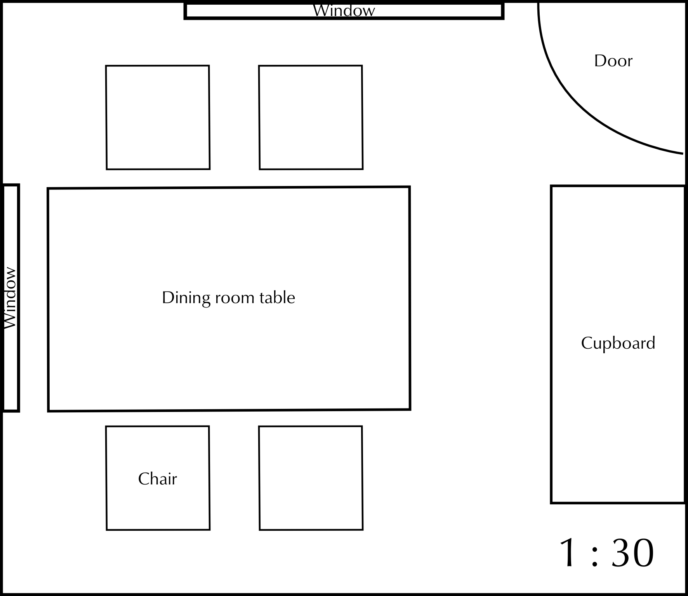
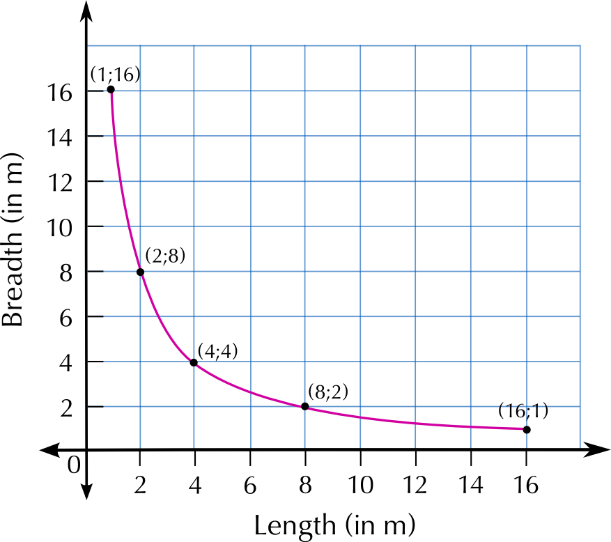

### Exercise 6.7

Using the number scale estimate the actual (real) size  in metres of:

**Problem:**
The dining room table.

**Solution:**
(\(\text{8}\) \(\text{cm}\) \(\times\) \(\text{5}\) \(\text{cm}\)) \(\times\) \(\text{30}\) = \(\text{240}\) \(\text{cm}\) \(\times\) \(\text{150}\) \(\text{cm}\) = \(\text{2,4}\) \(\text{m}\) \(\times\) \(\text{1,5}\) \(\text{m}\)

**Problem:**
The chairs.

**Solution:**
(\(\text{2,3}\) \(\text{cm}\) \(\times\) \(\text{2,3}\) \(\text{cm}\)) \(\times\) \(\text{30}\) = \(\text{69}\) \(\text{cm}\) \(\times\) \(\text{69}\) \(\text{cm}\) =\(\text{0,69}\) \(\text{m}\) \(\times\) \(\text{0,69}\) \(\text{m}\)

**Problem:**
The cupboard.

**Solution:**
(\(\text{3}\) \(\text{cm}\) \(\times\) \(\text{7}\) \(\text{cm}\)) \(\times\) \(\text{30}\) = \(\text{90}\) \(\text{cm}\) \(\times\) \(\text{210}\) \(\text{cm}\) = \(\text{0,9}\) \(\text{m}\) \(\times\) \(\text{2,1}\) \(\text{m}\)

**Problem:**
Using the number scale estimate the actual (real) size of the dimensions of the room in metres.

**Solution:**
(\(\text{15}\) \(\text{cm}\) \(\times\) \(\text{13}\) \(\text{cm}\)) \(\times\) \(\text{30}\) = \(\text{450}\) \(\text{cm}\) \(\times\) \(\text{390}\) \(\text{cm}\) = \(\text{4,5}\) \(\text{m}\) \(\times\) \(\text{3,9}\) \(\text{m}\)

**Problem:**
Explain where the door to the room is.

**Solution:**
The door is in the corner of the room, between the window and the cupboard.

**Problem:**
Is it possible to calculate how high the windows are? Explain your answer.

**Solution:**
No. We are not given any information about the height of the windows. We can only calculate how long they are.

**Problem:**
Calculate the width of curtaining that will be required for both windows (in cm).The width of the material required should be twice the width of the window.

**Solution:**
Top window = \(\text{7}\) \(\text{cm}\) long. \(\text{7}\) \(\text{cm}\) \(\times\) \(\text{30}\) = \(\text{210}\) \(\text{cm}\). \(\text{210}\) \(\text{cm}\) \(\times\) \(\text{2}\) = \(\text{420}\) \(\text{cm}\). Left window = \(\text{5}\) \(\text{cm}\) long. \(\text{5}\) \(\text{cm}\) \(\times\) \(\text{30}\) \(\text{cm}\) = \(\text{150}\) \(\text{cm}\). \(\text{150}\) \(\text{cm}\) \(\times\) \(\text{2}\) = \(\text{300}\) \(\text{cm}\). \(\text{420}\) \(\text{cm}\) + \(\text{300}\) \(\text{cm}\) = \(\text{720}\) \(\text{cm}\) of material for both curtains.

**Problem:**
Rearrange the furniture in this room. To help you, you can redraw and cut out the same size shapes. Draw the basic structure of the room (the walls, windows and door) in your books. Use the shapes you cut out to show your new room design. Paste them onto your room plan when you are happy with your design. You may also include some pictures from magazines to show what kind of furniture and accessories you would like in your room.

**Solution:**
Learner-dependent answer.

A carpet measures \(\text{1,8}\) \(\text{m}\) by \(\text{1,2}\) \(\text{m}\).

**Problem:**
Using the scale \(\text{1}\) : \(\text{30}\), draw a scale version of the carpet.

**Solution:**
\(\text{1,8}\) \(\text{m}\) = \(\text{180}\) \(\text{cm}\). \(\text{180}\) \(\div\) \(\text{30}\) = \(\text{6}\) \(\text{cm}\) on scale map.  \(\text{1,2}\) \(\text{m}\) = \(\text{120}\) \(\text{cm}\). \(\text{120}\) \(\text{cm}\) \(\div\) \(\text{30}\) = \(\text{4}\) \(\text{cm}\) on scale map. So diagram will be a rectangle that is \(\text{6}\) \(\text{cm}\) \(\times\) \(\text{4}\) \(\text{cm}\).

**Problem:**
Will the carpet fit into the room in Question 1? Explain your answer.

**Solution:**
Yes - the dimensions of the carpet are smaller than the dimensions of the room.

The following diagram shows a walled day care facility. Answer the questions that follow.

Use the bar scale to estimate the actual (real) size in metres of:

**Problem:**
The swimming pool.

**Solution:**
Dimensions = \(\text{3}\) \(\text{cm}\) \(\times\) \(\text{6}\) \(\text{cm}\) = \(\text{2}\) segments \(\times\) \(\text{4}\) segments = \(\text{6}\) \(\text{m}\) \(\times\) \(\text{12}\) \(\text{m}\).

**Problem:**
The daycare centre.

**Solution:**
Dimensions = \(\text{3}\) \(\text{cm}\) \(\times\) \(\text{7}\) \(\text{cm}\) = \(\text{2}\) segments \(\times\) \(\text{4,66667}\) segments = \(\text{6}\) \(\text{m}\) \(\times\) \(\text{14}\) \(\text{m}\)

**Problem:**
The lawn.

**Solution:**
Dimensions = \(\text{3}\) \(\text{cm}\) \(\times\) \(\text{3}\) \(\text{cm}\) = \(\text{2}\) segments \(\times\) \(\text{2}\) segments = \(\text{6}\) \(\text{m}\) \(\times\) \(\text{6}\) \(\text{m}\)

**Problem:**
Health and and safety regulations require that the swimming pool has a fence around it. The fence must be a minimum of \(\text{1,5}\) \(\text{m}\) from the pool. The fence must run from the left boundary wall (between the pool and playground) around the bottom of the pool, and then between the pool and the lawn, to the top boundary wall (i.e. it goes around the bottom and the right side of the pool). Calculate the minimum amount of fencing required.

**Solution:**
Pool is \(\text{6}\) \(\text{m}\) \(\times\) \(\text{12}\) \(\text{m}\). So fencing is (\(\text{6}\) + \(\text{1,5}\) \(\text{m}\)) + (\(\text{12}\)\(\text{+1,5}\) \(\text{m}\)) = \(\text{21}\) \(\text{m}\)

**Problem:**
Describe the position of the swimming pool in relation to the other buildings.

**Solution:**
The pool is in the corner of the property, by the side of the community hall, overlooking the lawn and the playground.

**Problem:**
Where would you plan to dig a flower bed for the day care facility? Explain why.

**Solution:**
Learner-dependent answer, but one option would be to the right of the lawn - there is space and it would not be in the way of any entrances/throughfares.

**Problem:**
Would a room with the dimensions \(\text{7}\) \(\text{m}\) \(\times\) \(\text{11}\) \(\text{m}\) fit inside the community hall? Use your calculations to justify your answer.

**Solution:**
Dimensions = \(\text{3}\) \(\text{cm}\) \(\times\) \(\text{7}\) \(\text{cm}\) = \(\text{2}\) segments \(\times\) \(\text{4,66667}\) segments = \(\text{6}\) \(\text{m}\) \(\times\) \(\text{14}\) \(\text{m}\). So a \(\text{7}\) \(\text{m}\) \(\times\) \(\text{11}\) \(\text{m}\) room would not fit into the hall.

**Problem:**
Describe where you would put a pathway that would link all the facilities together.

**Solution:**
Learner-dependent answer

**Problem:**
You are given the following information about the actual dimensions of a study and the furniture in it:

- Room: \(\text{3,6}\) \(\text{m}\) wide and \(\text{4,2}\) \(\text{m}\) long
- Window: \(\text{1,2}\) \(\text{m}\) wide
- Door: \(\text{1,2}\) \(\text{m}\) wide
- Desk: \(\text{120}\) \(\text{cm}\) wide and \(\text{180}\) \(\text{cm}\) long
- Chair: \(\text{60}\) \(\text{cm}\) wide and \(\text{60}\) \(\text{cm}\) long
- Bookshelf: \(\text{1,5}\) \(\text{m}\) long

Using a scale of \(\text{1}\) : \(\text{60}\), calculate the scaled dimensions of the room and furniture, and draw a scaled map of the room. Arrange the furniture in any sensible manner.

**Solution:**

Room: \(\text{6}\) \(\text{cm}\) \(\times\) \(\text{7}\) \(\text{cm}\). Window: \(\text{2}\) \(\text{cm}\) wide. Door: \(\text{2}\) \(\text{cm}\) wide. Desk: \(\text{2}\) \(\text{cm}\) \(\times\) \(\text{3}\) \(\text{cm}\). Chair: \(\text{1}\) \(\text{cm}\) \(\times\) \(\text{1}\) \(\text{cm}\). Bookshelf: \(\text{2,5}\) \(\text{cm}\) long.

Study the seating plan given below and answer the questions that follow:

Seating plan for The Hillvale Theatre

| The Hillvale Theatre. Performance. Seat : C 17. Date : 15 May 2013. Time : 20h00 |
| --- |

**Problem:**
Why are there only 18 seats in row J?

**Solution:**
Because there are entrances to the theatre on either side of the row.

**Problem:**
Your ticket indicates that you must sit in C17. Which entrance would you use and why?

**Solution:**
Entrance 1. It is closest to seat C17.

**Problem:**
There are 3 seats to your right between you and your friend. What is your friend's seat number?

**Solution:**
C13

**Problem:**
How many rows are between row B and row J?

**Solution:**
6 rows

**Problem:**
How many seats are in the theatre?

**Solution:**
\(\text{19}\) + \(\text{20}\) + \(\text{20}\) + \(\text{20}\) + \(\text{20}\) + \(\text{20}\) + \(\text{20}\) + \(\text{19}\) + \(\text{18}\) + \(\text{19}\) + \(\text{20}\) + \(\text{15}\) + \(\text{16}\) + \(\text{5}\) + \(\text{5}\) = \(\text{256}\) seats

**Problem:**
Your school wants everyone to attend the stage production of your prescribed English book. There are \(\text{30}\) people in your class. If the first person sits in seat D5 and the class takes up the rest of row D (to D20) and seats from the beginning of row E (E1, E2 etc), where will the last person in your class sit in row E, if the seats are filled consecutively?

**Solution:**
E14

**Problem:**
What percentage of the seats would your class of \(\text{30}\) fill?

**Solution:**
\(\frac{\text{30}}{\text{256}}\) = \(\text{0,1171}\)\(\ldots\)
 \(\text{0,1171}\)\(\ldots\) \(\times\) \(\text{100}\) = \(\text{11,7}\%\)

**Problem:**
Why are some rows labeled AA to FF?

**Solution:**
These rows of seats are in the balcony.

**Problem:**
Are rows AA and BB on the same level? Explain your answer.

**Solution:**
No. There is a short flight of stairs between them.

**Problem:**
Do you think the seats on the balcony wheelchair accessible?

**Solution:**
There is nothing on the seating plan to suggest that they are.

**Problem:**
What ratio of the total number of seats are balcony seats?

**Solution:**
Number of balcony seats = \(\text{19}\)\(\text{+20}\)\(\text{+15}\)\(\text{+16}\)\(\text{+5}\)\(\text{+5}\) = \(\text{80}\). So \(\text{256}\): \(\text{80}\)

**Problem:**
How many seats will still be available if \(\frac{\text{4}}{\text{5}}\) of the seats are sold?

**Solution:**
\(\frac{\text{4}}{\text{5}} \text{ of } \text{256} = \text{204}\) seats booked. So there will be \(\text{51}\) seats available.

**Problem:**
The cost of the tickets for the stalls is \(\text{R}\,\text{200}\). If school groups get a \(\text{10}\%\) discount, how much will your class's \(\text{30}\) tickets cost the school?

**Solution:**
\(\text{30}\) \(\times\) \(\text{R}\,\text{200}\) = \(\text{R}\,\text{6 000}\). \(\text{10}\%\) of \(\text{R}\,\text{6 000}\) = \(\text{R}\,\text{600}\). So the tickets will cost \(\text{R}\,\text{6 000}\) - \(\text{R}\,\text{600}\) = \(\text{R}\,\text{5 400}\).

Study the seating plan of the stadium given and answer the questions that follow:

**Problem:**
Describe where the players would enter onto the field.

**Solution:**
Through the tunnel, in the middle of the field, under Block 6.

**Problem:**
Are the blocks numbered in a clockwise or anti clockwise direction?

**Solution:**
Clockwise.

**Problem:**
Your seat is in Block 35. What entrance would you go to to get to your seat?

**Solution:**
The South entrance.

**Problem:**
The south entrance is closest to Block 35. Where is this entrance?

**Solution:**
It is in the corner of the stadium, between the main entrance and the east entrance

**Problem:**
How many blocks are there in the purple category?

**Solution:**
\(\text{11}\) + \(\text{12}\) = \(\text{23}\) Blocks.

**Problem:**
What percentage of the blocks are red?

**Solution:**
\(\text{17}\) red blocks out of \(\text{71}\) blocks in total. \(\frac{\text{17}}{\text{71}} \times \text{100} = \text{23,9}\%\)

**Problem:**
If your friend is sitting in Block \(\text{25}\) and you are in one of the blue blocks. Describe where you are in relation to your friend.

**Solution:**
If the friend is in Block 25, then the blue blocks are to their left, along the left side of the field.

The rugby match starts at 18:30. The game is \(\text{80}\) minutes long. Half time is \(\text{10}\) minutes long.

**Problem:**
What time will the match finish? (Assuming there is no over time)

**Solution:**
Total duration of match = \(\text{90}\) minutes. 18:30 + \(\text{90}\) minutes = 20:00

**Problem:**
The sun sets at 6:45 p.m. behind the main entrance. Where will you be sitting if you are looking into the sun during the game?

**Solution:**
In the orange blocks.

You are given the following ticket prices for an upcoming rugby match:

| \(\text{R}\,\text{250}\) | \(\text{R}\,\text{300}\) |
| --- | --- |
| \(\text{R}\,\text{400}\) | \(\text{R}\,\text{200}\) |

**Problem:**
Which are the cheapest seats?

**Solution:**
The seats in the purple blocks.

**Problem:**
You are going to buy \(\text{3}\) tickets for yourself and your friends in the blue category. How much will this cost?

**Solution:**
\(\text{3}\) \(\times\) \(\text{R}\,\text{300}\) = \(\text{R}\,\text{900}\)

**Problem:**
You decide that \(\text{3}\) tickets in the blue category is going to be too expensive and you'd rather sit in the orange stalls. How much will three orange category tickets cost?

**Solution:**
\(\text{3}\) \(\times\) \(\text{R}\,\text{250}\) = \(\text{R}\,\text{750}\)

Study the shopping mall map below and answer the questions that follow:

**Problem:**
What would you expect to be able to do in shop 148?

**Solution:**
Collect or send post.

**Problem:**
How many 'baby changing rooms' are there on the lower level and where are they?

**Solution:**
Two - one  between shops 106 and 107 (behind Edgars) and the other next to shop 171 and Clicks.

**Problem:**
Describe how you would get from Entrance 4 to Truworths.

**Solution:**
Walk straight along the mall. Pass Woolworths and CNA on your left. Follow the mall to the right. Pass the circular stairs and toilets on your right. Truworths with be in front of you, to your left.

**Problem:**
Near which entrance would you park if you wanted to shop at Shoprite Checkers and Ackermans?

**Solution:**
Entrance 5 is closest to Checkers and Ackermans.

**Problem:**
What would be a good meeting point for you and your friends? Explain your answer.

**Solution:**
Learner-dependent answer, but generally somewhere central and easy to find.

**Problem:**
Give three reasons why you would assume that this is a multi-level shopping centre.

**Solution:**
There are stairs and an escalator indicated on the map, and the entire map is for the lower level.
