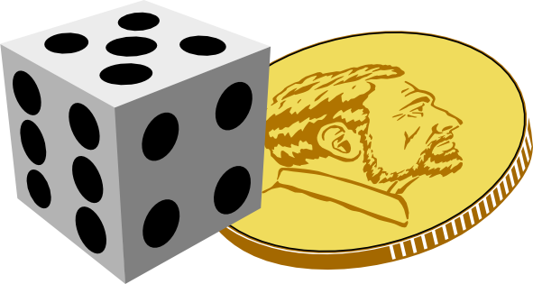
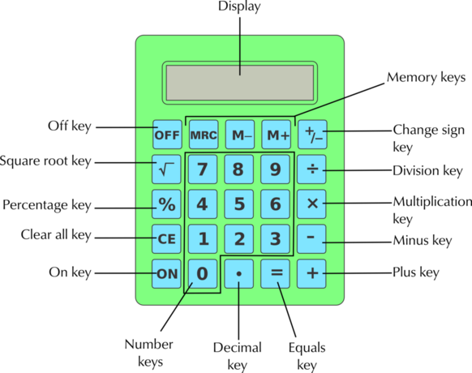

## 7.4 Single and combined outcomes (EMG55)

### Single outcomes (EMG56)

In this section we will explain and show how to draw a tree diagram. If we flip a coin there are two possible outcomes. There is a \(\frac{\text{1}}{\text{2}}\) chance of getting Heads and a \(\frac{\text{1}}{\text{2}}\) chance of getting Tails. Representing this in a tree diagram would look like this:

If we are rolling a dice the tree diagram would look like this. There is a \(\frac{\text{1}}{\text{6}}\) chance of getting each number.

### Combined outcomes (EMG57)

In this section we will use two outcomes to create more interesting games. To make sure we list all possible outcomes of the two events, we use two tools called tree diagrams and two-way tables.

Lets take these two situations mentioned above and combine their outcomes. I.e. we are going to flip the coin once and throw the dice once. We now have a **combined** event.

When we use more than one object or we repeat an experiment, we call this a **compound** event. For example, we could get Heads on the coin and a \(\text{2}\) on the dice and we could write this result as H2.

Now we need to use a different process for listing all the possible outcomes.

#### Tree diagrams of combined outcomes

Let's look at how a tree diagram is used to show combined outcomes.

<Callout type="tip" title="Worked example 2: Using a tree diagram for combined outcomes">
**Question:**

The tree diagram below shows all the possible outcomes for tossing a coin and then throwing a dice.

1. How many possible outcomes are there?
3. What is the probability of getting each outcome? Write this probability as a fraction, a decimal and a percentage.
5. How many possible outcomes out of the \(\text{12}\) include getting an even number on the dice?
7. How many possible outcomes out of \(\text{12}\) include getting Tails and an even number?
9. How many possible outcomes out of \(\text{12}\) include getting a 5\(\text{5}\) on the dice?

1. There are \(\text{12}\) possible outcomes altogether.
3. The probability is \(\frac{\text{1}}{\text{12}} = \text{0,08} = \text{8}\%\).
5. H2; H4; H6; T2; T4; T6 - six of them.
7. T2; T4; T6 - three possible outcomes.
9. H5 and T5 - two possible outcomes.
</Callout>

#### Using a two-way table to show combined outcomes

A two-way table (also known as a contingency table) works in a similar way to a tree diagram. We write the outcomes of one event in rows and the outcomes of the other event in columns.

For example, this table shows all the possible combinations for tossing a coin twice.

|  | H | T |
| --- | --- | --- |
| H | H, H | H, T |
| T | T, H | T, T |

So each block in the table will show a possible outcome of the combined events. Let's look at a worked example to understand this better.

<Callout type="tip" title="Worked example 3: Using a two-way table for combined outcomes">
**Question:**
1. Draw up a two-way table to show all the possible outcomes for tossing a red dice and a blue dice.
3. How many possible outcomes are there?
5. Now answer the following:
   1. What is the chance of rolling a \(\text{31}\) on the blue dice
              (and any number on the red dice)?
   3. Write the probability of getting a \(\text{5}\) on the blue dice as a:
      1. fraction.
      3. decimal fraction (round off your answer to \(\text{2}\) decimal places).
      5. percentage (round off your answer to \(\text{2}\) decimal places).
   5. What is the chance of rolling a \(\text{4}\) on the red dice and a \(\text{2}\) on the blue dice?
7. What is the chance, in a single roll of both dice, of you getting a \(\text{1}\) and a \(\text{2}\) of either colour?

1. For tossing a red dice and a blue dice we would have:
   | Blue/Red | R1 | R2 | R3 | R4 | R5 | R6 |
   | --- | --- | --- | --- | --- | --- | --- |
   | B1 | (B1; R1) | (B1; R2) | (B1; R3) | (B1; R4) | (B1; R5) | (B1; R6) |
   | B2 | (B2; R1) | (B2; R2) | (B2;R3) | (B2; R4) | (B2; R5) | (B2; R6) |
   | B3 | (B3; R1) | (B3; R2) | (B3; R3) | (B3; R4) | (B3; R5) | (B3; R6) |
   | B4 | (B4; R1) | (B4; R2) | (B4; R3) | (B4; R4) | (B4; R5) | (B4; R6) |
   | B5 | (B5; R1) | (B5; R2) | (B5; R3) | (B5; R4) | (B5; R5) | (B5; R6) |
   | B6 | (B6; R1) | (B6; R2) | (B6; R3) | (B6; R4) | (B6; R5) | (B6; R6) |
   So, for example, (B1; R3) represents rolling a \(\text{1}\) on the blue dice and a \(\text{3}\) on the red dice.
3. There are \(\text{36}\) possible outcomes.
5. 1. The chance is \(\text{1}\) in \(\text{6}\) or \(\frac{\text{1}}{\text{6}}\).
   3. 1. \(\frac{\text{1}}{\text{6}}\)
      3. \(\text{0,17}\)
      5. \(\text{16,67}\%\)
   5. There is only one block on the table for this: (B2; R4). so there is a \(\text{1}\) in \(\text{36}\) chance of this outcome.
7. To get a \(\text{1}\) and a \(\text{2}\): could be (B1; R2) or (B2; R2), so there are two possible outcomes and hence a \(\text{2}\) in \(\text{36}\) chance. This simplifies to \(\text{1}\) in \(\text{18}\) or \(\frac{\text{1}}{\text{18}}\).
</Callout>

## Calculating combined outcomes

### Exercise 7.5

Look at the table given for all the possible outcomes for tossing two coins.

|  | H | T |
| --- | --- | --- |
| H | H, H | H, T |
| T | T, H | T, T |

**Problem:**
How many possible outcomes are there altogether?

**Solution:**
Four possible outcomes.

**Problem:**
How many possible outcomes are there for getting two Heads (H; H)?

**Solution:**
One possible outcome.

**Problem:**
What is the probability of getting two Heads?

**Solution:**
\(\text{1}\) in \(\text{4}\) or \(\frac{\text{1}}{\text{4}}\)

**Problem:**
Is the probability of getting two Heads the same as the probability of getting two Tails?

**Solution:**
Yes.

**Problem:**
How many possible outcomes are there for getting one Heads and one Tails, in any order?

**Solution:**
There are two ways of getting this:  H; T or T; H.

**Problem:**
Is the probability of getting one Heads and one Tails greater or smaller than the probability of getting two Heads? Explain your answer.

**Solution:**
It is twice as likely to get one Heads and one Tails, because there are two possible ways of getting this and only one way of getting H; H.

A bag contains \(\text{5}\) balls: \(\text{2}\) red (R) and \(\text{3}\) blue (B). In a game of chance, a learner takes a ball out of the bag without looking, notes down the colour, and then puts it back into the bag. The learner then takes out another ball, notes down the colour and puts it back into the bag.

The two-way table shows all of the possible outcomes for this game.

|  | R | R | B | B | B |
| --- | --- | --- | --- | --- | --- |
| R | R; R | R; R | B; R | B; R | B; R |
| R | R; R | R; R | B; R | B; R | B; R |
| B | R; B | R; B | B; B | B; B | B; B |
| B | R; B | R; B | B; B | B; B | B; B |
| B | R; B | R; B | B; B | B; B | B; B |

**Problem:**
How many possible outcomes are there?

**Solution:**
\(\text{25}\)

**Problem:**
How many of the events represent getting R and then B?

**Solution:**
\(\text{6}\)

**Problem:**
Use your list to say what the probability of getting R and then B is.

**Solution:**
\(\frac{\text{6}}{\text{25}}\)

**Problem:**
What is the probability of drawing blue twice?

**Solution:**
There are \(\text{9}\) possible outcomes out of \(\text{25}\), so the probability is \(\frac{\text{9}}{\text{25}}\).

**Problem:**
In a game of chance, learners toss two coins, a \(\text{R}\,\text{1}\) coin and a \(\text{R}\,\text{2}\) coin.

1. Draw up a two-way table to show all the possible outcomes.
3. How many possible outcomes are there altogether?
5. How many of the events are two Heads (H; H)?
7. In how many of the events is there only one Heads?
9. How many of the events are two Tails (T; T)?

**Solution:**
|  | H | T |
| --- | --- | --- |
| H | H; H | T; H |
| T | H; T | T; T |

1. There are four possible outcomes.
3. One of the outcomes is (H; H).
5. Two of the outcomes have one H only.
7. One of the outcomes is (T; T).
