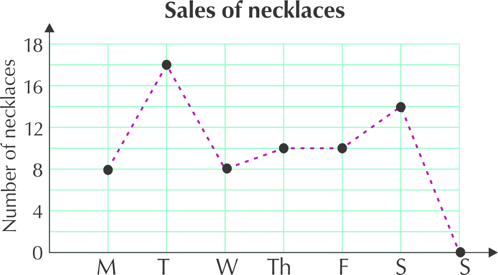

### Exercise 7.8

On a the probability scale below choose the which words best describe the probability of each of the following events:

Learners' answers to this kind of activity will differ, as some learners will put more weight on the very slight chance that something will happen, while others will say that things that have a very remote possibility of happening are impossible. Encourage learners to discuss their choices.

**Problem:**
The chance of visiting Mars.

**Solution:**
Learner-dependent answer.

**Problem:**
The sun rising tomorrow morning.

**Solution:**
Learner-dependent answer.

**Problem:**
Getting snow in the Kruger National Park in December.

**Solution:**
Learner-dependent answer.

**Problem:**
The chance of getting rain in the Sahara Desert.

**Solution:**
Learner-dependent answer.

**Problem:**
The chance of throwing Heads on a coin.

**Solution:**
Learner-dependent answer.

**Problem:**
Fill in the numbers in this table to show probabilities in different number formats.

| Fraction (simplest form) | Decimal  fraction | Percentage |
| --- | --- | --- |
| \(\frac{\text{3}}{\text{4}}\) | \(\text{0,75}\) |  |
|  | \(\text{0,3}\) |  |
|  |  | \(\text{10}\%\) |
|  |  | \(\text{90}\%\) |
| \(\frac{\text{1}}{\text{8}}\) |  |  |

**Solution:**
| Fraction (simplest form) | Decimal  fraction | Percentage |
| --- | --- | --- |
| \(\frac{\text{3}}{\text{4}}\) | \(\text{0,75}\) | \(\text{75}\%\) |
| \(\frac{\text{3}}{\text{10}}\) | \(\text{0,3}\) | \(\text{30}\%\) |
| \(\frac{\text{1}}{\text{10}}\) | \(\text{0,1}\) | \(\text{10}\%\) |
| \(\frac{\text{9}}{\text{10}}\) | \(\text{0,9}\) | \(\text{90}\%\) |
| \(\frac{\text{1}}{\text{8}}\) | \(\text{0,125}\) | \(\text{12,5}\%\) |

Look at the five-sided spinner shown in the diagram. When we spin the arrow, it has an equal chance of landing in each triangle, because they are all the same size.

Answer the following questions:

**Problem:**
List all the possible outcomes for getting an even number.

**Solution:**
\(\text{2}\); \(\text{4}\)

**Problem:**
List all the possible outcomes for getting an odd number.

**Solution:**
\(\text{1}\); \(\text{3}\); \(\text{5}\)

**Problem:**
Is there an equal chance of getting an odd number and an even number? Explain.

**Solution:**
No, there is a higher chance of getting an odd number, because there are more possible outcomes for odd numbers.

**Problem:**
How could you use this spinner to design an unfair game of chance?

**Solution:**
The game would be unfair if a player has a small chance of winning, for example, if they win only if they get five. It would also be unfair if they win only if they get an even number.

**Problem:**
Draw a tree diagram with the first set of branches showing the possible outcomes for spinning the spinner in question \(\text{3}\). Then add the outcomes for a coin toss to each of the branches.

**Solution:**

**Problem:**
How many possible outcomes are there altogether?

**Solution:**
Ten

**Problem:**
How many outcomes are there for getting a \(\text{4}\); H?

**Solution:**
Only one.

**Problem:**
What is the probability of getting a \(\text{4}\); H?

**Solution:**
One in ten or \(\frac{\text{1}}{\text{10}}\)

**Problem:**
How many outcomes are there for getting an even number and Heads? List them.

**Solution:**
Two: \(\text{2}\); H and \(\text{4}\); H

**Problem:**
What is the probability of getting an even number and Heads?

**Solution:**
The probability is \(\text{2}\) in \(\text{10}\), which simplifies to \(\text{1}\) in \(\text{5}\) or \(\frac{\text{1}}{\text{5}}\)
