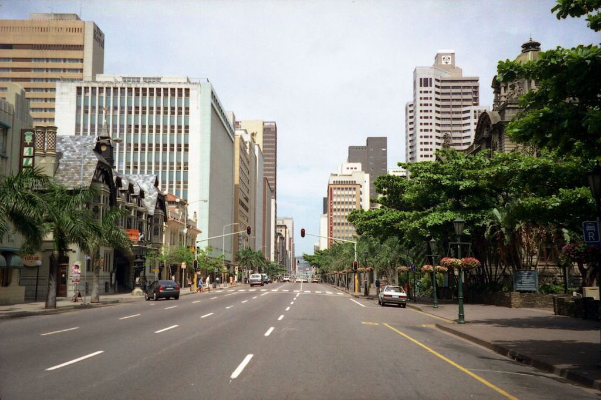

## 8.5 The importance of saving (EMG5M)

Saving is a good way to prepare for unexpected costs, annual bills and important events. These could be essential or non-essential expenses such as medical costs, a trip, a party or car repairs and servicing. Also keep in mind that your circumstances can change very quickly, and you need to be prepared for this.

It is more important to repay debts before starting to save, because you need to pay interest on debts. Debts also tie up money that could be used for savings. When you are living on a strict budget there might be little or no spare money to set aside. However, your financial situation can get worse rapidly if there is no money set aside for unexpected expenses.

### Budgeting for savings (EMG5N)

You may be able to save money on things you are already paying for, so you can put it aside for when you really need it. For example, if you have insurance policies, you might be able to find a better deal by investigating alternative policies. If you are paying a lot of interest on a credit card, you could find out if you can transfer the balance to an account that charges less interest.
