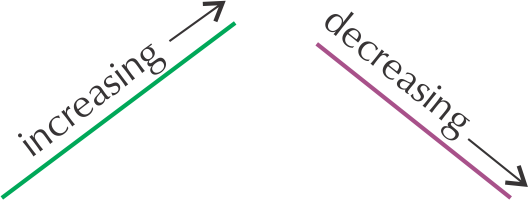
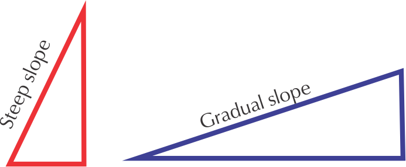
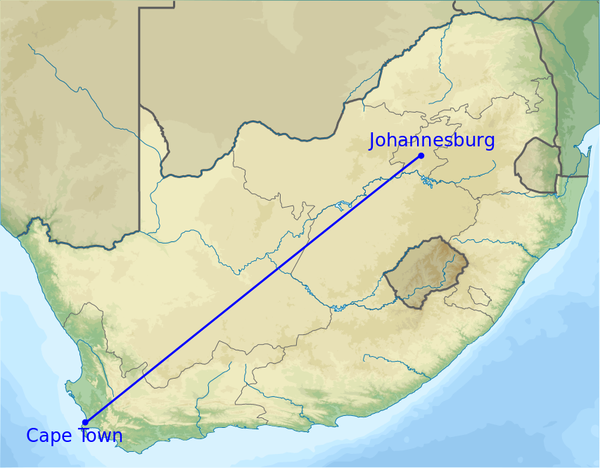
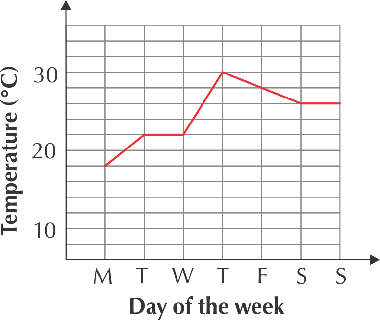
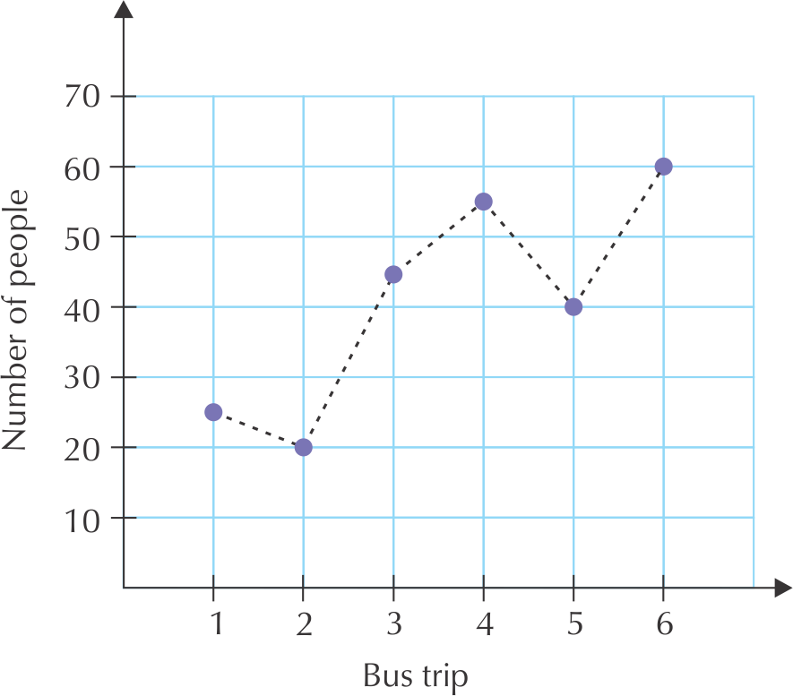
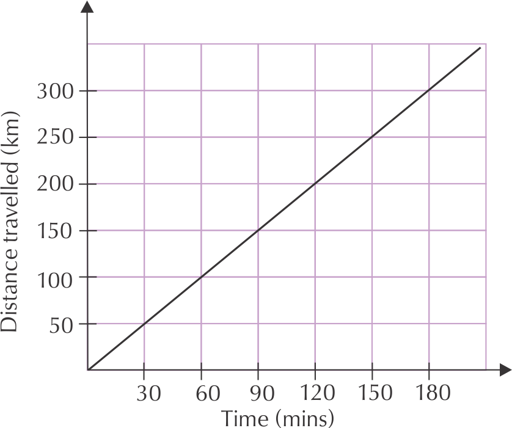

## 9.2 Perimeter (EMG5R)

PerimeterThe total length of the outside of a shape or the continuous line forming the boundary of a closed geometric figure. perimeter is measured in mm, cm,  m  or km.

In this section we will find the perimeter of rectangles, squares and triangles by measuring them directly, and the perimeter of a circle, by estimation. We will not being using any formulae just yet.

RectangleA flat two dimensional shape, with both pairs of opposite sides equal in length and all adjacent sides at right-angles (\(\text{90}\)\(\text{°}\)) to each other.

SquareA flat, two dimensional shape with all four sides equal in length, and all adjacent sides at right-angles (\(\text{90}\)\(\text{°}\)) to each other.

### Estimation and direct measurement of perimeter (EMG5S)

To measure the perimeter of a rectangle, a square or a triangle, we simply measure the length of each side using a ruler and add up the sides to get the perimeter.

To measure the perimeter of a circle, we need to use a piece of string: we can place the string along the outline of the circle, marking off how much string it took to go around the circle once. Then we measure that length of string on a ruler to estimate the perimeter of the circle.

The perimeter of a circle is the same as the **circumference** of the circle.

CircumferenceThe perimeter of a circle or the distance around the curved edge of a circle. Circumference is measured in mm; cm; m or km.

<Callout type="tip" title="Worked example 1: Measuring the perimeter of a rectangle">
**Question:**
Mr and Mrs Dlamini have recently moved into a new house. In the rectangular backyard, the house has a lawn and a rectangular patio as shown in the diagram below.

1. Using a ruler, measure the perimeter (in cm) of Mr and Mrs Dlamini's backyard on the diagram.
   
3. If the diagram was drawn using a scale of \(\text{1}\) : \(\text{100}\), calculate what the perimeter of the yard is in metres.

1. The length of the yard is \(\text{12}\) \(\text{cm}\) and the width is \(\text{10}\) \(\text{cm}\).
   Because the back yard is a rectangle, both pairs of opposite sides are equal in length.
   The perimeter is the total length of the outside of the yard, therefore:
   Perimeter \(= \text{12}\text{ cm} + \text{12}\text{ cm} + \text{10}\text{ cm} + \text{10}\text{ cm}\)
   = \(\text{44}\) \(\text{cm}\)
3. Using the scale of \(\text{1}\) : \(\text{100}\)
   	    Perimeter\(= \text{44}\text{ cm} \times \text{100} = \text{4 400}\text{ cm} = \text{44}\text{ m}\)
</Callout>

<Callout type="tip" title="Worked example 2: Measuring the perimeter of a triangle">
**Question:**
Mrs Dlamini wants to dig up some of the lawn and plant a triangular vegetable garden as shown in the diagram below:

1. Using a ruler, measure the perimeter of the triangular garden in the diagram (in cm).
3. If this diagram was drawn using a scale of \(\text{1}\) : \(\text{100}\), calculate the actual perimeter of the garden in metres.

1. The perimeter of the triangle is \(\text{4}\text{ cm} + \text{12}\text{ cm} + \text{12,7}\text{ cm} = \text{28,7}\text{ cm}\)
3. Using a scale of \(\text{1}\) : \(\text{100}\)
   \(\text{28,7}\text{ cm} \times \text{100} = \text{2 870}\text{ cm} = \text{28,7}\text{ m}\).
</Callout>

<Callout type="tip" title="Worked example 3: Estimating the circumference of a circle">
**Question:**
Mr Dlamini's hobby is breeding Koi fish. He would like to put a circular pond in the corner of the garden. He would also like to put paving around the fish pond. In order to do this, he needs to calculate the circumference of a circle.

1. Using a piece of string or wool, estimate the circumference of the fish pond shown in the diagram below. You will need to place the string along the outline of the circle, and then measure (in cm) the length of string you used (to form the complete circle) on your ruler. Round your estimated answer off to the nearest centimetre.
3. If the fish pond was drawn using a scale of \(\text{1}\) : \(\text{100}\), what is the actual circumference of the fish pond in metres?

1. Circumference \(\approx\) \(\text{12}\) \(\text{cm}\)
3. Using the scale of \(\text{1}\) : \(\text{100}\)
   \(\text{12}\text{ cm} \times \text{100} = \text{1 200}\text{ cm} = \text{12}\text{ m}\).
</Callout>

## Measuring and estimating perimeter

### Exercise 9.1

Study the diagram below and answer the questions that follow:

**Problem:**
Before Mr Dlamini builds his fish pond, he decides he wants to make the patio smaller. Using a ruler, measure the new perimeter of the patio on the diagram (in cm)

**Solution:**
Perimeter \(= \text{5}\text{ cm} + \text{5}\text{ cm} + \text{5}\text{ cm} + \text{5}\text{ cm} = \text{20}\text{ cm}\)

**Problem:**
Mrs Dlamini decides it might be better to build her vegetable garden on the right of the garden because that area gets more sun. Using a ruler, measure the perimeter of the new triangular garden on the diagram (in mm).

**Solution:**
Perimeter \(= \text{40}\text{ mm} + \text{55}\text{ mm} + \text{68}\text{ mm} = \text{163}\text{ mm}\)

**Problem:**
Mrs Dlamini also buys a new, circular table for the patio. Using a piece of string and a ruler, estimate the circumference of the table (in mm).

**Solution:**
Circumference \(\approx\) \(\text{47}\) \(\text{mm}\).

**Problem:**
Mr Dlamini has two options for the design of his new fish pond. The second option is shown below. Using a ruler and string, measure the dimensions of the new pond (on the diagram) in cm.

**Solution:**
Perimeter = (\(\text{3}\) sides of rectangle) + half circle \(\approx (\text{4,5}\text{ cm} + \text{3}\text{ cm} + \text{4,5}\text{ cm}) + \text{4,5}\text{ cm} = \text{16,5}\text{ cm}\)

### Using formulae to calculate perimeter (EMG5T)

We have learnt how to directly measure perimeter and circumference, but in some cases (like measuring the circumference of a circle using a piece of string) we have seen that it is difficult to be accurate.

There are simple formulae we can use to accurately calculate perimeter and circumference. In order to use these formulae, we need to know certain dimensions of the shape we want to measure.

| Shape | Perimeter formula |  |
| --- | --- | --- |
| Rectangle | \(\text{2}\) \(\times\) length + \(\text{2}\)\(\times\)  width |  |
| Square | \(\text{4}\)\(\times\) length or \(\text{4}\)\(\times\)side | or |
| Triangle | length \(\text{1}\) + length \(\text{2}\) + length \(\text{3}\) | or |
| Circle | \(\pi \times (\text{2} \times\) radius) and/or \(\pi \times\) diameter | and |
