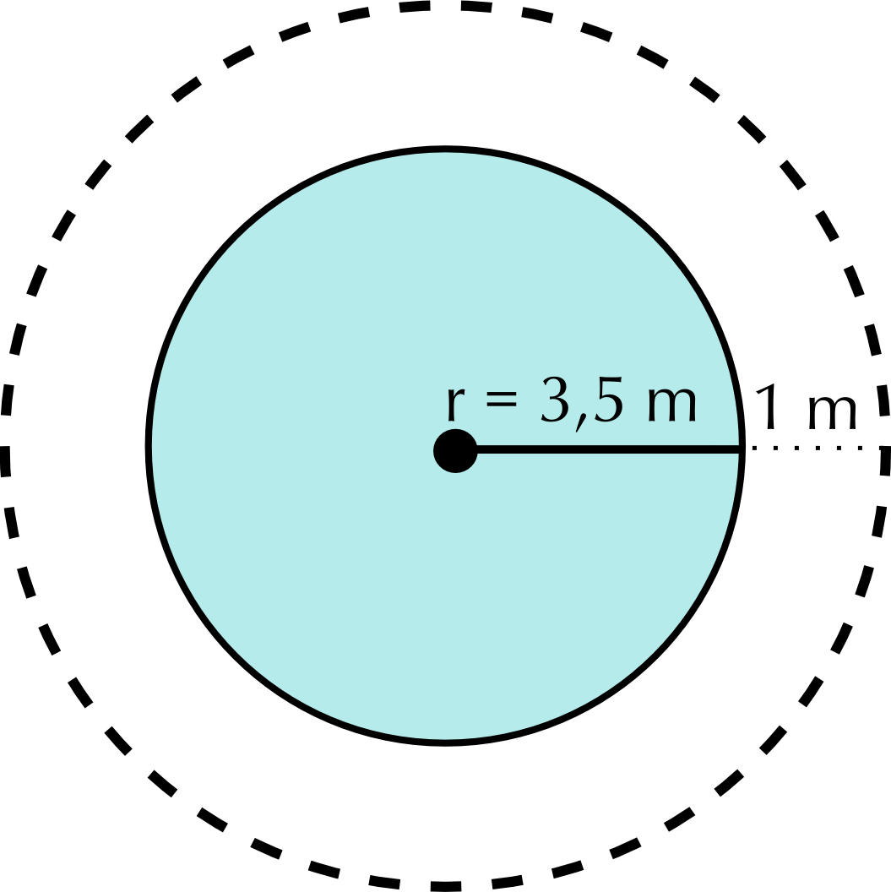
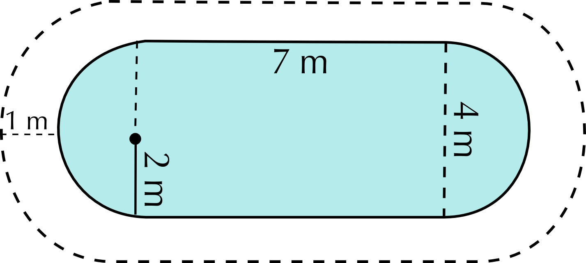
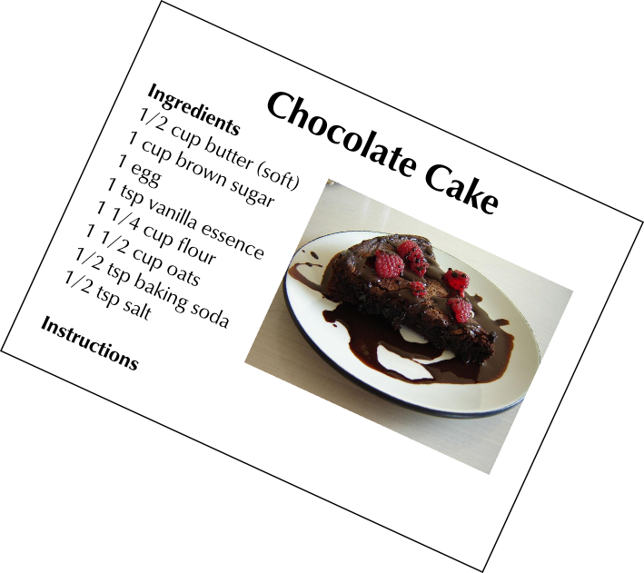

### Exercise 9.2

Mr and Mrs Dlamini need to make a final decision about their garden and what they are prepared to spend. The diagram below (**not** drawn to scale) shows what their garden currently looks like, with the lawn, patio and garden.

**Problem:**
Calculate the area of the property, in metres squared. Use the following formula: Area = length \(\times\) width.

**Solution:**
Area = (\(\text{20}\) \(\text{m}\)) \(\times\) \(\text{4}\) \(\text{m}\) + \(\text{8}\) \(\text{m}\)) = \(\text{20}\) \(\text{m}\) \(\times\) \(\text{12}\) \(\text{m}\) = \(\text{240}\) \(\text{m}\)\(^{\text{2}}\)

**Problem:**
Calculate the area of the garden (indicated on the diagram) using the following formula: Area = \(\frac{\text{1}}{\text{2}} \times\) base \(\times\) perpendicular height.

**Solution:**
Area = \(\frac{\text{1}}{\text{2}} \times\) \(\text{20}\) \(\text{m}\) \(\times\) \(\text{4}\) \(\text{m}\) = \(\text{40}\) \(\text{m}\)\(^{\text{2}}\)

**Problem:**
What percentage of the area of the whole property is the triangular garden? Express your answer as a whole number.

**Solution:**
\(\frac{\text{40}}{\text{240}} = \text{0,16666}\). \(\text{0,16666}\) \(\times\) \(\text{100}\) = \(\text{16,67}\%\)

Mr Dlamini still has not decided on a shape for his new fish pond.

**Problem:**
One option is for Mr Dlamini to install a circular fish pond with a radius of \(\text{1,5}\) \(\text{m}\), as shown in the diagram:

Calculate the area of this pond in metres squared, using the formula: Area = \(\pi \times\) radius\(^{\text{2}}\), where \(\pi=\text{3,142}\).

**Solution:**
Area = \(\text{3,142}\) \(\times\) (\(\text{1,5}\) \(\text{m}\))\(^{\text{2}}\) = \(\text{7,07}\) \(\text{m}\)\(^{\text{2}}\)

**Problem:**
The alternative design for the fish pond, as we have already seen looks as follows:

Using the dimensions given on the diagram above, calculate the area of the other possible fish pond using the formulae Area = \(\pi \times\) radius\(^{\text{2}}\) and Area =length \(\times\) width, where \(\pi= \text{3,142}\).

**Solution:**
Area = area rectangle + area semicircle = (\(\text{2}\) \(\text{m}\) \(\times\) \(\text{1}\) \(\text{m}\)) + \(\frac{\text{1}}{\text{2}}(\pi \cdot\)(\(\text{1}\) \(\text{m}\))\(^{\text{2}}\)) = \(\text{2}\) \(\text{m}\) + \(\text{1,57}\) = \(\text{3,57}\) \(\text{m}\)\(^{\text{2}}\)

**Problem:**
How does your answer to b) compare to the area of the circular fish pond that we calculated in a)? Which shape of fish pond should Mr Dlamini choose if he is worried about the pond taking up too much space in his garden? Give reasons for your answer.

**Solution:**
The second design is much smaller than the first. If he is concerned that the pond will be too large, he should decide on the second shape.

**Problem:**
Mr Dlamini is concerned that his dog will try to climb into the fish pond once it's built. He will need to put a fence around the fish pond. He has still not decided which style of fish pond he wants to build. He decides to get quotes from a fencing company called “Fence-Me-In”. They give him the following information:

1. Labour costs: \(\text{R}\,\text{549,99}\) for the whole project
3. \(\text{1}\) metre of fencing costs \(\text{R}\,\text{29,99}\).

Calculate the total cost for each style of pond.

**Solution:**
**Pond shape 1 (circle):** cost = Labour + fencing price \(\times\) perimeter = \(\text{R}\,\text{549,99}\) + (\(\text{R}\,\text{29,99}\))(\(\text{2}\pi \times\) \(\text{1,5}\) \(\text{m}\)) = \(\text{R}\,\text{549,99}\) + R(\(\text{29,99}\))(\(\text{9,426}\) \(\text{m}\)) = \(\text{R}\,\text{549,99}\) + \(\text{R}\,\text{282,69}\) = \(\text{R}\,\text{832,68}\).

** Pond shape 2**: Cost = Labour + fencing price \(\times\) perimeter = \(\text{R}\,\text{549,99}\) + (\(\text{R}\,\text{29,99}\))(\(\text{2}\) \(\text{m}\) + \(\text{1}\) \(\text{m}\) + \(\text{2}\) \(\text{m}\) + \(\frac{\text{1}}{\text{2}} \times \text{2} \times \pi \times\) \(\text{1}\) \(\text{m}\)) = \(\text{R}\,\text{549,99}\) + (\(\text{R}\,\text{29,99}\))(\(\text{5}\) \(\text{m}\) + \(\text{3,142}\) \(\text{m}\)) = \(\text{R}\,\text{549,99}\) + \(\text{R}\,\text{244,18}\) = \(\text{R}\,\text{794,17}\)

**Problem:**
Based on your answers to Questions 2 c) and d), which style of fish pond do you think Mr Dlamini should choose? Give reasons for your answer.

**Solution:**
Learner-dependent answer, but based on his concern about the size of the pond he should choose the second design - it's cheaper to fence too.

The Dlamini's are also wanting to redo the paving of the patio, and replace the bricks with cobblestones. The actual dimensions of the patio are as follows: length = \(\text{6}\) \(\text{m}\) and width = \(\text{8}\) \(\text{m}\).

Cobblestone paving

**Problem:**
If the dimensions of **one** cobblestone is \(\text{10}\) \(\text{cm}\) by \(\text{10}\) \(\text{cm}\), how many cobble stones will be needed to pave the patio? (Hint: convert all units to be the same!)

**Solution:**
Area of patio = \(\text{6}\) \(\text{m}\) \(\times\) \(\text{8}\) \(\text{m}\) = \(\text{48}\) \(\text{m}\)\(^{\text{2}}\). Area of cobblestone = \(\text{0,1}\) \(\text{m}\) \(\times\) \(\text{0,1}\) \(\text{m}\) = \(\text{0,01}\) \(\text{m}\)\(^{\text{2}}\).  \(\text{48}\div \text{0,01}^{\text{2}}\) = \(\text{4 800}\) cobblestones.

**Problem:**
Cobblestones are sold in batches of \(\text{200}\). How many batches will be needed to be bought?

**Solution:**
\(\text{4 800}\) \(\div\) \(\text{200}\) = \(\text{24}\) batches of cobblestones.

**Problem:**
If one batch costs \(\text{R}\,\text{129,99}\), what will be the **total** cost of the cobblestones?

**Solution:**
\(\text{24}\) \(\times\) \(\text{R}\,\text{129,99}\) = \(\text{R}\,\text{3 119,76}\)

Sam's uncle works for a company that puts up safety fences around swimming pools,   and nets over swimming pools. He must calculate how much fencing and netting they need for each of the  swimming pools shown below. The fencing is always \(\text{1}\) metre away from the swimming pool. For each swimming pool below, calculate:

1. the perimeter of the swimming pool
3. the length of fencing needed
5. the area of the swimming pool (the area of netting needed)
7. the cost of the fence at \(\text{R}\,\text{250,00}\) per metre
9. the cost of the netting at \(\text{R}\,\text{199,99}\) per m\(^{\text{2}}\).

Round all of your answers to two decimal places.

**Problem:**

**Solution:**
1. Perimeter of pool = \(\text{2}\) \(\times\) (\(\text{8}\) \(\text{m}\) + \(\text{4}\) \(\text{m}\)) = \(\text{24}\) \(\text{m}\)
3. Length of fencing = \(\text{2}\) \(\times\) (\(\text{10}\) \(\text{m}\) + \(\text{6}\) \(\text{m}\)) = \(\text{32}\) \(\text{m}\)
5. Area of pool = \(\text{8}\) \(\text{m}\) \(\times\) \(\text{4}\) \(\text{m}\) = \(\text{32}\) \(\text{m}\)\(^{\text{2}}\)
7. Cost of fence= \(\text{R}\,\text{250,00}\) \(\times\) \(\text{32}\) \(\text{m}\) = \(\text{R}\,\text{8 000}\)
9. Cost of netting= \(\text{R}\,\text{199,99}\) \(\times\) \(\text{32}\) \(\text{m}\)\(^{\text{2}}\) \(\text{R}\,\text{6 399,68}\)

**Problem:**

**Solution:**
1. Perimeter of pool = \(\text{2}\pi r\) = \(\text{2}\) \(\times\) \(\text{3,142}\) \(\times\) \(\text{3,5}\) = \(\text{21,99}\) \(\text{m}\)
3. Length of fencing = \(\text{2}\pi (\text{4,5}\) m) = \(\text{28,28}\) \(\text{m}\)
5. Area of pool = \(\pi r^{\text{2}}\) = \(\text{3,142}\) \(\times\) (\(\text{3,5}\) \(\text{m}\))\(^{\text{2}}\) = \(\text{38,49}\) \(\text{m}\)\(^{\text{2}}\)
7. Cost of fence = \(\text{R}\,\text{250,00}\) \(\times\) \(\text{28,28}\) \(\text{m}\) = \(\text{R}\,\text{7 070}\)
9. Cost of netting= \(\text{R}\,\text{199,99}\) \(\times\) \(\text{38,49}\) \(\text{m}\)\(^{\text{2}}\) = \(\text{R}\,\text{7 697,62}\)

**Problem:**

**Solution:**
1. Perimeter of pool = \(\text{2}\)(perimeter of semi-circles) + length of \(\text{2}\) rectangular sides = (perimeter one circle with radius \(\text{2}\) \(\text{m}\)) + \(\text{2}\)(\(\text{7}\) \(\text{m}\)) = \(\text{2}\pi (\text{2}\)m) + \(\text{14}\) \(\text{m}\) = \(\text{12,568}\) \(\text{m}\) + \(\text{14}\) \(\text{m}\) = \(\text{26,57}\) \(\text{m}\)
3. Length of fencing = \(\text{2}\)(perimeter of semi-circles) + length of \(\text{2}\) rectangular sides = (perimeter one circle with radius \(\text{4}\) \(\text{m}\)) + \(\text{2}\)(\(\text{7}\) \(\text{m}\)) = \(\text{2}\pi (\text{4}\)m) + \(\text{14}\) \(\text{m}\) = \(\text{25,136}\) \(\text{m}\) + \(\text{14}\) \(\text{m}\) = \(\text{39,14}\) \(\text{m}\)
5. Area of pool = Area rectangle + \(\text{2}\)(area semi-circles) = Area rectangle + (area cricle radius \(\text{2}\) \(\text{m}\))= (\(\text{7}\) \(\text{m}\) \(\times\) \(\text{4}\) \(\text{m}\)) + \((\pi (\text{2})^\text{2})\) = \(\text{28}\) \(\text{m}\)\(^{\text{2}}\) + \(\text{12,568}\) \(\text{m}\)\(^{\text{2}}\)  = \(\text{40,57}\) \(\text{m}\)\(^{\text{2}}\)
7. Cost of fence = \(\text{R}\,\text{25,00}\) \(\times\) \(\text{39,14}\) \(\text{m}\) = \(\text{R}\,\text{9 785}\)
9. Cost of netting = \(\text{R}\,\text{199,99}\) \(\times\) \(\text{40,57}\) \(\text{m}\)\(^{\text{2}}\) =\(\text{R}\,\text{8 113,59}\)

Below is the plan of Phumza's property. Homeowners pay rates to the municipality which are calculated according to the area of the property.

**Problem:**
Calculate the area of this house. Round your answer to the nearest whole metre.

**Solution:**
Area = (Area small rectangle) + (area big rectangle) = (\(\text{4,7}\) \(\text{m}\) \(\times\) \(\text{4,3}\) \(\text{m}\)) + (\(\text{10,8}\) \(\text{m}\) \(\times\) \(\text{12,8}\) \(\text{m}\)) = \(\text{20,21}\) \(\text{m}\)\(^{\text{2}}\) + \(\text{138,24}\) \(\text{m}\)\(^{\text{2}}\)  = \(\text{158,45}\) \(\text{m}\)\(^{\text{2}}\)

**Problem:**
The basic municipal rate is calculated using the following formula:

\(\text{R}\,\text{15,05}\) per m\(^{\text{2}}\) of the property per year.

What would Phumza's **monthly** rate bill be?

**Solution:**
Rate per year = Area \(\times\) \(\text{R}\,\text{15,05}\) = \(\text{158,45}\) \(\text{m}\)\(^{\text{2}}\) \(\times\) \(\text{R}\,\text{15,05}\) = \(\text{R}\,\text{2 384,6725}\) per year. Per month = \(\text{R}\,\text{2 384,6725}\) \(\div\) \(\text{12}\) = \(\text{R}\,\text{198,72}\) per month.

Lebo wants to put paving around her new, triangular vegetable garden as shown in the diagram:

**Problem:**
What is the area of the vegetable garden in metres squared?

**Solution:**
Area = \(\frac{\text{1}}{\text{2}}\)(\(\text{2,4}\) \(\text{m}\))(\(\text{90}\) \(\text{cm}\)) = \(\frac{\text{1}}{\text{2}}\)(\(\text{2,4}\))(\(\text{0,9}\) \(\text{m}\)) = \(\text{1,08}\) \(\text{m}\)\(^{\text{2}}\)

**Problem:**
What is the area of the paving, in metres squared? (excluding he vegetable garden!)

**Solution:**
Area = (Area of rectangle) - (area of triangle) = [(\(\text{80}\) + \(\text{90}\) + \(\text{80}\) \(\text{cm}\)) \(\times\) (\(\text{1,2}\) + \(\text{2,4}\) + \(\text{1,2}\) \(\text{m}\))] - \(\text{1,08}\) \(\text{m}\)\(^{\text{2}}\) = [\(\text{2,5}\) \(\text{m}\) \(\times\) \(\text{4,8}\) \(\text{m}\)] - \(\text{1,08}\) \(\text{m}\)\(^{\text{2}}\) = \(\text{12}\) \(\text{m}\)\(^{\text{2}}\) -\(\text{1,08}\) \(\text{m}\)\(^{\text{2}}\) =  \(\text{10,92}\) \(\text{m}\)\(^{\text{2}}\)

**Problem:**
If the paving is going to cost \(\text{R}\,\text{24,65}\) per metre squared, how much will the total cost of the paving be?

**Solution:**
\(\text{10,92}\) \(\text{m}\)\(^{\text{2}}\) \(\times\) \(\text{R}\,\text{24,65}\) = \(\text{R}\,\text{269,18}\)

**Problem:**
Lebo wants to build a fence around her garden. To do this, she needs to calculate the perimeter of the triangular garden. Is this possible with the information provided in the diagram? Explain your answer.

**Solution:**
No. We do not know the length of the third side of the triangle so we cannot calculate the perimeter.

As a decorative feature, Jan builds a round window into the attic of his house.

**Problem:**
Jan needs to paint the triangular wall around the window. What is the area of the triangular piece of wall in m\(^{\text{2}}\)? (Use the formula: Area =  \(\frac{\text{1}}{\text{2}} \times\) base \(\times\) height )

**Solution:**
Area of triangle = \(\frac{\text{1}}{\text{2}} \times\) base \(\times\) height = \(\frac{\text{1}}{\text{2}}\)(\(\text{2,63}\) \(\text{m}\))(\(\text{2,1}\) \(\text{m}\)) = \(\text{2,76}\) \(\text{m}\)\(^{\text{2}}\)

**Problem:**
Assume it takes \(\text{1}\) litre of paint to cover \(\text{0,5}\) \(\text{m}\)\(^{\text{2}}\) of wall. How many litres of paint will Jan need to buy?

**Solution:**
\(\text{2,76}\) \(\text{m}\)\(^{\text{2}} \div\) \(\text{0,5}\) \(\text{m}\)\(^{\text{2}}\) = \(\text{5,52}\) litres of paint

**Problem:**
If the hardware store only sells paint in \(\text{2}\) litre tins, how many tins will Jan need to buy?

**Solution:**
\(\text{5,52}\) \(\div\) \(\text{2}\) = \(\text{2,76}\) tins. He cannot buy \(\text{0,76}\) of a tin, so he will have to buy \(\text{3}\) tins.
