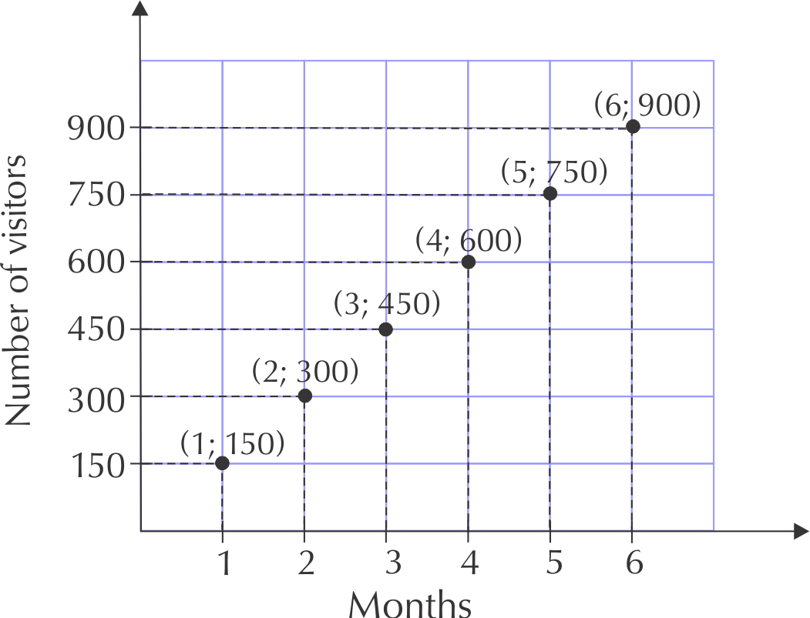
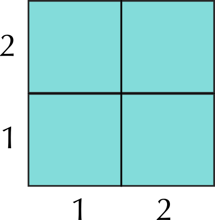
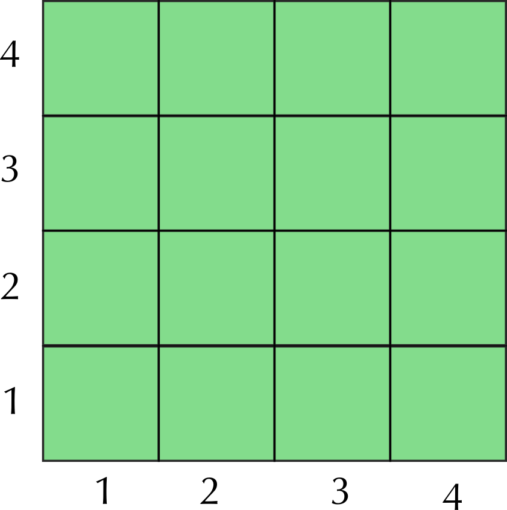
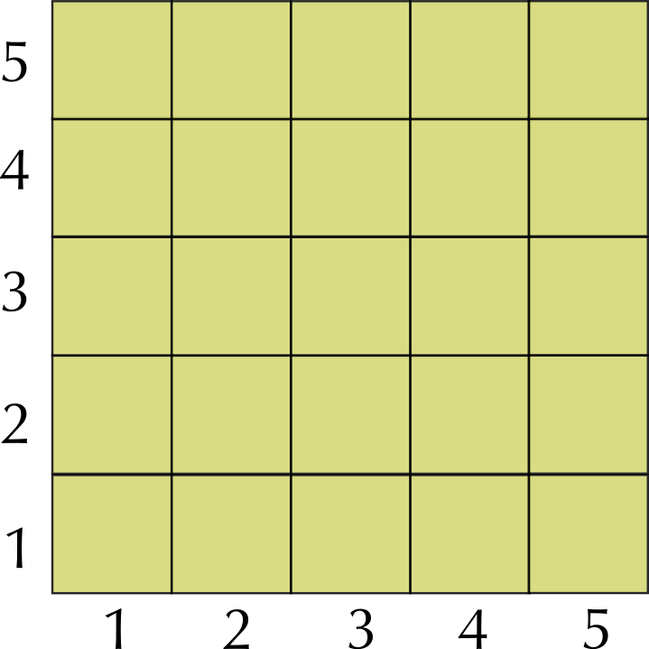
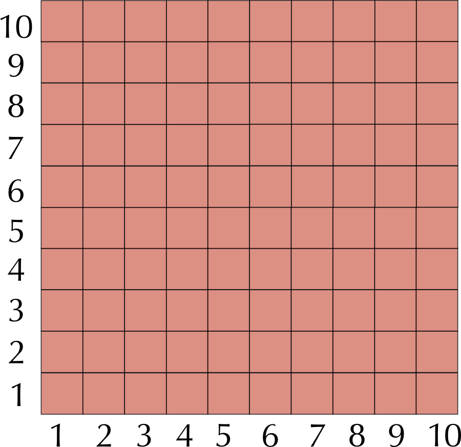
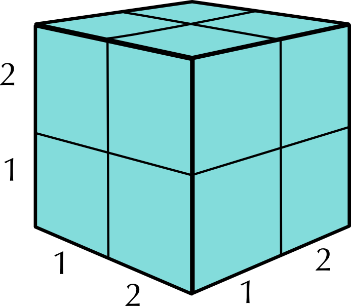
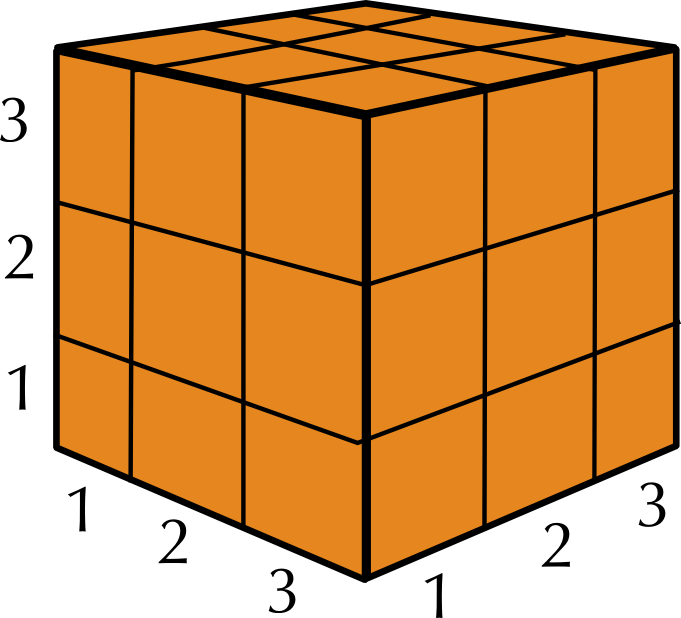
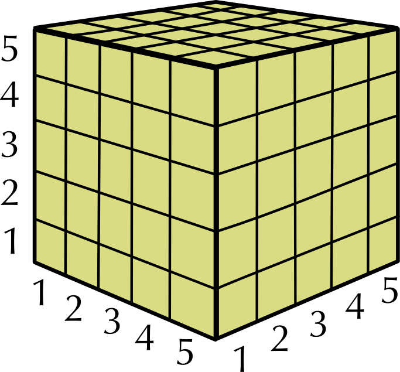
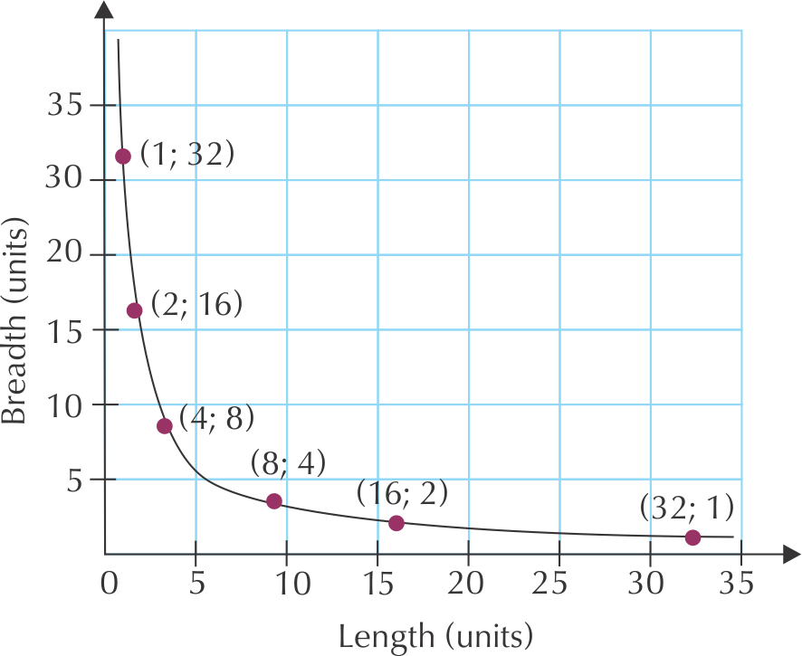
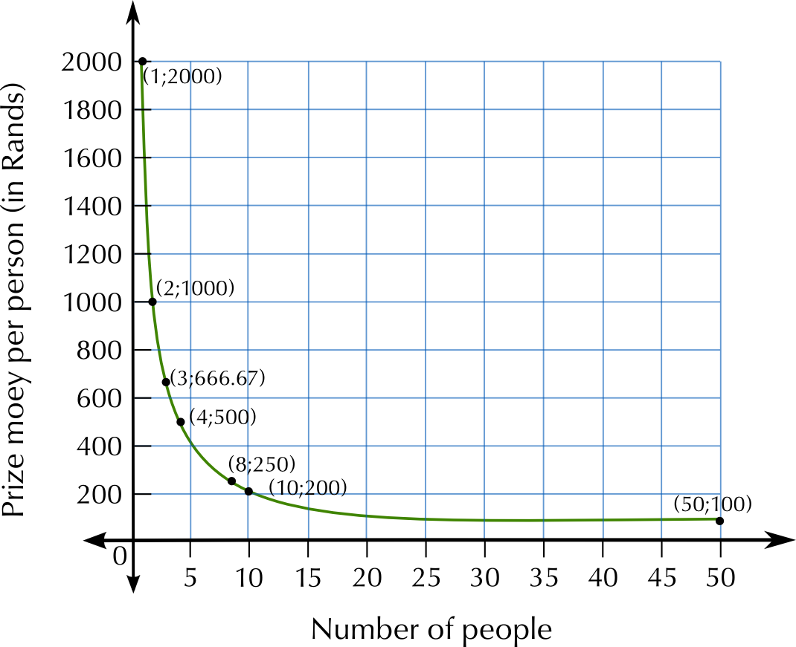

## 10.3 Floor plans (EMG63)

We have already worked with floor plans in Chapter 6. In this section we will learn about them in more detail.

To recap what we already know:

- A plan is a \(\text{2}\) dimensional picture or drawing that describes what an object looks like and the dimensions of the object.
- Plans can be drawn to show different views of an object.
- Plans can involve the use of a scale. This scale is used to find the actual size (real life size) of certain objects within the plan.

There are three main types of plans, namely: floor or layout plans, elevation plans and design plans. Floor plans are plans showing the layout of buildings or structures seen from a top view (from above). Elevation plans show what an object looks like from different side views. Design plans are commonly used in the fashion and design industry. The plans are often of clothing items that will be sent to the manufacturers. In Grade 10, you only need to understand how to work with floor plans.

A floor plan is also known as a layout plan. It shows an object as seen from above, as if you have taken off the roof of the building/structure to look inside. In Grade 10 we will only work with two dimensional plans showing the dimensions for length and width.

### Understanding floor plan symbols (EMG64)

It is important to understand the layout of floor plans. In order to do this, one can use a key (or legend) that would portray the symbols (and their names) most commonly used on floor plans.

The picture below shows the symbols most commonly used in a floor plan.

<Callout type="tip" title="Worked example 4: Reading a floor plan">
**Question:**

1. What kind of room is this?
3. How many doors does the room have?
5. How many windows does the room have?
7. Why is the desk in front of the window?
9. Is there an alternative position for the bed if the bed may not be in front of a window? Explain your answer.
11. Which items would need to be removed from the room if the single bed was exchanged for a double bed?
13. Explain why the symbol for a door is a quarter circle.

1. A bedroom
3. One door
5. Two windows
7. The window lets in light which means that the person sitting at the desk will be able to work or study without putting strain on their eyes.
9. No, the current position is the only one where the bed is not in front of a window. The bed is too wide or too long to fit against the other walls.
11. The bedside cabinet.
13. This shows the space needed for the door to open. It helps to ensure that no furniture is placed in such a way that the door won't open.
</Callout>

### Understanding floor plan layout (EMG65)

In this section we will learn how to describe what is being represented on a plan, to analyse the layout of the structure show on the plan and suggest alternative layouts.

<Callout type="tip" title="Worked example 5: Understanding floor layout">
**Question:**

The room above has some serious design flaws.

1. Identify \(\text{4}\) problem areas in the diagram. Motivate your answer.
3. Redraw the floor plan with an improved layout. Include all the elements from the original plan.

1. The bed is directly in front of the door. The basin is facing the wrong way. The toilet is not attached to a wall. The toilet is almost impossible to use. The couch faces into the bathroom area.
3. 
</Callout>

## Understanding floor layout

### Exercise 10.3

The following diagrams show two different kitchen layouts. The arrows on the diagrams indicate the movements required to cook dinner, which includes meat, vegetables, a starch (potatoes or rice) and a salad.

Diagram 1

Diagram 2

**Problem:**
Compare the direction that the door opens for Diagram 1 and Diagram 2. Why would the direction that the door opens in be better in Diagram 2 than in Diagram 1?

**Solution:**
In Diagram 1 the stove is almost behind the open door, so every time a person turns around from the stove, they will be bumping into the door.

**Problem:**
Why is the stove not placed under the window in either diagram?

**Solution:**
If there are curtains or blinds over the window this could become a fire hazard if something cooking on the stove caught alight.

**Problem:**
Which layout is better when you are cooking food? Give reasons for your answer.

**Solution:**
Diagram 2: The fridge and work surface are close to the stove.

**Problem:**
Which layout is better when you are washing dishes and cleaning up after dinner? Give reasons for your answer.

**Solution:**
Diagram 1: the area for plates and bowls is close to the sink so it is easy to put dry dishes away.

**Problem:**
Design your own kitchen that will keep the distance you have to walk to a minimum when cooking and cleaning up. Your kitchen has to have the same elements in it as are found in the diagrams.

**Solution:**
Learner-dependent answer

**Problem:**
Draw a rough floor plan of the room in the illustration. Use the symbols given above at the beginning of this chapter. The plan does not have to be to scale but the relative size of the contents must be accurate. Add a door to your floorplan in any place you think is appropriate.

**Solution:**

**Problem:**
There are no windows shown on the diagram. The two walls that aren't visible in the illustration are inside the house. Where would you place a window? Provide reasons for your answer.

**Solution:**
Place the window above the bath. The other two walls are inside the house.

### Working with scale on floor plans (EMG66)

In order to be able to calculate the dimensions of an object on a scale or map you must be able to work with scale. We learnt about the number and bar scales in Chapter 6. We will continue to work with them in this section.

<Callout type="tip" title="Worked example 6: Working with scaled floor plans">
**Question:**
Your school is building a new classroom. The measurements of the classroom are as follows:

Length of the walls: 5 metres

Width of the door: \(\text{810}\) \(\text{mm}\)

Width of the windows: \(\text{1 000}\) \(\text{mm}\)

1. You have to draw a plan of the classroom using a scale of \(\text{1}\) : \(\text{50}\). You have to place a door and \(\text{2}\) windows in one of the walls. Another wall must have \(\text{3}\) windows. Two walls have no windows.Use the appropriate symbols in your plan.
3. If the school wants to make blinds out of fabric for the classroom windows, and the blinds are the same size as the windows (\(\text{1 000}\) \(\text{mm}\) wide), calculate the total length of material (in metres) that needs to be bought.
5. If the material for the blinds costs \(\text{R}\,\text{60}\) per metre, calculate the total cost of fabric for the blinds.
7. The school needs to tile the floor of the classroom. Calculate the total area that must be tiled.
9. If the tiles come in \(\text{4}\) \(\text{m}\)\(^{\text{2}}\), how many boxes must the school buy? Explain your answer.
11. If the tiles cost \(\text{R}\,\text{150}\) per box, calculate how much the tiles will cost.

1. 
3. |  | Real life measurement | Calculation | Measurement on the plan |
   | --- | --- | --- | --- |
   | Length of the walls | \(\text{5}\) metres | \(\text{5}\) metres = \(\text{500}\) \(\text{cm}\) \(\text{500}\) \(\text{cm}\) \(\div\) \(\text{50}\) = \(\text{10}\) \(\text{cm}\) | \(\text{10}\) \(\text{cm}\) |
   | Width of the door | \(\text{810}\) \(\text{mm}\) | \(\text{810}\) \(\text{mm}\) \(\div\) \(\text{50}\) = \(\text{16,2}\) \(\text{mm}\) | \(\text{16,2}\) \(\text{mm}\) = \(\text{1,62}\) \(\text{cm}\) |
   | Width of the window | \(\text{1 000}\) \(\text{mm}\) | \(\text{1 000}\) \(\text{mm}\) \(\div\) \(\text{50}\) = \(\text{20}\) \(\text{mm}\) | \(\text{20}\) \(\text{mm}\) = \(\text{2}\) \(\text{cm}\) |
5. There are \(\text{5}\) windows in total. Each window is \(\text{1 000}\) \(\text{mm}\) wide.
   \(\text{1 000}\text{ mm}\times\text{5}\) = \(\text{5 000}\) \(\text{mm}\)
   There are \(\text{1 000}\) \(\text{mm}\) in a metre
   \(\text{5 000}\div\text{1 000}\) = \(\text{5}\) \(\text{m}\)
7. \(\text{R}\,\text{60}\) per metre \(\times\) \(\text{5}\) \(\text{m}\) = \(\text{R}\,\text{300}\)
9. Area = length\(\times\)breadth
   = \(\text{5}\text{ m}\times\text{5}\text{ m}\)
   = \(\text{25}\) \(\text{m}\)\(^{\text{2}}\)
11. \(\text{25}\text{ m}^{\text{2}}\div\text{4}\text{ m}^{\text{2}}\) =\(\text{6,25}\) boxes
   You cannot purchase \(\text{6,25}\) boxes of tiles. You will have to buy \(\text{7}\) boxes.
13. \(\text{7}\times\text{R}\,\text{150}\) =\(\text{R}\,\text{1 050}\)
</Callout>

## Working with scaled floor plans

### Exercise 10.4

The diagram shows a classroom that has been drawn with a scale of \(\text{1}\) : \(\text{100}\).

**Problem:**
Complete the following table:

|  | Measurement on the plan | Calculation | Measurement in real life |
| --- | --- | --- | --- |
| Length of the classroom |  |  |  |
| Width of the classroom |  |  |  |
| Length of the checkered rug |  |  |  |
| Width of the checkered rug |  |  |  |

**Solution:**
|  | Measurement on the plan | Calculation | Measurement in real life |
| --- | --- | --- | --- |
| Length of the classroom | \(\text{13}\) \(\text{cm}\) | \(\text{13}\)\(\times\)\(\text{100}\) \(\text{cm}\) = \(\text{1 300}\) \(\text{cm}\) | \(\text{1 300}\) \(\text{cm}\)\(\div\)\(\text{100}\) \(\text{cm}\) = \(\text{13}\) \(\text{m}\) |
| Width of the classroom | \(\text{8}\) \(\text{cm}\) | \(\text{8}\)\(\times\)\(\text{100}\) \(\text{cm}\) = \(\text{800}\) \(\text{cm}\) | \(\text{800}\) \(\text{cm}\)\(\div\)\(\text{100}\) \(\text{cm}\) = \(\text{8}\) \(\text{m}\) |
| Length of the checkered rug | \(\text{3}\) \(\text{cm}\) | \(\text{3}\)\(\times\)\(\text{100}\) \(\text{cm}\) = \(\text{300}\) \(\text{cm}\) | \(\text{300}\) \(\text{cm}\)\(\div\)\(\text{100}\) \(\text{cm}\) = \(\text{3}\) \(\text{m}\) |
| Width of the checkered rug | \(\text{2}\) \(\text{cm}\) | \(\text{2}\)\(\times\)\(\text{100}\) \(\text{cm}\) = \(\text{200}\) \(\text{cm}\) | \(\text{200}\) \(\text{cm}\)\(\div\)\(\text{100}\) \(\text{cm}\) = \(\text{2}\) \(\text{m}\) |

**Problem:**
The teacher wants to replace the checkered rug. Calculate how big the new rug must be in m\(^{\text{2}}\).

**Solution:**
New rug: Area = length \(\times\) width = \(\text{3}\) \(\text{m}\) \(\times\) \(\text{2}\) \(\text{m}\) = \(\text{6}\) \(\text{m}\)\(^{\text{2}}\)

**Problem:**
If the rug cost \(\text{R}\,\text{800}\) in total, determine the cost per m\(^{\text{2}}\).

**Solution:**
Cost per m\(^{\text{2}}\) = \(\text{R}\,\text{800}\) \(\div\) \(\text{6}\) \(\text{m}\)\(^{\text{2}}\) = \(\text{R}\,\text{133,3333}\)\(\ldots\) = \(\text{R}\,\text{133,33}\) per m\(^{\text{2}}\)
