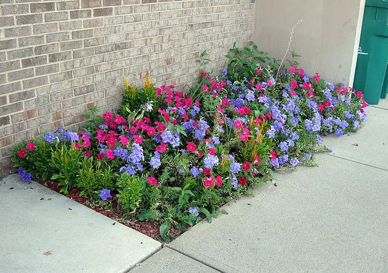
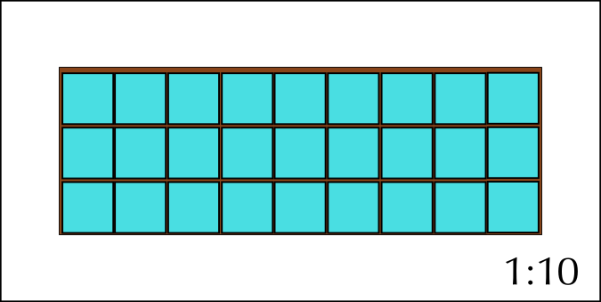

## 10.4 Packaging and models (EMG67)

When items are packed into a limited space like a box, cupboard or suitcase, how they are packed often determines how many items can fit into the space. A good example of this is trying to pack everything you need for your school day (like your books, sports equipment and food) into your school bag or backpack.

Your books must not be damaged in the process and you have to be able to carry everything yourself.

These same limits apply to posting a package to a friend or family member. An additional aspect to consider is the cost of the postage which is regularly determined by weight. Sending an extra container costs extra money as well. If what you are posting is fragile extra protective material must be packed between the items to make sure they reach the destination whole.

<Callout type="tip" title="Worked example 7: Understanding packaging arrangements">
**Question:**
Vuyo and Sipho's father own a biscuit business called Biscuits for Africa. It is the June/July school holidays and, to make more pocket money, their father has employed Vuyo and Sipho for one week to help package the biscuits into boxes so they can be transported to stores.

1. Vuyo has to pack small boxes of ginger biscuits into the large shipping boxes for transporting. There are \(\text{600}\) small boxes, and Vuyo's father tells him he can pack \(\text{15}\) boxes of biscuits into one large shipping box. How many large boxes will Vuyo need?
3. Sipho has to pack tin cans of chocolate biscuits into the same sized large shipping boxes that Vuyo is given. He is told he can fit \(\text{20}\) cans into one larger box. If there are \(\text{500}\) cans, how many large boxes will Sipho need?
5. If each large shipping box costs \(\text{R}\,\text{5,50}\). Which will be cheaper to pack - the ginger biscuits in small boxes, or the chocolate biscuits in tins?
7. Vuyo's and Sipho's father tells them that each large box can hold a maximum weight of \(\text{3,5}\) \(\text{kg}\).
   1. If each small box of ginger biscuits weighs \(\text{200}\) \(\text{g}\), how many small boxes can Vuyo pack into a bigger box without exceeding the weight limit?
   3. If each can of chocolate biscuits weighs \(\text{300}\) \(\text{g}\), how many cans can Sipho pack into a bigger box without exceeding the weight limit?
      
9. The boys' father orders new large shipping boxes that are \(\text{45}\) \(\text{cm}\) long and \(\text{16}\) \(\text{cm}\) wide.
   1. If the surface area of the bottom of one small box of ginger biscuits is \(\text{25}\) \(\text{cm}\)\(^{\text{2}}\) (they are square: \(\text{5}\) \(\text{cm}\)\(\times\)\(\text{5}\) \(\text{cm}\)), how many small boxes can Vuyo fit (only one layer deep) into the new large boxes? Draw a scaled diagram (\(\text{1}\) : \(\text{100}\)) to demonstrate this packaging arrangement.
   3. If the diameter of one round can is \(\text{5}\) \(\text{cm}\), how many cans can Sipho fit (only one layer deep) into the new large boxes? Draw a
      scaled diagram (\(\text{1}\) : \(\text{100}\)) to demonstrate this packaging arrangement.
   5. Vuyo wants to practice his Maths Literacy skills and rather calculate the area of the bottom of the large box and the small boxes, and divide the larger area by the small one to see how many boxes he can pack.
      He does the following calculations:
      Area of bottom of one small box = \(\text{25}\) \(\text{cm}\)\(^{\text{2}}\).
      \(\text{720}\) \(\text{cm}\)\(^{\text{2}}\) \(\div\) \(\text{25}\) \(\text{cm}\)\(^{\text{2}}\) = \(\text{28,8}\) = \(\text{28}\) boxes.
      This is different to Vuyo's initial calculation from Question 5 a).
      Why do you think Vuyo got a different answer when he calculated the area alone?

1. \(\text{600}\) small boxes \(\div\) \(\text{15}\) per box = \(\text{40}\) large boxes.
3. \(\text{500}\) cans \(\div\) \(\text{20}\) per box = \(\text{25}\) large boxes.
5. Ginger biscuits require \(\text{15}\) large boxes. \(\text{15}\) \(\times\) \(\text{R}\,\text{5,50}\) = \(\text{R}\,\text{82,50}\)
   Chocolate biscuits require \(\text{20}\) large boxes. \(\text{20}\) \(\times\) \(\text{R}\,\text{5,50}\) = \(\text{R}\,\text{110,00}\).
   Therefore the ginger biscuits will be cheaper to pack, because they require fewer large boxes.
7. 1. \(\text{3,5}\) \(\text{kg}\) = \(\text{3 500}\) \(\text{g}\). \(\text{3 500}\) \(\text{g}\) \(\div\) \(\text{200}\) \(\text{g}\) = \(\text{17,5}\). But Vuyo can't pack half a box of biscuits, therefore we round down to the nearest whole number: Vuyo can pack \(\text{17}\) small boxes of ginger biscuits into one large box.
   3. \(\text{3,5}\) \(\text{kg}\) = \(\text{3 500}\) \(\text{g}\). \(\text{3 500}\) \(\text{g}\) \(\div\) \(\text{300}\) \(\text{g}\) = \(\text{11,67}\). But Sipho can't pack \(\text{0,67}\) cans, therefore we round down to the nearest whole number: Sipho can pack \(\text{11}\) cans of chocolate biscuits into one large box.
9. 1. Length of large box = \(\text{45}\) \(\text{cm}\).
      \(\text{45}\) \(\text{cm}\) \(\div\) \(\text{5}\) \(\text{cm}\) = \(\text{9}\) boxes.
      Width of large box = \(\text{16}\) \(\text{cm}\).
      \(\text{16}\) \(\text{cm}\) \(\div\) \(\text{5}\) \(\text{cm}\) = \(\text{3,2}\) boxes. Vuyo can't pack \(\text{0,2}\) of a box, so we round this down to the nearest whole number, \(\text{3}\) boxes.
      So Vuyo can fit \(\text{9}\) rows of \(\text{3}\) boxes each. \(\text{9}\) \(\times\) \(\text{3}\) = \(\text{27}\) boxes.
      
   3. Length of large box = \(\text{45}\) \(\text{cm}\).
      \(\text{45}\) \(\text{cm}\) \(\div\) \(\text{5}\) \(\text{cm}\) diameter = \(\text{9}\) cans.
      Width of large box = \(\text{16}\) \(\text{cm}\).
      \(\text{16}\) \(\text{cm}\) \(\div\) \(\text{5}\) \(\text{cm}\) diameter = \(\text{3,2}\) cans. Sipho can't pack \(\text{0,2}\) of a can, so we round this down to the nearest whole number: \(\text{3}\) cans.
      So Sipho can fit \(\text{9}\) rows of \(\text{3}\) cans each. \(\text{9}\) \(\times\) \(\text{3}\) = \(\text{27}\) cans.
      Sipho can fit \(\text{27}\) cans of chocolate biscuits into the new large shipping boxes.
      
   5. Calculating the area of the bottom of the large and small boxes does not take into account the shape of the boxes. We can see from the scale diagram in Question 5 a) that it is only possible to fit \(\text{27}\) small boxes into the larger box. \(\text{3}\) boxes in a row (\(\text{3}\) \(\times\) \(\text{5}\) \(\text{cm}\) = \(\text{15}\) \(\text{cm}\)) do not fit exactly into the large box (\(\text{16}\) \(\text{cm}\) wide) - there is a small space left which we cannot fill with boxes due to their shape. When dealing with packaging, it is very important to take shapes into account - we cannot just do area calculations without testing our packaging arrangement in reality!
</Callout>

## Investigating packaging arrangements

### Exercise 10.5

For this activity you will need collect a number cans and at least three boxes of different sizes.

**Problem:**
Measure the area of the bottom of the boxes, and the diameter of the cans. Using the length and width calculation method from the previous worked example, estimate how many cans you should be able to fit into each box.

**Solution:**
learner-dependent answer

**Problem:**
Through trial and error find the best way to fit as many cans as possible into each box without damaging either the cans or the box.

**Solution:**
learner-dependent answer

**Problem:**
Draw a top view of your final packing arrangement.

**Solution:**
learner-dependent answer

**Problem:**
Compare your layout with the rest of your class.

**Solution:**
learner-dependent answer

**Problem:**
Would it have been easier to pack boxes than cans? Motivate your answer.

**Solution:**
learner-dependent answer

**Problem:**
How do you know that the cans are cylindrical rather than box-shaped? (Hint: Look at the shapes of the bases.)

**Solution:**
learner-dependent answer.
