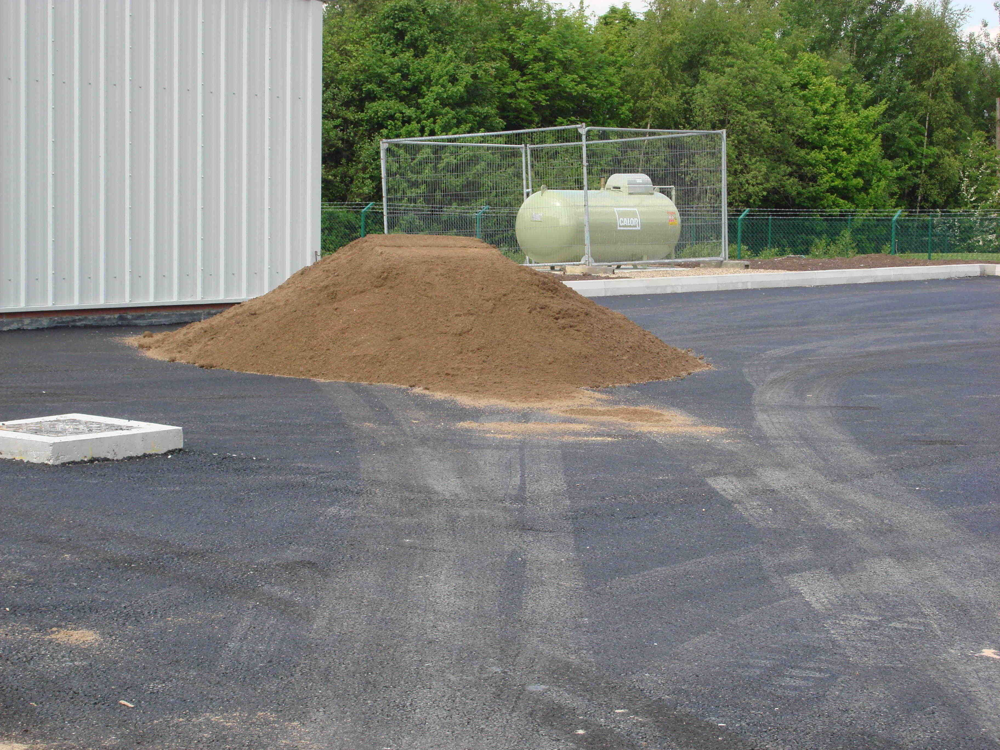

## 11.2 Banking accounts and documents (EMG6B)

### Bank accounts (EMG6C)

Bank accountA financial account that can be opened with a financial institution, e.g. absa, fnb, nedbank, etc.

When you open an account for the first time, you need to be familiar with the different types of accounts that are available. Banks usually offer a package of a few different accounts and services.

- Savings account: A bank account that earns interest. A savings account does not have an overdraft facility. You can use a savings account for short-term savings. You earn interest on the amount in the account, but not as much as you would earn with a fixed deposit account.
- Cheque or current account: A bank account that is used to deposit and withdraw money by visiting the bank branch, using an ATM or Internet banking or by writing a cheque. These are usually available to people who earn a regular income. They also have an overdraft facility, which allows you to use more money that you have in your account. Interest is charged on the overdraft.
- Fixed deposit account: A fixed deposit account is aimed at those who have a lump sum they want to invest over a set period of time. The money is deposited into the account and left there until the agreed upon date, when it is released back to the account holder with added interest. You would consider a fixed deposit if you want to save money for a medium to long term.
- Credit account (with credit  card): An account either with a store or bank, that allows the account holder to purchase items now and pay for them later. Often the account holder is able to choose between the straight payment plan, where they will pay back the money in one lump sum, or the budget plan where the debt payments are divided up over a set number of payments. The two different payments have two different interest rates.
  
- Debit account (with debit card): Debit cards can be used to pay for purchases. When the card is swiped, instructions are sent to the account holder's bank to deduct the money from their account. Often this is their main account and is easier to manage than first paying for something with a credit card and then at a later date, transferring money into the credit card account. Usually a debit account does not offer as much credit as a credit account (if any at all).

The type of account you should open depends on your needs. For example, you might not have a fixed income, but want to save money to buy a Playstation, so a savings account would be the most appropriate for your needs as a learner.

Someone who is employed full-time will need a cheque account, so that their salary can be deposited there and they can apply for other benefits attached to this type of account.

### Banking documents (EMG6D)

According to FICA (the Financial Intelligence Centre Act), people need to supply certain information and documents when they open a bank account.

- You must bring your identity document or passport.
- You must have proof of residence, which is a document such as a recent electricity or water bill that has your name and residential address on it.
- You must show proof of income, or information about your source of income, where the funds you expect to use in your transactions come from and the type of activities that can be expected on the account.

### Bank statements (EMG6F)

A bank statement is usually sent to the account holder monthly. Bank statements show the following for each transaction:

- the date of the transaction
- a description of the transaction, showing the type of transaction
- the amount of the transaction, indicating whether it is a debit or a credit (often in different columns)
- a column for the balance after each transaction.

So a bank statement gives you a running total of the amount of money in an account for the month.

Account holderThe person whose name the account is in.Opening and closing balanceThe amount of money in the account at the beginning and the end of the period.TransactionAny event where money moves into or out of an account.Debit transactionAmount of money paid out of an account.Credit transactionAmount of money deposited into an account.

<Callout type="tip" title="Worked example 1: Understanding a statement">
**Question:**
Xola receives the following statement from her bank, detailing her transactions  from 25/01/2013 to 25/02/2013. Study the statement and answer the questions that follow:

| Date | Description | Amount | Amount | Balance |
| --- | --- | --- | --- | --- |
| 25/01/2013 | Salary | \(\text{8 000,00}\) |  | \(\text{8 050,50}\) |
| 27/01/2013 | Car insurance |  | \(--\text{100,00}\) | \(\text{7 950,50}\) |
| 01/02/2013 | Electronic transfer Mr Serei (RENT) |  | \(--\text{3 000,00}\) | \(\text{4 950,50}\) |
| \(\text{01}\)/\(\text{02}\)/\(\text{2 013}\) | Debit order Healthsaver medical aid |  | \(--\text{500,00}\) | \(\text{4 450,50}\) |
| \(\text{02}\)/\(\text{02}\)/\(\text{2 013}\) | Debit order Mobi contract |  | \(--\text{250,00}\) | \(\text{4 200,50}\) |
| \(\text{03}\)/\(\text{02}\)/\(\text{2 013}\) | Debit order Supa Fashion Store |  | \(--\text{300,00}\) | \(\text{3 900,50}\) |
| 05/02/2013 | Purchase at Shop 'n Save |  | \(--\text{2 000,00}\) | \(\text{1 900,50}\) |
| 14/02/2013 | PAYMENT Mrs S Khumalo | \(\text{500,00}\) |  | \(\text{2 400,50}\) |
| 20/02/2013 | Automechanix |  | \(--\text{1 000,00}\) | \(\text{1 400,50}\) |
|  |  |  | Total remaining : | \(\text{1 400,50}\) |

1. How can you tell the difference between the debits and the credits in this statement?
3. List Xola's debits and credits for the month.
5. In the first line of this statement, Xola receives a salary of \(\text{R}\,\text{8 000}\). Look at the balance to work out what she had in the account before the payment was made.
7. Xola receives some birthday money as well as her salary this month. Identify this transaction.
9. How much money would she have been left with, if she hadn't received money for her birthday?
11. Xola wants to save \(\text{15}\%\) of her remaining money this month. How much can she save?
   

1. The credits are positive values and are in the left-hand column, while the debits are negative and are in the right-hand column.
3. Credits: Salary, deposit from Mrs S Khumalo.
   Debits: Car insurance, rent, medical aid, cellphone contract, clothing store account, groceries, car repair.
5. \(\text{R}\,\text{8 050,50}\) = \(\text{R}\,\text{8 000}\) = \(\text{R}\,\text{50,50}\), so she had \(\text{R}\,\text{50,50}\) in her account at the start.
7. 14/02/2103 PAYMENT Mrs S Khumalo \(\text{R}\,\text{500}\).
9. \(\text{R}\,\text{1 400,50}\) - \(\text{R}\,\text{900}\) = \(\text{R}\,\text{500,50}\)
11. \(\text{15}\%\) of \(\text{R}\,\text{1 450,50}\) =\(\text{1 450,50}\) \(\times\) \(\text{0,15}\) = \(\text{R}\,\text{217,575}\), which is rounded off to \(\text{R}\,\text{217,58}\).
</Callout>

## Understanding a bank statement

### Exercise 11.1

Here is an incomplete bank statement for Koketso's savings account at the end of March:

| Date | Transaction | Payment | Deposit | Balance |
| --- | --- | --- | --- | --- |
| 27/02/2013 | OPENING BAL |  |  | \(\text{2 304,85}\) |
| 1/03/2013 | INTEREST ON CREDIT BALANCE |  | \(\text{13,95}\) |  |
| 1/03/2013 | CHEQUE (SALARY) |  | \(\text{2 100,00}\) |  |
| \(\text{1}\)/\(\text{03}\)/\(\text{2 013}\) | ATM CASH | \(\text{400,00}\) |  |  |
| 5/03/2013 | ATM CASH | \(\text{800,00}\) |  |  |
| 10/03/2013 | ATM DEPOSIT |  | \(\text{600,00}\) |  |
| 22/3/2013 | SPENDLESS DEBIT CARD PURCHASE | \(\text{235,95}\) |  |  |

**Problem:**
How are the debits and credits indicated on this statement?

**Solution:**
As payments (debits) and deposits (credits) respectively.

**Problem:**
Copy Koketso's statement and complete the balance column as a running total.

**Solution:**
| Date | Transaction | Payment | Deposit | Balance |
| --- | --- | --- | --- | --- |
| 27/02/2013 | OPENING BAL |  |  | \(\text{2 304,85}\) |
| 1/03/2013 | INTEREST ON CREDIT BALANCE |  | \(\text{13,95}\) | \(\text{2 318,80}\) |
| 1/03/2013 | CHEQUE (SALARY) |  | \(\text{2 100,00}\) | \(\text{4 418,80}\) |
| 1/03/2013 | ATM CASH | \(\text{400,00}\) |  | \(\text{4 018,80}\) |
| 5/03/2013 | ATM CASH | \(\text{800,00}\) |  | \(\text{3 218,80}\) |
| 10/03/2013 | ATM DEPOSIT |  | \(\text{600,00}\) | \(\text{3 818,80}\) |
| 22/3/2013 | SPENDLESS DEBIT CARD PURCHASE | \(\text{235,95}\) |  | \(\text{3 582,85}\) |

**Problem:**
What is Koketso's balance at the end of March?

**Solution:**
\(\text{R}\,\text{3 582,95}\)

**Problem:**
Koketso aims to keep a minimum balance of \(\text{R}\,\text{2 500}\) in his account to earn interest. Is he succeeding?

**Solution:**
Yes.

### Banking fees (EMG6G)

Banks charge fees for the services they provide. Most cheque accounts, for example, have a monthly fee that needs to be paid to keep the account open. The bank will automatically deduct this fee out from the account every month. As well as this monthly fee, some banks charge a fee every time you withdraw or deposit money and for other services. These bank charges are called transaction fees. The transaction fees vary depending on which bank you use and which type of account you have.

You can reduce your transaction fees by choosing the most appropriate bank account for your own needs and also by adjusting your banking habits. For example, a bank account may offer a certain number of free withdrawals, deposits and balance enquiries per month, so if you keep within those, you can keep the fees low.

<Callout type="tip" title="Worked example 2: Calculating bank fees">
**Question:**
Arthur's bank, Egoli Bank list the following banking fees :

Arthur subscribes to self-service banking and pays a monthly maintenance fee. In the space of a month Arthur performs the following transactions:

- He deposits \(\text{R}\,\text{335,00}\) in cash at an Egoli Bank ATM.
- He withdraws \(\text{R}\,\text{500}\) cash at another bank's ATM.
- He withdraws \(\text{R}\,\text{100}\) cash over the counter in an Egoli Bank branch..
- He enquires twice about his balance, over the counter in an Egoli Bank branch.
- He draws cash, whilst buying groceries at a till point at his local supermarket.
- He makes \(\text{3}\) electronic account payments to pay his rent, electricity and phone bill.

1. Calculate the total bank charges for these transactions.
3. Arthur has a balance of \(\text{R}\,\text{650}\) in his bank account at the end of the month.
   1. Calculate the ratio of the total bank fees to the month end balance.
   3. Express this ratio as a percentage. (round your answer to \(\text{1}\) decimal place)
5. Suggest three ways in which Arthur could reduce his banking fees.

1. \(\text{R}\,\text{5,00}\) (Monthly maintenance fee) + \(\text{R}\,\text{15,00}\) (self-service banking) + \(\text{R}\,\text{5,00}\) (cash deposit at Egoli bank) + \(\text{R}\,\text{7,00}\) (cash withdrawal at other bank) +\(\text{R}\,\text{10,00}\) (cash withdrawal over the counter) + \(\text{R}\,\text{0,00}\) (first balance enquiry) + \(\text{R}\,\text{10,00}\) (second balance enquiry) + \(\text{R}\,\text{2,00}\) (till point cash withdrawal) + (\(\text{3}\) \(\times\) \(\text{R}\,\text{0,00}\)) (free electronic account payments) = \(\text{R}\,\text{54,00}\)
3. 1. Banking fees : closing balance = \(\text{R}\,\text{54}\) : \(\text{R}\,\text{650}\)
   3. \(\frac{\text{R}\,\text{54}}{\text{R}\,\text{650}} \times \text{100}\) = \(\text{8,3}\%\)
5. Arthur could withdraw cash at Egoli Bank ATM's only, not at other banks' ATMs or over the counter at a bank branch. He could ask for a balance enquiry from an Egoli ATM, or via self-service banking, instead of over the counter. He could withdraw cash only at a till point, without purchasing anything.
</Callout>

<Callout type="tip" title="Worked example 3: Calculating bank fees">
**Question:**
Lulama wants to withdraw \(\text{R}\,\text{650}\) from her savings account, at the ATM. The transaction fee for withdrawals is \(\text{R}\,\text{2,25}\) for the first \(\text{R}\,\text{100}\) plus \(\text{R}\,\text{1,20}\) for every additional \(\text{R}\,\text{100}\) (or part thereof). Calculate the bank fee.

|  |  |  | \(\text{R}\,\text{650}\) (divided into full \(\text{R}\,\text{100}\) amounts or part thereof) |  |  |  |
| --- | --- | --- | --- | --- | --- | --- |
| \(\text{R}\,\text{100}\) | \(\text{R}\,\text{100}\) | \(\text{R}\,\text{100}\) | \(\text{R}\,\text{100}\) | \(\text{R}\,\text{100}\) | \(\text{R}\,\text{100}\) | \(\text{R}\,\text{50}\) |
|  |  |  | (tariff/fee per \(\text{R}\,\text{100}\) or part thereof) |  |  |  |
| \(\text{R}\,\text{2,25}\) | \(\text{R}\,\text{1,20}\) | \(\text{R}\,\text{1,20}\) | \(\text{R}\,\text{1,20}\) | \(\text{R}\,\text{1,20}\) | \(\text{R}\,\text{1,20}\) | \(\text{R}\,\text{1,20}\) |

Therefore: \(\text{R}\,\text{2,25}\) for the first \(\text{R}\,\text{100}\) plus \(\text{R}\,\text{1,20}\) for every additional \(\text{R}\,\text{100}\) (or part thereof).

Bank fee =  \(\text{R}\,\text{2,25}\) + ( \(\text{R}\,\text{1,20}\) \(\times\) \(\text{6}\)) = \(\text{R}\,\text{9,45}\)
</Callout>

## Calculating banking fees

### Exercise 11.2

Mia has recently open a Global account at Capital Bank. She is concerned about her monthly bank charges. Use the provided brochure and the list of her account activities for the month of April to answer the questions below:

The list of Mia's transactions for April is as follows:

| Date | Activities | Amounts |
| --- | --- | --- |
| 1 Apr 2013 | Balance of previous month carried forward | \(\text{R}\,\text{210,25}\) |
| 1 Apr 2013 | Old Mutual Policy x74534: Debit order returned: insufficient funds* | \(\text{R}\,\text{254,39}\) |
| 1 Apr 2013 | Balance enquiry (mobile) | \(\text{R}\,\text{0,00}\) |
| 2 Apr 2013 | Davidsons Textiles: Salary deposit* | \(\text{R}\,\text{4 500,00}\) |
| 2 Apr 2013 | Shoprite: Purchases: Debit card* | \(\text{R}\,\text{847,21}\) |
| 2 Apr 2013 | Shoprite: Cash withdrawal*. | \(\text{R}\,\text{250,00}\) |
| 7 Apr 2013 | Old Mutual Policy x74534: Branch Payment | \(\text{R}\,\text{254,39}\) |
| 15 Apr 2013 | Edgars: Purchases: Debit card* | \(\text{R}\,\text{149,59}\) |
| 20 Apr 2013 | Capital Bank ATM Withdrawal* | \(\text{R}\,\text{200,00}\) |
| 23 Apr 2013 | Shoprite: municipal account payment* | \(\text{R}\,\text{639,00}\) |
| 28 Apr 2013 | FNB ATM Withdrawal* | \(\text{R}\,\text{500,00}\) |
| 29 Apr 2013 | Balance statement at the branch | \(\text{R}\,\text{3,00}\) |
| 30 Apr 2013 | Monthly Administration Fee | \(\text{R}\,\text{4,50}\) |

* denotes SMS notification for April

**Problem:**
How many withdrawals did Mia make during this month?

**Solution:**
Three.

**Problem:**
Calculate the amount of money that was spent on monthly shop purchases

**Solution:**
\(\text{R}\,\text{847,21}\) + \(\text{R}\,\text{149,59}\) = \(\text{R}\,\text{995,80}\)

**Problem:**
Use the relevant resources and calculate the amount of bank fees that Mia should pay for April.

**Solution:**
Returned debit order: \(\text{R}\,\text{4,00}\). Cash withdrawal at Shoprite: \(\text{R}\,\text{1,00}\). Old Mutual debit order payment at branch: \(\text{R}\,\text{3,00}\). Capital Bank ATM withdrawal: \(\text{R}\,\text{4,00}\). FNB ATM withdrawal: \(\text{R}\,\text{7,00}\). Balance query in branch: \(\text{R}\,\text{3,00}\). Monthly admin fee: \(\text{R}\,\text{4,50}\). \(\text{8}\) SMS notifications: \(\text{R}\,\text{3,20}\). Total: \(\text{R}\,\text{29,70}\)

**Problem:**
Suggest how Mia can further reduce her banking charges.

**Solution:**
She could do away with SMS notifications, only draw cash at tillpoints, make sure her debit orders don't get returned and so on.

A bank uses the following formula to calculate the bank charges (transaction fee) on money deposited at a branch (inside the bank): **Transaction fee = \(\text{R}\,\text{2,50}\) + \(\text{0,95}\%\) of the amount deposited**.

Use the above formula to calculate the bank fees on the following deposits:

**Problem:**
\(\text{R}\,\text{450}\)

**Solution:**
\(\text{R}\,\text{2,50}\) + \(\text{R}\,\text{4,275}\) = \(\text{R}\,\text{6,78}\)

**Problem:**
\(\text{R}\,\text{117,35}\)

**Solution:**
\(\text{R}\,\text{2,50}\) + \(\text{R}\,\text{1,11}\) = \(\text{R}\,\text{3,61}\)

**Problem:**
\(\text{R}\,\text{6 500 000}\)

**Solution:**
\(\text{R}\,\text{2,50}\) + \(\text{R}\,\text{61 750}\) = \(\text{R}\,\text{61 752,50}\)

**Problem:**
Use this formula to see if the transaction fee of \(\text{R}\,\text{5,59}\) was correctly calculated from a deposit of \(\text{R}\,\text{325}\).

**Solution:**
\(\text{R}\,\text{2,50}\) + \(\text{R}\,\text{3,0875}\) = \(\text{R}\,\text{5,59}\). Yes, it was calculated correctly.

Calculate the bank fee on the following deposits at the ATM if the transaction fee is \(\text{R}\,\text{0,90}\) for every \(\text{R}\,\text{100}\) (or part thereof) deposited:

**Problem:**
\(\text{R}\,\text{450}\)

**Solution:**
\(\text{R}\,\text{0,90}\) \(\times\) \(\text{5}\) parts of \(\text{R}\,\text{100}\) = \(\text{R}\,\text{4,50}\)

**Problem:**
\(\text{R}\,\text{637,14}\)

**Solution:**
\(\text{R}\,\text{0,90}\) \(\times\) \(\text{7}\) parts of \(\text{R}\,\text{100}\) = \(\text{R}\,\text{6,30}\)

**Problem:**
\(\text{R}\,\text{3 500,05}\)

**Solution:**
\(\text{R}\,\text{0,90}\) \(\times\) \(\text{36}\) parts of \(\text{R}\,\text{100}\) = \(\text{R}\,\text{32,40}\)

**Problem:**
Tumi withdrew \(\text{R}\,\text{350}\) from her savings account, at the ATM. The withdrawal transaction fee is \(\text{R}\,\text{2,35}\) for the first \(\text{R}\,\text{100}\), plus \(\text{R}\,\text{1,15}\) for every additional \(\text{R}\,\text{100}\) (or part thereof). Calculate the bank fee.

**Solution:**
\(\text{R}\,\text{2,35}\) + \(\text{3}\) \(\times\) \(\text{R}\,\text{1,15}\) = \(\text{R}\,\text{5,80}\)

**Problem:**
The transaction fee of a cash deposit at a branch is \(\text{R}\,\text{2,45}\) + \(\text{0,85}\%\) of the deposited amount. If Tumi deposits \(\text{R}\,\text{875,00}\) at the bank, calculate the bank charges.

**Solution:**
\(\text{R}\,\text{2,45}\) + (\(\text{0,85}\%\) of \(\text{R}\,\text{875}\)) = \(\text{R}\,\text{2,45}\) + \(\text{R}\,\text{7,44}\) = \(\text{R}\,\text{9,99}\)

**Problem:**
Demi wants to withdraw \(\text{R}\,\text{750,00}\) from her savings account at an ATM. The withdrawal transaction fee is \(\text{R}\,\text{1,20}\) for the first \(\text{R}\,\text{100}\) plus \(\text{R}\,\text{0,75}\) for every additional \(\text{R}\,\text{100}\) (or part thereof). Calculate the bank fee.

**Solution:**
\(\text{R}\,\text{1,20}\) + (\(\text{6}\) \(\times\) \(\text{R}\,\text{0,75}\)) = \(\text{R}\,\text{5,70}\)

A bank charges the following fees for cash deposits:

Bank teller: \(\text{2,5}\%\) of deposit value

ATM deposit: \(\text{R}\,\text{1}\) basic + \(\text{R}\,\text{1,20}\) per \(\text{R}\,\text{100}\) or part of \(\text{R}\,\text{100}\)

**Problem:**
Is it more expensive to go into the bank or to do the transaction at an ATM? Why do you think this is?

**Solution:**
It is cheaper to use the ATM. If you deposited \(\text{R}\,\text{200}\), for example, the bank fees would be \(\text{R}\,\text{1}\) + \(\text{R}\,\text{2,40}\) = \(\text{R}\,\text{3,40}\). The same deposit at a teller would cost \(\text{R}\,\text{5,00}\). It is cheaper to deposit the cash at an ATM, because the process is automated and does not involve a skilled employee.

**Problem:**
Using the formulae given above, fill in the table below to show the transaction fees for the given amounts of money:

| Deposit amount (R) | \(\text{500}\) | \(\text{1 000}\) | \(\text{1 500}\) | \(\text{2 000}\) | \(\text{2 500}\) | \(\text{3 000}\) | \(\text{3 500}\) |
| --- | --- | --- | --- | --- | --- | --- | --- |
| Fee at teller |  |  |  |  |  |  |  |
| Fee at ATM |  |  |  |  |  |  |  |

**Solution:**
| Deposit amount (R) | \(\text{500}\) | \(\text{1 000}\) | \(\text{1 500}\) | \(\text{2 000}\) | \(\text{2 500}\) | \(\text{3 000}\) | \(\text{3 500}\) |
| --- | --- | --- | --- | --- | --- | --- | --- |
| Fee at teller | \(\text{R}\,\text{12,50}\) | \(\text{R}\,\text{25,00}\) | \(\text{R}\,\text{37,50}\) | \(\text{R}\,\text{50,00}\) | \(\text{R}\,\text{62,50}\) | \(\text{R}\,\text{75,00}\) | \(\text{R}\,\text{87,50}\) |
| Fee at ATM | \(\text{R}\,\text{7,00}\) | \(\text{R}\,\text{13,00}\) | \(\text{R}\,\text{19,00}\) | \(\text{R}\,\text{25,00}\) | \(\text{R}\,\text{31,00}\) | \(\text{R}\,\text{37,00}\) | \(\text{R}\,\text{45,00}\) |

**Problem:**
Plot two graphs of the transaction fees for the different amounts of money given in the table.

**Solution:**

**Problem:**
Read off the graph: how much money can you save by using an ATM if you need to deposit \(\text{R}\,\text{1 250}\)?

**Solution:**
Approximately \(\text{R}\,\text{15}\)
