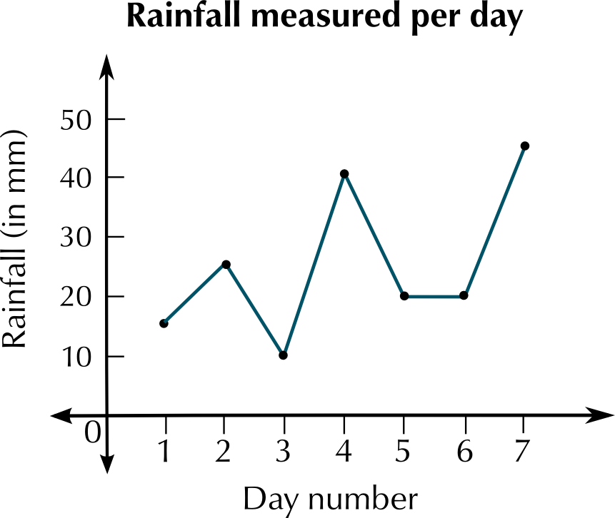
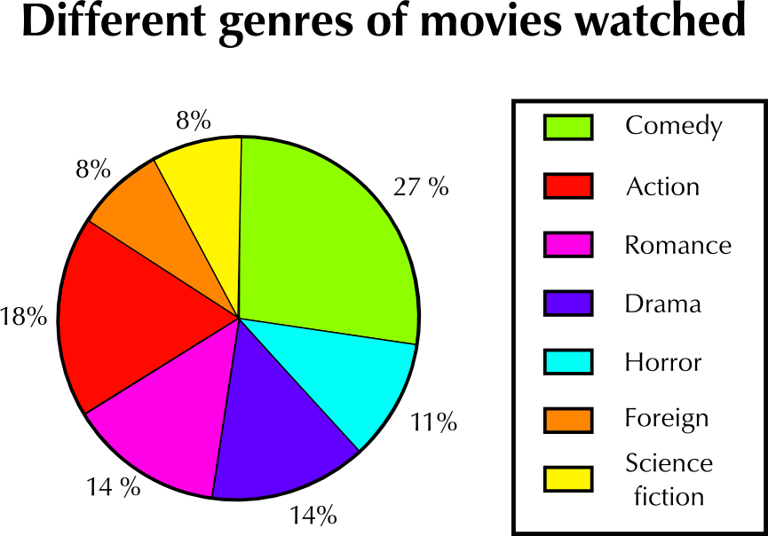

### Exercise 12.8

In your school, collect (anonymous) data about learners' performance in Grade 10 Mathematical Literacy during the June 2012 examination. This must grouped be in terms of the levels that each learner has achieved, e.g Level 1 (\(\text{0}\%\) - \(\text{29}\%\)), Level 2 (\(\text{30}\%\) - \(\text{39}\%\)), and so on.

**Problem:**
Organise the data collected into a frequency table.

**Solution:**
Learner-dependent answer

**Problem:**
Draw a histogram for the data collected, clearly label both axes and provide a meaningful heading.

**Solution:**
Learner-dependent answer

**Problem:**
Refering to your histogram, clearly state which level most learners achieved, and what the reason for this trend could be.

**Solution:**
Learner-dependent answer

After the first term Mathematical Literacy test was written at Lerato Secondary School, the Head of department sampled the scripts of \(\text{11}\) learners out of a class of \(\text{42}\). The results of these \(\text{11}\) learners were as follows (out of a total of \(\text{50}\) marks):

\(\text{22}\); \(\text{16}\); \(\text{45}\); \(\text{35}\); \(\text{40}\); \(\text{25}\); \(\text{42}\); \(\text{37}\); \(\text{41}\); \(\text{35}\); \(\text{27}\)

**Problem:**
Arrange the set of marks in an ascending order.

**Solution:**
\(\text{16}\); \(\text{22}\); \(\text{25}\); \(\text{27}\); \(\text{35}\); \(\text{37}\); \(\text{40}\); \(\text{41}\); \(\text{42}\); \(\text{45}\)

**Problem:**
Determine the mean mark of the learners sampled.

**Solution:**
Mean = \(\text{33,18}\)

**Problem:**
Determine the median mark of the learners.

**Solution:**
Median = \(\text{35}\).

**Problem:**
Determine the mode of the learners' marks.

**Solution:**
Mode = \(\text{35}\).

**Problem:**
Calculate the range of the  learners' marks.

**Solution:**
Range = \(\text{45}\) - \(\text{16}\) = \(\text{29}\).

**Problem:**
Convert the mean mark obtained above to a percentage (round off the answer to one decimal place).

**Solution:**
\(\frac{\text{33,18}}{\text{50}} \times \text{100}\) = \(\text{66,36}\%\) = \(\text{66,4}\%\)

Gaab is a citrus farmer who grows orange trees. After one season of growth, he measures the height of a sample of his trees. \(\text{50}\) trees were chosen and  the results were recorded.

| Height in cm | Number of trees |
| --- | --- |
| \(\text{0}\) - \(\text{139}\) | \(\text{3}\) |
| \(\text{140}\) - \(\text{149}\) | \(\text{7}\) |
| \(\text{150}\) - \(\text{159}\) | \(\text{20}\) |
| \(\text{160}\) - \(\text{169}\) | \(\text{12}\) |
| \(\text{170}\) - \(\text{179}\) | \(\text{5}\) |
| \(\text{180}\) - \(\text{189}\) | \(\text{2}\) |
| \(\text{190}\) - \(\text{199}\) | \(\text{1}\) |
| Total | \(\text{50}\) |

**Problem:**
Use the above given information to draw a histogram. Label your graph with a heading and both axes labelled.

**Solution:**

**Problem:**
Use your histogram to determine the most common height interval.

**Solution:**
\(\text{150}\) - \(\text{159}\) \(\text{cm}\)

**Problem:**
Which height interval was the least common?

**Solution:**
\(\text{190}\) - \(\text{199}\) \(\text{cm}\)

A survey was done at Thahameso Secondary School to determine which subjects learners enjoyed the most. A total of \(\text{100}\) learners were interviewed. Look at the table below:

| Subject | History | English | Maths Lit | Life Sciences | Life Orientation | Business Studies |
| --- | --- | --- | --- | --- | --- | --- |
| Number of learners | \(\text{30}\) | \(\text{20}\) | \(\text{18}\) | \(\text{12}\) | \(\text{6}\) | \(\text{14}\) |

**Problem:**
Draw a neat bar graph to represent the above information.  Clearly label your graph with a heading.  Label both axes.

**Solution:**

**Problem:**
Which subject is the most popular and why do you think this is so?

**Solution:**
History is the most popular subject. This could be because students like the history teacher the most.

The following table is a record of rainfall in mm for the town of Bethlehem during the month of January 2012.  The data was collected over \(\text{7}\) days.

| Day | \(\text{1}\) | \(\text{2}\) | \(\text{3}\) | \(\text{4}\) | \(\text{5}\) | \(\text{6}\) | \(\text{7}\) |
| --- | --- | --- | --- | --- | --- | --- | --- |
| Rainfall (mm) | \(\text{15}\) | \(\text{25}\) | \(\text{10}\) | \(\text{40}\) | \(\text{20}\) | \(\text{20}\) | \(\text{45}\) |

**Problem:**
Determine the mean rainfall for the town of Bethlehem for the \(\text{7}\) days of observation.

**Solution:**
Mean = \(\text{25}\) \(\text{mm}\).

**Problem:**
Calculate the mode.

**Solution:**
Mode = \(\text{20}\) \(\text{mm}\).

**Problem:**
Determine the median rainfall for the town of Bethlehem for this week.

**Solution:**
Median = \(\text{20}\) \(\text{mm}\).

**Problem:**
Calculate the range of the data.

**Solution:**
Range = \(\text{40}\) - \(\text{10}\) = \(\text{30}\) \(\text{mm}\).

**Problem:**
Draw a neat line graph for the above data.  Label both axes and give the graph a heading.

**Solution:**

The pie chart below represents data about what kinds (or genres) of movies people watch. This data was gathered by asking a sample of people to answer questions and their choice of films.  Study the pie chart carefully and answer the questions that follow.

**Problem:**
What kind of movie is watched the most?

**Solution:**
Comedy movies.

**Problem:**
What percentage of all the movies watched is this (the most watched movie)?

**Solution:**
\(\text{27}\%\)

**Problem:**
According to the pie chart, some kinds of movies are watched the same amount.  Which two pairs of movies are watched the same amount?

**Solution:**
Romance and Drama movies, and Foreign and Science Fiction movies

Supposed a sample of \(\text{200}\) people were interviewed.

**Problem:**
What is the number of people in the sample who watch action movies?

**Solution:**
\(\text{18}\%\) of \(\text{200}\) people is \(\text{36}\) people.

**Problem:**
What is the number of people who watch science fiction movies?

**Solution:**
\(\text{8}\%\) of \(\text{200}\) people is \(\text{16}\) people.

**Problem:**
Write the number of people who watch action movies and the number of people who watch science fiction movies as a ratio in its simplest form.

**Solution:**
\(\text{18}\) : \(\text{8}\) = \(\text{9}\) : \(\text{4}\)

**Problem:**
Give two reasons for why you think the percentages of people watching science fiction movies and foreign movies are the lowest.

**Solution:**
There may be less science fiction and foreign movies made or screened, or they may simply be less popular.

Melissa measures her heart rate every half hour during the morning, and she draws up the following table of results:

| Time of day | Heart rate |
| --- | --- |
| 9:00 a.m. | \(\text{65}\) |
| 9:30 a.m. | \(\text{69}\) |
| 10:00 a.m. | \(\text{72}\) |
| 10:30 a.m. | \(\text{110}\) |
| 11:00 a.m. | \(\text{90}\) |
| 11:30 a.m. | \(\text{72}\) |
| 12:00 p.m. | \(\text{75}\) |
| 12:30 p.m. | \(\text{75}\) |
| 1:00 p.m. | \(\text{69}\) |

**Problem:**
Plot a line graph of the data in the table.

**Solution:**

**Problem:**
Describe what you notice about the graph.

**Solution:**
Melissa's heart rate increases suddenly at 10:30 a.m. Apart from this spike, it is fairly consistent, within a small range.

**Problem:**
Why do you think that her heart rate increases suddenly during the day?

**Solution:**
It may have increased if she exercised - e.g. if she went for a walk or a run.
